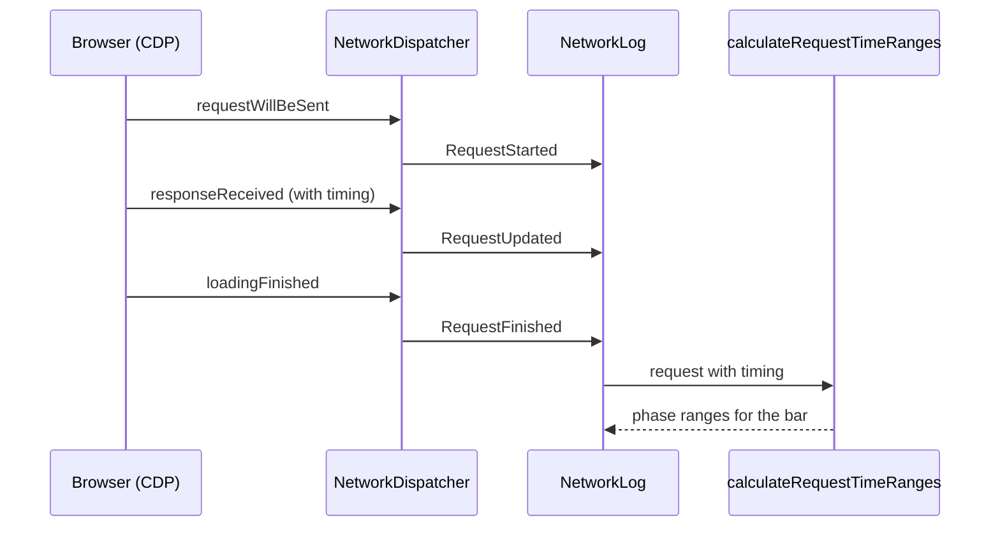

# ChromeDevTools/devtools-frontend — module: network-timing

## Responsibility

This slice turns the browser's `Network.*` protocol events into one `NetworkRequest` object per request. It then keeps a log of those objects and turns each request's timing numbers into the coloured phases of the waterfall: queueing, DNS, connecting, SSL, sending, waiting, receiving. The browser (not DevTools) measures the times; this code only arranges them into bars.

## Key files

| File | Role |
|------|------|
| `front_end/core/sdk/NetworkManager.ts` | One `NetworkManager` per target; its `NetworkDispatcher` receives each CDP Network event and updates requests |
| `front_end/models/logs/NetworkLog.ts` | Collects requests from every target, handles "Preserve log" and page reloads |
| `front_end/models/network_time_calculator/RequestTimeRanges.ts` | `calculateRequestTimeRanges`: timing fields to named phase ranges |
| `front_end/models/network_time_calculator/NetworkTimeCalculator.ts` | Maps times to bar positions and labels; tracks the time axis |

## How it works

1. A `NetworkManager` registers a `NetworkDispatcher` on its target, so CDP Network events reach it (`front_end/core/sdk/NetworkManager.ts:188-191 @ 92a1ec4`).
2. `requestWillBeSent` creates the request, or, if the id already exists and carries a `redirectResponse`, closes the old hop and appends a redirect (`front_end/core/sdk/NetworkManager.ts:990-1012 @ 92a1ec4`). It stores the issue time (`:1026`) and calls `startNetworkRequest` (`:1040`).
3. `startNetworkRequest` indexes the request by id, URL and loader id, then fires `RequestStarted` (`front_end/core/sdk/NetworkManager.ts:1376-1393 @ 92a1ec4`).
4. `responseReceived` records `responseReceivedTime` and applies the response (`:1071-1074`). The response's `timing` object (the browser's resource timing numbers) is copied onto the request at `front_end/core/sdk/NetworkManager.ts:890 @ 92a1ec4`.
5. `dataReceived` adds chunks and fires `RequestUpdated` (`:1089-1090`). `loadingFinished` / `loadingFailed` call `finishNetworkRequest`, which sets `endTime` and transfer size and fires `RequestFinished` (`front_end/core/sdk/NetworkManager.ts:1399-1421 @ 92a1ec4`).
6. `NetworkLog.modelAdded` listens to those manager events (`front_end/models/logs/NetworkLog.ts:79-90 @ 92a1ec4`), so the panel reads one log, not many managers.
7. For each request the view calls `calculateRequestTimeRanges(request, navigationStart)`. With `timing` present it builds the phases from offsets in milliseconds (`front_end/models/network_time_calculator/RequestTimeRanges.ts:119-138 @ 92a1ec4`). Without it, it falls back to a coarse blocking / connecting / receiving split (`:85-100`).
8. The calculator converts times to percentages of the visible axis (`front_end/models/network_time_calculator/NetworkTimeCalculator.ts:153-186 @ 92a1ec4`).

Each phase in plain words (from `RequestTimeRanges.ts:128-137 @ 92a1ec4`): blocking runs from 0 to the first of DNS, connect or send start; DNS, connecting, SSL, sending are the matching start and end pairs; waiting runs from the latest of the earlier phase ends to the response arrival. Queueing is separate: it is the gap between `issueTime` and `timing.requestTime` (`:115-117`).

## Beyond the textbook

### Out-of-order and missing events are expected

- Textbook version: events arrive in order: request, response, finished.
- What they do: `responseReceived` for an unknown request does not crash. It emits a `RequestUpdateDropped` event with the URL and MIME type (`front_end/core/sdk/NetworkManager.ts:1056-1068 @ 92a1ec4`). `dataReceived` and `loadingFinished` try to "adopt" a main-resource request first (`:1083-1085`, `:1095-1097`). `loadingFailed` on an unknown id returns quietly (`:1115-1118`).
- Why: DevTools can open after a page started loading, so the first events are missed (the code comment says "We missed the requestWillBeSent", `:1058`).
- Evidence: `front_end/core/sdk/NetworkManager.ts:1052-1118 @ 92a1ec4`

### Extra-info events matched by position

- Textbook version: one request has one response.
- What they do: the `ExtraInfoBuilder` pairs `requestWillBeSent` with the separate `...ExtraInfo` events (raw headers, cookies) that share a `requestId` across redirects, using parallel arrays and a `hasExtraInfo` flag. It asserts the counts match and pads missing entries with `null`.
- Why: the extra events can arrive before the main event, and a redirect chain reuses one id (comment at `:2690-2692`; padding comment at `:2713-2716`).
- Evidence: `front_end/core/sdk/NetworkManager.ts:2690-2735 @ 92a1ec4`

### Timing is derived defensively, with a fallback and many special cases

- Textbook version: waterfall = subtract start times.
- What they do: ranges are skipped if the start is invalid (`start <= end`, `:55`); `-1` offsets are ignored (`:70`); service worker, push and cache-lookup requests get their own phase names (`:8-26`, `:120-126`, `:140-165`). A comment explains why some service-worker fields can precede `requestStart` (`:75-80`).
- Why: real requests are served by service workers, HTTP/2 push or cache, and the browser leaves unused fields at -1 or 0.
- Evidence: `front_end/models/network_time_calculator/RequestTimeRanges.ts:51-174 @ 92a1ec4`

### Throttled redraws and a minimum axis span

- Textbook version: redraw on every event.
- What they do: boundary changes go through `Throttler(0)` so many events cause one redraw (`front_end/models/network_time_calculator/NetworkTimeCalculator.ts:95,188-192 @ 92a1ec4`). The axis never shrinks below `MINIMUM_SPREAD = 0.1` seconds (`:258-263`, `:277`).
- Why: a single request would otherwise give a zero-width axis and a divide by zero; the throttler is inferred from its use, not stated in a comment.

### Two calculators, one base class

- The "start at zero" duration calculator and the transfer-time calculator override only `lowerBound` and `upperBound` (`NetworkTimeCalculator.ts:287-317 @ 92a1ec4`).  One view shows absolute time, another shows each request relative to its own start.

## Tests and what they protect

`core/sdk/NetworkManager.test.ts` exists beside the code. Its visible cases cover gzip form data decoding (`front_end/core/sdk/NetworkManager.test.ts:62,84 @ 92a1ec4`) and "does nothing if no request exists" for socket events (`:222,318,407 @ 92a1ec4`). That confirms the team tests the missing-request path. I did not find a test file for `RequestTimeRanges.ts` or `NetworkTimeCalculator.ts` in `models/network_time_calculator` (the directory listing contained only the four source files); tests may live elsewhere, which was out of this slice.

## Error handling, performance, and security

- Error handling: failed requests set `failed`, `canceled`, blocked reason, CORS status and a failure text, then finish with size -1 (`front_end/core/sdk/NetworkManager.ts:1120-1135 @ 92a1ec4`). A request blocked by DevTools also writes a console message (`:1125-1128`).
- Performance: lookups use maps by id, URL and loader id (`:1377-1381`); redraws are throttled (above).
- Preserve log: a page reload clears the log unless the preserve setting is on (`front_end/models/logs/NetworkLog.ts:305-309 @ 92a1ec4`).
- Security: not a focus of this slice.

## Technologies and services seen

- Chrome DevTools Protocol `Network` domain, typed through `Protocol.Network` types (`front_end/core/sdk/NetworkManager.ts:975-989 @ 92a1ec4`).
- DevTools i18n helpers for labels (`front_end/models/network_time_calculator/NetworkTimeCalculator.ts:70-71 @ 92a1ec4`).
- DevTools `Common.ObjectWrapper` event emitter and `Common.Throttler` (`front_end/models/network_time_calculator/NetworkTimeCalculator.ts:92-95 @ 92a1ec4`).
- Mermaid is used only in this note, not in the code.

## Worth exploring interactively

- One request's life: (1) `requestWillBeSent` creates it (`NetworkManager.ts:1014 @ 92a1ec4`); (2) `startNetworkRequest` indexes it and fires `RequestStarted` (`:1376-1393`); (3) `responseReceived` sets the response time and timing (`:1071-1074`); (4) `loadingFinished` sets end time (`:1093-1103`, `:1399-1404`); (5) `NetworkLog` forwards the events (`NetworkLog.ts:79-90`). Fits FlowAnimation: the learner sees one bar grow as each event arrives.
- Phase builder: step through `calculateRequestTimeRanges` with sample timing numbers: total (`RequestTimeRanges.ts:106`), queueing (`:115-117`), blocking (`:128-129`), DNS/connect/SSL/send (`:130-134`), waiting (`:135-137`), receiving (`:167-171 @ 92a1ec4`). Fits AlgorithmStepper: the learner sees each coloured segment appended to the list.

## Open questions

- Where the `NetworkRequest` class stores `issueTime` and `startTime` was not read (`NetworkRequest.ts` is outside this slice).
- The panel view that draws the bars (`panels/network`) was skipped by the slice plan.

## My insights
