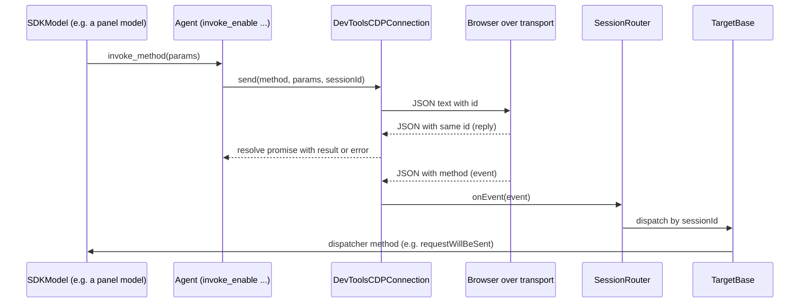

# ChromeDevTools/devtools-frontend — module: protocol-client

## Responsibility

This module is how DevTools talks to the browser it inspects. It sends Chrome DevTools Protocol (CDP) commands as JSON, matches each answer to its question, and hands each event to the right object. The `core/sdk` files on top (`Target`, `SDKModel`, `TargetManager`) turn raw protocol traffic into long-lived objects that panels can use. For your capstone, this is the same job a CDP-driven page inspector must do: number requests, wait for replies, and route events.

## Key files

| File | Role |
|------|------|
| `front_end/core/protocol_client/CDPConnection.ts` | Types for messages and errors, and the `CDPConnection` interface (`send`, `observe`) |
| `front_end/core/protocol_client/DevToolsCDPConnection.ts` | The real connection: message ids, pending-reply map, incoming message routing |
| `front_end/core/protocol_client/InspectorBackend.ts` | Agents (command senders), dispatchers (event receivers), `SessionRouter`, `TargetBase` |
| `front_end/core/sdk/Target.ts` | A `Target` is one debuggable thing (page, worker, ...); it owns models and a capability mask |
| `front_end/core/sdk/SDKModel.ts` | Base class and registry for per-target models |
| `front_end/core/sdk/TargetManager.ts` | Creates and removes targets, builds their models, tells observers |
| `front_end/core/protocol_client/InspectorBackend.test.ts` | Tests for event dispatch to unknown domains and methods |

## How it works

Sending a command:

1. A caller uses a typed method like `target.networkAgent()`. Each `TargetBase` returns one agent object per protocol domain, and throws if the domain is unknown (`front_end/core/protocol_client/InspectorBackend.ts:319-324 @ 92a1ec4`).
2. The agent has methods named `invoke_<command>`. They are installed at startup from the generated protocol description (`front_end/core/protocol_client/InspectorBackend.ts:692-697 @ 92a1ec4`).
3. `invoke` finds the connection through the target's router and calls `connection.send(method, params, sessionId)` (`front_end/core/protocol_client/InspectorBackend.ts:700-707 @ 92a1ec4`).
4. `send` adds one to a counter to make the message id, builds `{id, method, params, sessionId}` and stores a promise `resolve` function under that id (`front_end/core/protocol_client/DevToolsCDPConnection.ts:55-62 @ 92a1ec4`, `:78-80 @ 92a1ec4`).
5. The message is written to the transport as a JSON string (`front_end/core/protocol_client/DevToolsCDPConnection.ts:80 @ 92a1ec4`).

Receiving:

6. The transport calls `#onMessage`. A message with an `id` is a reply: its callback is looked up, removed, and resolved (`front_end/core/protocol_client/DevToolsCDPConnection.ts:120-137 @ 92a1ec4`).
7. A message with `method` and no `id` is an event, passed to every observer (`front_end/core/protocol_client/DevToolsCDPConnection.ts:138-139 @ 92a1ec4`).
8. `SessionRouter.onEvent` reads the event's `sessionId` (empty string for the root) and calls `dispatch` on the matching target (`front_end/core/protocol_client/InspectorBackend.ts:219-223 @ 92a1ec4`).
9. `TargetBase.dispatch` splits `Domain.event`, finds that domain's `DispatcherManager`, and the manager calls the event's method on each registered listener object with the event params (`front_end/core/protocol_client/InspectorBackend.ts:285-294 @ 92a1ec4`, `:765-772 @ 92a1ec4`).

Wrapping in models:

10. `TargetManager.createTarget` makes a `Target`, then calls `createModels` with the auto-start list (`front_end/core/sdk/TargetManager.ts:331-336 @ 92a1ec4`).
11. `Target.model(Class)` builds a model only when the target has every capability that model needs (`front_end/core/sdk/Target.ts:188-196 @ 92a1ec4`). Models are registered with `SDKModel.register(class, {capabilities, autostart})` (`front_end/core/sdk/SDKModel.ts:57-62 @ 92a1ec4`).
12. Observers hear about new targets and models (`front_end/core/sdk/TargetManager.ts:339-349 @ 92a1ec4`).

## Beyond the textbook

### Errors are values, not exceptions

- Textbook version: a command either returns data or throws.
- What they do: the connection's `send` resolves to `{result}` or `{error}`. The agent wraps both and adds a `getError()` function, so callers check one field and never need `try/catch` for protocol failures.
- Why: a failed CDP call is normal (the page may be gone). Rejecting would need a handler at every call site.
- Evidence: `front_end/core/protocol_client/InspectorBackend.ts:708-722 @ 92a1ec4`, `front_end/core/protocol_client/CDPConnection.ts:68-70 @ 92a1ec4`.

### Quiet errors for expected failures

- Textbook version: log every failed call.
- What they do: a small set of error codes (server error, session not found, stub and rehydration errors) is not logged, and tests can switch logging off.
- Why: these happen on normal page close or navigation, and logs would be noise.
- Evidence: `front_end/core/protocol_client/InspectorBackend.ts:660-666 @ 92a1ec4`, `:710 @ 92a1ec4`.

### Pending calls are failed when a session ends

- Textbook version: a promise whose page closed hangs forever.
- What they do: `unregisterSession` asks the connection to resolve every pending call of that session with a `SESSION_NOT_FOUND` error. A command sent after the connection is gone returns a "Connection is closed" error value at once.
- Why: code that does `await` must not hang when a tab or worker disappears.
- Evidence: `front_end/core/protocol_client/DevToolsCDPConnection.ts:84-96 @ 92a1ec4`, `front_end/core/protocol_client/InspectorBackend.ts:201-210 @ 92a1ec4`, `:701-705 @ 92a1ec4`.

### One connection, many sessions

- Textbook version: one WebSocket per page.
- What they do: one connection carries many sessions. Each message has an optional `sessionId`. Child targets reuse the parent's router. Replies whose session does not match the pending call are ignored, and so are unknown ids.
- Why: the code comments say Puppeteer traffic may be proxied over the same channel. They also note DevTools uses both `''` and `undefined` for the root session, so both are compared as `''`.
- Evidence: `front_end/core/protocol_client/InspectorBackend.ts:261-270 @ 92a1ec4`, `front_end/core/protocol_client/DevToolsCDPConnection.ts:123-135 @ 92a1ec4`.

### Types generated from the protocol

- Textbook version: `send(method: string, params: any)`.
- What they do: `Command`, `CommandParams` and `CommandResult` are derived from a generated `ProtocolMapping`, so a wrong method name or parameter fails at compile time. The error codes enum is kept in sync by hand with the Chromium C++ file named in a comment.
- Why: compile-time checking of a large protocol.
- Evidence: `front_end/core/protocol_client/CDPConnection.ts:5-11 @ 92a1ec4`, `:33-46 @ 92a1ec4`.

### Capability masks decide which models a target gets

- Textbook version: create every model for every target.
- What they do: each target type gets a bit mask of protocol features. A worker has no DOM, a tab has only Target and Tracing. Some capabilities are given only to the main frame, matching what the browser exposes.
- Why: asking a target for a domain it does not have would fail. The comment says "This matches backend exposing certain capabilities only for the main frame."
- Evidence: `front_end/core/sdk/Target.ts:51-60 @ 92a1ec4`, `:100-105 @ 92a1ec4`, `:194 @ 92a1ec4`.

### Model creation order and a timeout on suspend

- Textbook version: create objects in any order; wait for each without a limit.
- What they do: models marked `early` are built first, and an early model must also be autostart. Suspending all targets races each against a 2000 ms timer and only warns if it loses.
- Why: some models need others to exist; one stuck renderer must not freeze the whole UI.
- Evidence: `front_end/core/sdk/TargetManager.ts:311-324 @ 92a1ec4`, `:169-181 @ 92a1ec4`, `front_end/core/sdk/SDKModel.ts:58-60 @ 92a1ec4`.

### A crashed flag so resume does not freeze the Performance panel

- Textbook version: resume every target after a trace.
- What they do: `Target` keeps `#hasCrashed`. When it flips back to healthy, the target resumes.
- Why: the comment links a bug where a crashed target made the Performance panel freeze.
- Evidence: `front_end/core/sdk/Target.ts:30-39 @ 92a1ec4`, `:242-253 @ 92a1ec4`.

## Tests and what they protect

`InspectorBackend.test.ts` has three tests of `TargetBase.dispatch`, built on a `MockCDPConnection`. They check that an event for an unknown domain logs a protocol error, an unknown event name in a known domain logs a warning, and a listener without a handler for the event is skipped silently while another listener still gets it (`front_end/core/protocol_client/InspectorBackend.test.ts:15-66 @ 92a1ec4`). The code logs through static methods that tests replace with sinon stubs (`front_end/core/protocol_client/InspectorBackend.ts:100-106 @ 92a1ec4`). No tests of `DevToolsCDPConnection`, `Target` or `TargetManager` are in this slice.

## Error handling, performance, and security

- Bad messages: a message with neither `id` nor `method` is reported as a protocol error (`front_end/core/protocol_client/DevToolsCDPConnection.ts:140-141 @ 92a1ec4`). An event for an unknown domain is reported, and an unspecified event name in a known domain only warns (`front_end/core/protocol_client/InspectorBackend.ts:286-293 @ 92a1ec4`, `:759-763 @ 92a1ec4`).
- Disconnect: the transport's disconnect reaches all observers; the router disposes the root session's target (`front_end/core/protocol_client/DevToolsCDPConnection.ts:40-42 @ 92a1ec4`, `front_end/core/protocol_client/InspectorBackend.ts:212-217 @ 92a1ec4`).
- Test hooks: a `test` object offers `dumpProtocol`, `onMessageSent` and `onMessageReceived`, and each is a null check when unused (`front_end/core/protocol_client/InspectorBackend.ts:149-184 @ 92a1ec4`, `front_end/core/protocol_client/DevToolsCDPConnection.ts:68-76 @ 92a1ec4`). A second interface, `DebuggableCDPConnection`, exists for the protocol monitor (`front_end/core/protocol_client/CDPConnection.ts:81-87 @ 92a1ec4`).
- Boot: `maybeAttachInitialTarget` does not await `autoAttachRelated`, so a stuck renderer cannot block front-end start (`front_end/core/sdk/TargetManager.ts:442-448 @ 92a1ec4`).
- Security: not present in this slice.

## Technologies and services seen

- Chrome DevTools Protocol — JSON command, reply and event format (`front_end/core/protocol_client/CDPConnection.ts:13-31 @ 92a1ec4`).
- TypeScript generics and generated protocol types — typed commands (`front_end/core/protocol_client/CDPConnection.ts:5-11 @ 92a1ec4`).
- Mocha and sinon — test runner and stubs (`front_end/core/protocol_client/InspectorBackend.test.ts:5-6 @ 92a1ec4`).
- Chromium crdtp dispatcher — C++ source of the error codes (`front_end/core/protocol_client/CDPConnection.ts:34 @ 92a1ec4`).

## Worth exploring interactively

- Command and reply round trip — steps: agent `invoke` (`front_end/core/protocol_client/InspectorBackend.ts:700-707 @ 92a1ec4`), id assigned and callback stored (`front_end/core/protocol_client/DevToolsCDPConnection.ts:55-80 @ 92a1ec4`), reply matched by id and session (`front_end/core/protocol_client/DevToolsCDPConnection.ts:120-137 @ 92a1ec4`), wrapped with `getError` (`front_end/core/protocol_client/InspectorBackend.ts:708-722 @ 92a1ec4`) — fits FlowAnimation because the learner watches a message get an id, wait in a table, and resolve.
- Event routing to a model — steps: observer gets event (`front_end/core/protocol_client/DevToolsCDPConnection.ts:138-139 @ 92a1ec4`), router picks target by session (`front_end/core/protocol_client/InspectorBackend.ts:219-223 @ 92a1ec4`), manager calls listener (`front_end/core/protocol_client/InspectorBackend.ts:754-772 @ 92a1ec4`) — fits SystemDiagram because the learner sees which part owns which lookup.

## Open questions

- Which class provides the `ConnectionTransport` (WebSocket or host channel) is outside this slice; the default factory is called at `front_end/core/protocol_client/InspectorBackend.ts:267 @ 92a1ec4`.
- `resolvePendingCalls` resolves callbacks but this slice does not show them being removed from the map.

## My insights
