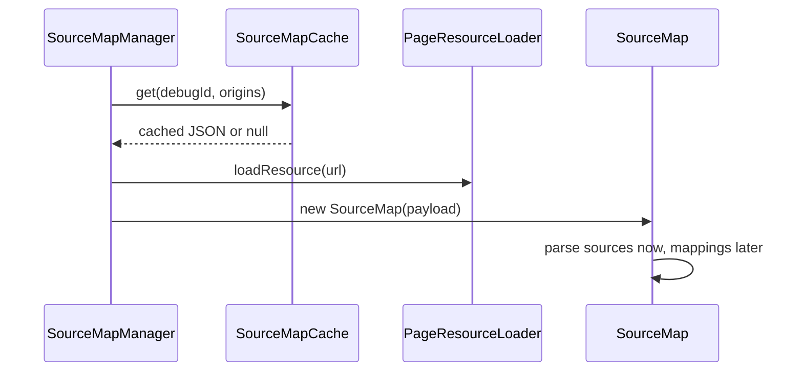

# ChromeDevTools/devtools-frontend — module: source-map

## Responsibility

This module turns a source map (a JSON file that links built code back to your original files) into a lookup table that the debugger can search. It also decides when to download a map, when to reuse a saved one, and which original files count as third-party code to skip. Background concepts: [[Source maps]], [[Base64 VLQ]], [[Ignore listing]].

## Key files

| File | Role |
|------|------|
| `front_end/core/sdk/SourceMap.ts` | Parses the JSON, decodes the `mappings` string, answers position lookups |
| `front_end/core/sdk/SourceMapManager.ts` | Loads maps for scripts and stylesheets, and tells listeners when a map attaches or detaches |
| `front_end/core/sdk/SourceMapCache.ts` | Saves parsed JSON by Debug ID in the browser Cache API, or in memory |
| `front_end/core/sdk/SourceMap.test.ts` | Unit tests for decoding, lookups, ignore list, range mappings |

Only the four files in the slice list were read. Sibling files (`SourceMapScopesInfo.ts` and others) were not read.

## How it works

In plain words: the manager downloads the map, the `SourceMap` class turns its compact text into a sorted list of entries, and lookups use binary search on that list.

1. `attachSourceMap` refuses a second attach for the same client, then stores the raw (maybe relative) URLs (`front_end/core/sdk/SourceMapManager.ts:102-117 @ 572bfc0`).
2. It resolves the script URL against the inspected page, then resolves the map URL against the script URL (`front_end/core/sdk/SourceMapManager.ts:122-123 @ 572bfc0`).
3. `loadSourceMap` first asks the cache, then falls back to the network loader, then parses the text (`front_end/core/sdk/SourceMapManager.ts:254-262 @ 572bfc0`).
4. `parseSourceMap` strips the `)]}` anti-XSSI prefix line and a byte-order mark, then calls `JSON.parse` (`front_end/core/sdk/SourceMap.ts:82-90 @ 572bfc0`).
5. The `SourceMap` constructor only reads the `sources` list (URLs, embedded content, ignore hints) (`front_end/core/sdk/SourceMap.ts:170-188 @ 572bfc0`, `front_end/core/sdk/SourceMap.ts:549-579 @ 572bfc0`).
6. The first lookup calls `#ensureSourceMapProcessed`, which decodes `mappings` through `#parseMap` (`front_end/core/sdk/SourceMap.ts:472-480 @ 572bfc0`).
7. In `#parseMap`, `;` starts a new generated line and resets the column; `,` separates segments (`front_end/core/sdk/SourceMap.ts:608-619 @ 572bfc0`). Each field is a delta added to the previous value, read with `nextVLQ` (`front_end/core/sdk/SourceMap.ts:623-643 @ 572bfc0`).
8. Entries are sorted, because the spec does not promise order, and a reverse table (original to generated) is built (`front_end/core/sdk/SourceMap.ts:489-492 @ 572bfc0`).
9. `findEntry` binary-searches with `upperBound` and returns the entry just before the position (`front_end/core/sdk/SourceMap.ts:273-282 @ 572bfc0`).

The VLQ decoder reads 5 data bits per Base64 character; bit 6 means "more digits follow"; the lowest bit of the result is the sign (`front_end/core/sdk/SourceMap.ts:945-947 @ 572bfc0`, `front_end/core/sdk/SourceMap.ts:970-977 @ 572bfc0`, `front_end/core/sdk/SourceMap.ts:993-1013 @ 572bfc0`).

## Beyond the textbook

### Lazy parsing in two phases

- Textbook version: parse the whole map in the constructor.
- What they do: the constructor reads only `sources`; the expensive `mappings` decode waits for the first query. After parsing, the raw JSON is dropped unless `retainRawSourceMaps` is set.
- Why: large bundles have huge maps, and most are never queried. Dropping the JSON frees memory (inferred from the code, no comment states it).
- Evidence: `front_end/core/sdk/SourceMap.ts:188 @ 572bfc0`, `front_end/core/sdk/SourceMap.ts:472-496 @ 572bfc0`, `front_end/core/sdk/SourceMap.ts:146 @ 572bfc0`.

### Lazy download behind a setting

- Textbook version: fetch every map as soon as a script loads.
- What they do: a boolean setting `source-maps-lazy-loading` (default false) makes `getSourceMap` start the download only when someone asks. Otherwise it downloads immediately and shares one promise.
- Why: avoids network cost for scripts the developer never opens (inferred).
- Evidence: `front_end/core/sdk/SourceMapManager.ts:20-25 @ 572bfc0`, `front_end/core/sdk/SourceMapManager.ts:176-181 @ 572bfc0`; tested by `front_end/core/sdk/SourceMapManager.test.ts:869 @ 572bfc0`.

### Debug-ID cache keyed by origin

- Textbook version: cache by map URL.
- What they do: the cache key joins the map's Debug ID with the script origin and the loader (page) origin. Opaque origins are never cached. The map is only stored when its own `debugId` equals the script's. A failed cache write is swallowed so the map still works.
- Why: the code comment says the Cache API only accepts URLs as keys, so a fake URL is built. Tests check that maps are isolated by origin.
- Evidence: `front_end/core/sdk/SourceMapCache.ts:31-35 @ 572bfc0`, `front_end/core/sdk/SourceMapCache.ts:63-67 @ 572bfc0`, `front_end/core/sdk/SourceMapManager.ts:263-265 @ 572bfc0`, `front_end/core/sdk/SourceMapCache.test.ts:58 @ 572bfc0`, `front_end/core/sdk/SourceMapCache.test.ts:120 @ 572bfc0`.

### In-memory fallback when no Cache API exists

- Textbook version: assume the browser API is there.
- What they do: `create()` returns a `Map`-backed instance when the host has no cache storage.
- Why: DevTools also runs outside a normal browser host (inferred from `HOST_RUNTIME`).
- Evidence: `front_end/core/sdk/SourceMapCache.ts:12-15 @ 572bfc0`, `front_end/core/sdk/SourceMapCache.ts:74-90 @ 572bfc0`.

### Ignore listing starts in the map itself

- Textbook version: the user lists files to skip in settings.
- What they do: the map's `ignoreList` array (indices into `sources`) becomes an `ignoreListHint` per source. The older `x_google_ignoreList` is used only if `ignoreList` is absent. `findRanges` then turns "which sources match" into generated-code ranges.
- Why: build tools know which files are vendor code, so the debugger can skip them without user work. A test confirms the new field wins over the deprecated one.
- Evidence: `front_end/core/sdk/SourceMap.ts:40-46 @ 572bfc0`, `front_end/core/sdk/SourceMap.ts:551 @ 572bfc0`, `front_end/core/sdk/SourceMap.ts:572 @ 572bfc0`, `front_end/core/sdk/SourceMap.ts:815-817 @ 572bfc0`, `front_end/core/sdk/SourceMap.ts:824-857 @ 572bfc0`, `front_end/core/sdk/SourceMap.test.ts:961 @ 572bfc0`.

### Strict unsigned VLQ with a 32-bit limit

- Textbook version: one signed decoder.
- What they do: a second decoder for the range-mappings proposal uses the lowest bit as data, rejects numbers over 32 bits, and throws on truncated input or non-Base64 characters. It avoids `<<` there because it sign-extends.
- Why: a comment explains the sign problem; the limit stops hostile or corrupt input.
- Evidence: `front_end/core/sdk/SourceMap.ts:949-951 @ 572bfc0`, `front_end/core/sdk/SourceMap.ts:984-1012 @ 572bfc0`, `front_end/core/sdk/SourceMap.test.ts:147-152 @ 572bfc0`.

### Range mappings and tolerant extras

- Textbook version: only classic segments.
- What they do: `rangeMappings` marks entries that cover code character by character, so a lookup inside the range is interpolated. A bad field is ignored and never invalidates the map. Scopes come from the spec field, a Bloomberg-specific field, or a fallback built from the script's syntax tree.
- Why: the code comment states a malformed field must never invalidate the map.
- Evidence: `front_end/core/sdk/SourceMap.ts:683-706 @ 572bfc0`, `front_end/core/sdk/SourceMap.ts:283-291 @ 572bfc0`, `front_end/core/sdk/SourceMap.ts:649-662 @ 572bfc0`, `front_end/core/sdk/SourceMap.ts:456-466 @ 572bfc0`.

## Tests and what they protect

- Tests sit beside the code (`SourceMap.test.ts`, `SourceMapCache.test.ts`, `SourceMapManager.test.ts` in the same folder).
- Decoder edge cases: peeking without moving, unsigned values, 32-bit overflow, truncation (`front_end/core/sdk/SourceMap.test.ts:94 @ 572bfc0`, `front_end/core/sdk/SourceMap.test.ts:147-152 @ 572bfc0`).
- Format quirks: empty segments, empty lines, mappings in reverse order, index maps with sections, ClosureScript names, BOM and `)]}` prefix (`front_end/core/sdk/SourceMap.test.ts:349-435 @ 572bfc0`, `front_end/core/sdk/SourceMap.test.ts:1169-1174 @ 572bfc0`).
- Many generated cases for `sourceRoot` and URL resolution (`front_end/core/sdk/SourceMap.test.ts:884 @ 572bfc0`).
- Real bug regressions cite crbug numbers: empty `sources` and out-of-range indices must not throw (`front_end/core/sdk/SourceMap.test.ts:1433-1455 @ 572bfc0`).
- Manager lifecycle: attach twice, fail, reattach, disable while attaching, cancel (`front_end/core/sdk/SourceMapManager.test.ts:122-359 @ 572bfc0`). Cache isolation by frame, file URL, worker, and opaque origin (`front_end/core/sdk/SourceMapManager.test.ts:572-818 @ 572bfc0`).

## Error handling, performance, and security

- Parse failure: `#ensureSourceMapProcessed` catches the error, logs it, and leaves an empty mapping list instead of crashing (`front_end/core/sdk/SourceMap.ts:477-487 @ 572bfc0`).
- Load failure: the error is wrapped with the URL and the original cause; the manager fires `SourceMapFailedToAttach` and returns `undefined` (`front_end/core/sdk/SourceMapManager.ts:156-161 @ 572bfc0`, `front_end/core/sdk/SourceMapManager.ts:268-270 @ 572bfc0`). `tryLoadSourceMap` returns `null` instead (`front_end/core/sdk/SourceMapManager.ts:273-281 @ 572bfc0`).
- Stale results: a finished load is applied only if the client still holds the same data object (`front_end/core/sdk/SourceMapManager.ts:149 @ 572bfc0`).
- Unsupported index-map `url` sections only produce a console warning (`front_end/core/sdk/SourceMap.ts:182-185 @ 572bfc0`).
- Security: the cache refuses opaque origins and separates entries by two origins, so one site cannot read another site's saved map (`front_end/core/sdk/SourceMapCache.ts:33-35 @ 572bfc0`, `front_end/core/sdk/SourceMapCache.ts:65-66 @ 572bfc0`).
- Performance: binary search lookups (`front_end/core/sdk/SourceMap.ts:275-277 @ 572bfc0`); lazy parse and JSON release as above.

## Technologies and services seen

- Cache API (browser `CacheStorage`) — persists parsed maps by Debug ID (`front_end/core/sdk/SourceMapCache.ts:13-17 @ 572bfc0`, `front_end/core/sdk/SourceMapCache.ts:59 @ 572bfc0`).
- Source Map V3 spec and the range-mappings proposal — the file format supported (`front_end/core/sdk/SourceMap.ts:21-30 @ 572bfc0`, `front_end/core/sdk/SourceMap.ts:107 @ 572bfc0`).
- Base64 helpers from the repo's `Common` module — digit lookup for VLQ (`front_end/core/sdk/SourceMap.ts:1002 @ 572bfc0`).
- `PageResourceLoader` — fetches the map over the page's loader (`front_end/core/sdk/SourceMapManager.ts:143-145 @ 572bfc0`).
- DevTools settings system — stores the lazy-loading flag (`front_end/core/sdk/SourceMapManager.ts:20-25 @ 572bfc0`).
- Chai `assert` — test assertions (`front_end/core/sdk/SourceMapCache.test.ts:5 @ 572bfc0`).
- V8 supplies the raw `sourceMappingURL` (`front_end/core/sdk/SourceMapManager.ts:286 @ 572bfc0`).

## Worth exploring interactively

- Decoding one mapping segment — ordered steps: a Base64 char is looked up (`front_end/core/sdk/SourceMap.ts:1002 @ 572bfc0`); 5 bits are added at the next shift (`front_end/core/sdk/SourceMap.ts:1009-1010 @ 572bfc0`); the loop repeats while the continuation bit is set (`front_end/core/sdk/SourceMap.ts:996 @ 572bfc0`); the sign bit is split off (`front_end/core/sdk/SourceMap.ts:970-977 @ 572bfc0`); the delta is added to the running column/source/line values (`front_end/core/sdk/SourceMap.ts:623-635 @ 572bfc0`); an entry is pushed (`front_end/core/sdk/SourceMap.ts:606 @ 572bfc0`) — fits AlgorithmStepper because the learner sees the string, the running numbers and the entry table change one character at a time.
- Attaching a source map — steps: `attachSourceMap` (`front_end/core/sdk/SourceMapManager.ts:102 @ 572bfc0`), `SourceMapWillAttach` event (`front_end/core/sdk/SourceMapManager.ts:133 @ 572bfc0`), cache check then network (`front_end/core/sdk/SourceMapManager.ts:255-261 @ 572bfc0`), `SourceMap` built (`front_end/core/sdk/SourceMapManager.ts:148 @ 572bfc0`), `SourceMapAttached` (`front_end/core/sdk/SourceMapManager.ts:152 @ 572bfc0`), later `SourceMapDetached` (`front_end/core/sdk/SourceMapManager.ts:209 @ 572bfc0`) — fits StateMachine because each client moves between attaching, attached, failed and detached.

## Open questions

- Which panel code consumes `hasIgnoreListHint` and `findRanges` was not in this slice.
- How scope data (`SourceMapScopesInfo.ts`) uses decoded entries was not read.

## My insights
