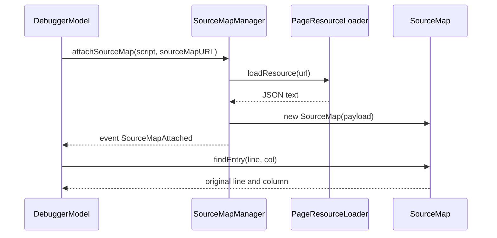

# ChromeDevTools/devtools-frontend — module: source-maps

## Responsibility

A bundler turns many source files into one small script. A source map is a JSON file that says which original line each spot in the bundle came from. This module finds that file, downloads it, decodes it, and answers two questions: "generated position to original position" (stack traces) and "original position to generated positions" (breakpoints). The format is defined by the source map spec (ECMA-426).

## Key files

| File | Role |
|------|------|
| `front_end/core/sdk/SourceMapManager.ts` | Resolves URLs, loads maps, keeps one map per script, fires lifecycle events |
| `front_end/core/sdk/SourceMap.ts` | Parses JSON, decodes the `mappings` string (VLQ), and does the lookups |
| `front_end/core/sdk/SourceMapManager.test.ts` | Tests the lifecycle, caching, and lazy loading |

## How it works

1. The debugger model sees a script and hands the manager its `sourceURL` and `sourceMapURL` (`front_end/core/sdk/DebuggerModel.ts:785 @ 92a1ec4`). The manager stores the raw URL, which "is not guaranteed to be valid" until attach time (`front_end/core/sdk/SourceMapManager.ts:286-288 @ 92a1ec4`).
2. Attaching twice for one script throws; an empty map URL returns quietly (`front_end/core/sdk/SourceMapManager.ts:104-109 @ 92a1ec4`).
3. The script URL is completed against the inspected page URL, then the map URL is completed against the script URL (`front_end/core/sdk/SourceMapManager.ts:122-123 @ 92a1ec4`).
4. `loadSourceMap` fetches the text through `PageResourceLoader` and parses it (`front_end/core/sdk/SourceMapManager.ts:261-262 @ 92a1ec4`). A failure becomes an error that names the URL (`front_end/core/sdk/SourceMapManager.ts:268-270 @ 92a1ec4`).
5. `parseSourceMap` cuts a `)]}` prefix line and a byte-order mark, then calls `JSON.parse` (`front_end/core/sdk/SourceMap.ts:82-91 @ 92a1ec4`).
6. The factory builds a `SourceMap`, and the manager fires `SourceMapAttached` (`front_end/core/sdk/SourceMapManager.ts:148-152 @ 92a1ec4`). On failure it fires `SourceMapFailedToAttach` (`front_end/core/sdk/SourceMapManager.ts:156-160 @ 92a1ec4`).
7. Decoding is lazy: the first lookup calls `#ensureSourceMapProcessed`, which parses every section, sorts the entries, and builds reverse tables (`front_end/core/sdk/SourceMap.ts:474-493 @ 92a1ec4`).
8. `#parseMap` walks the `mappings` string. A `;` starts a new generated line and resets the column; a `,` separates segments (`front_end/core/sdk/SourceMap.ts:609-621 @ 92a1ec4`). Each segment adds deltas to running totals: column, source index, source line, source column, name index (`front_end/core/sdk/SourceMap.ts:623-645 @ 92a1ec4`).
9. Each number is a Base64 VLQ. Five bits carry value, bit 6 means "more digits follow" (`front_end/core/sdk/SourceMap.ts:946-948 @ 92a1ec4`; loop at `front_end/core/sdk/SourceMap.ts:1004-1019 @ 92a1ec4`).
10. Generated to original (stack traces): `findEntry` binary-searches the sorted entries with `upperBound` and takes the entry just before the position (`front_end/core/sdk/SourceMap.ts:273-281 @ 92a1ec4`).
11. Original to generated (breakpoints): `#findReverseIndices` binary-searches a second list sorted by source line and column, then collects all entries at that exact original spot (`front_end/core/sdk/SourceMap.ts:387-403 @ 92a1ec4`). One original line can map to many generated places, so the result is an array.

## Beyond the textbook

### Delta decoding with a hardened VLQ reader

- Textbook version: decode Base64 digits and shift bits.
- What they do: the decoder throws on truncated input, on a character outside the Base64 table, and (for the unsigned form) on a number over 32 bits.
- Why: maps come from the network and may be broken; the comment says unsigned numbers "may use the full 32 bits, where `<<` would sign extend", so they use multiplication.
- Evidence: `front_end/core/sdk/SourceMap.ts:1005-1021 @ 92a1ec4`

### Cache keyed by debug ID plus two origins

- Textbook version: fetch the map every time, or cache by URL.
- What they do: if the script has a `debugId`, the cache key also includes the script origin and the page (loader) origin. The map is saved only when the map's own `debugId` equals the script's. A cache write failure is swallowed so the map is still used.
- Why: a cache shared across sites could leak or mix maps; the tests check that a matching `debugId` with a different origin does not hit the cache.
- Evidence: `front_end/core/sdk/SourceMapManager.ts:252-266 @ 92a1ec4`; `front_end/core/sdk/SourceMapManager.test.ts:444 @ 92a1ec4`; `front_end/core/sdk/SourceMapManager.test.ts:498 @ 92a1ec4`

### Lazy loading behind a setting

- Textbook version: download every map as soon as a script appears.
- What they do: with lazy loading on, `getSourceMap` only starts the download when someone asks for it; otherwise it starts at once and shares one promise.
- Why: large apps have hundreds of scripts and most maps are never needed (the test is named "defers loading until sourceMapForClientPromise is called").
- Evidence: `front_end/core/sdk/SourceMapManager.ts:176-181 @ 92a1ec4`; `front_end/core/sdk/SourceMapManager.test.ts:869 @ 92a1ec4`

### Stale-result guards

- Textbook version: assign the loaded map to the script.
- What they do: before saving a result, the code checks that the client still holds the same `clientData`. If the script was detached or re-attached meanwhile, the late result is dropped.
- Why: downloads are async, and a test covers "sourcemap reattaches immediately".
- Evidence: `front_end/core/sdk/SourceMapManager.ts:149-153 @ 92a1ec4`; `front_end/core/sdk/SourceMapManager.test.ts:178 @ 92a1ec4`

### Beyond spec v3: sections, ignore lists, range mappings, scopes

- Textbook version: one flat `mappings` string.
- What they do: handle index maps with `sections` (each with an offset), the `ignoreList` field and the older `x_google_ignoreList`, `sourceRoot` joining rules, the "range mappings" proposal (a mapping that covers a whole range character by character), and scope data from the scopes proposal or a Bloomberg extension. If a map has no scope info, names are rebuilt from the parsed code.
- Why: real bundlers emit these; comments explain each choice.
- Evidence: `front_end/core/sdk/SourceMap.ts:532-547 @ 92a1ec4`; `front_end/core/sdk/SourceMap.ts:551 @ 92a1ec4`; `front_end/core/sdk/SourceMap.ts:282-290 @ 92a1ec4`; `front_end/core/sdk/SourceMap.ts:653-661 @ 92a1ec4`; `front_end/core/sdk/SourceMap.ts:479-483 @ 92a1ec4`

### Open-ended last range as max int32

- Textbook version: a mapping ends where the next begins.
- What they do: the last entry has no next entry, so the end is `2 ** 31 - 1`, safe to send to V8 in the step-over skip list (crbug 1305956).
- Why: stated in the comment.
- Evidence: `front_end/core/sdk/SourceMap.ts:432-442 @ 92a1ec4`

### Memory: drop the raw JSON

- Textbook version: keep the parsed JSON forever.
- What they do: after processing, set `#json` to null unless `retainRawSourceMaps` is set.
- Why: the decoded entry list replaces it (inferred from the code, no comment).
- Evidence: `front_end/core/sdk/SourceMap.ts:495-497 @ 92a1ec4`

## Tests and what they protect

The test file covers: attach lifecycle events on success, failure, double attach, immediate re-attach, and cancelled attach (`front_end/core/sdk/SourceMapManager.test.ts:122-239 @ 92a1ec4`); detach and enable/disable while attaching (`front_end/core/sdk/SourceMapManager.test.ts:269-359 @ 92a1ec4`); URL handling for worker and data-URL frames (`front_end/core/sdk/SourceMapManager.test.ts:47-80 @ 92a1ec4`); the cache with security-origin isolation, including `file://` URLs and opaque origins (`front_end/core/sdk/SourceMapManager.test.ts:403-818 @ 92a1ec4`); and lazy loading (`front_end/core/sdk/SourceMapManager.test.ts:868-913 @ 92a1ec4`). There is no VLQ or `findEntry` test in this slice; those tests live elsewhere and were not read.

## Error handling, performance, and security

- Parse errors are caught; the map becomes empty and the error is logged, so the debugger still works on the generated code (`front_end/core/sdk/SourceMap.ts:484-487 @ 92a1ec4`).
- Maps are sorted after parsing because "mappings are not necessarily sorted" (`front_end/core/sdk/SourceMap.ts:489-490 @ 92a1ec4`).
- `tryLoadSourceMap` never throws: it logs and returns null (`front_end/core/sdk/SourceMapManager.ts:273-281 @ 92a1ec4`).
- Fetches go through the page resource loader with an initiator, not a raw `fetch` (`front_end/core/sdk/SourceMapManager.ts:137-145 @ 92a1ec4`).
- Opaque origins never enter the cache (`front_end/core/sdk/SourceMapManager.ts:220-226 @ 92a1ec4`).
- The `)]}` prefix handling exists for the CORB bypass (`front_end/core/sdk/SourceMap.ts:76-77 @ 92a1ec4`).

## Technologies and services seen

- Chrome DevTools Protocol, via the debugger model's script events (`front_end/core/sdk/DebuggerModel.ts:785 @ 92a1ec4`)
- Source map format v3 plus proposals: range mappings (`front_end/core/sdk/SourceMap.ts:107 @ 92a1ec4`), scopes (`front_end/core/sdk/SourceMap.ts:653-657 @ 92a1ec4`)
- `PageResourceLoader`, the DevTools network fetch path (`front_end/core/sdk/SourceMapManager.ts:143 @ 92a1ec4`)
- V8 skip list for `Debugger.stepOver` (`front_end/core/sdk/SourceMap.ts:438 @ 92a1ec4`)

## Worth exploring interactively

- Decode a `mappings` string — read `;` and `,`, decode each VLQ digit, add the deltas to running totals, push an entry (`front_end/core/sdk/SourceMap.ts:609-645 @ 92a1ec4`, `front_end/core/sdk/SourceMap.ts:1004-1019 @ 92a1ec4`) — fits AlgorithmStepper because the learner sees five counters change per segment.
- Source map attach lifecycle — script seen, URLs resolved, load, then Attached or FailedToAttach, with Detach and re-attach (`front_end/core/sdk/SourceMapManager.ts:122-160 @ 92a1ec4`, `front_end/core/sdk/SourceMapManager.ts:197-213 @ 92a1ec4`) — fits StateMachine because states and events are explicit.

## Open questions

- `DebuggerModel.ts` breakpoint code (how reverse entries become `setBreakpoint` calls) was skipped in the slice plan and not read, so the link from `findReverseEntries` (`front_end/core/sdk/SourceMap.ts:405-414 @ 92a1ec4`) to a CDP breakpoint call is not shown here.

## My insights
