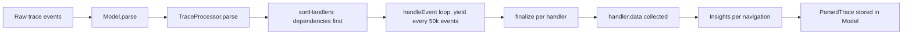

# ChromeDevTools/devtools-frontend — module: trace-processing

## Responsibility

When you press Record in the Performance panel, the browser returns a long list of small timestamped records called trace events. This module turns that list into organised data (requests, tasks, metrics and "insights") that the panel can draw. A `TraceProcessor` runs a set of small plug-in parsers, called handlers, over every event. A `Model` wrapper stores the finished results and tells the UI about progress.

## Key files

| File | Role |
|------|------|
| `front_end/models/trace/Processor.ts` | Runs handlers over events, then computes insights |
| `front_end/models/trace/ModelImpl.ts` | Public wrapper: stores several parsed traces, reports progress |
| `front_end/models/trace/handlers/NetworkRequestsHandler.ts` | One example handler: events become network request records |
| `front_end/models/trace/Processor.test.ts` | Tests for handler wiring, progress, cleanup, sorting, insights |

## How it works

1. The UI calls `Model.parse(events)`. It starts a progress listener and creates a synthetic-events manager (`front_end/models/trace/ModelImpl.ts:85-102 @ 92a1ec4`).
2. `Model.parse` awaits `TraceProcessor.parse`; only if parsing succeeds is the result pushed to the list of stored traces (`front_end/models/trace/ModelImpl.ts:107-115 @ 92a1ec4`).
3. `TraceProcessor.parse` refuses to start unless its status is `IDLE`, so two parses cannot overlap (`front_end/models/trace/Processor.ts:154-157 @ 92a1ec4`).
4. Handlers are sorted so each one runs after the handlers it depends on (`front_end/models/trace/Processor.ts:205 @ 92a1ec4`, `front_end/models/trace/Processor.ts:672-705 @ 92a1ec4`).
5. Pass one: every event goes to every handler's `handleEvent` (`front_end/models/trace/Processor.ts:220-233 @ 92a1ec4`). A handler only stores what it cares about. The network handler, for example, files each resource event under its `requestId` (`front_end/models/trace/handlers/NetworkRequestsHandler.ts:144-173 @ 92a1ec4`).
6. Pass two: each handler's `finalize` runs, with all events available (`front_end/models/trace/Processor.ts:238-256 @ 92a1ec4`). The network handler joins its stored pieces here, and drops requests that have no `sendRequests` (`front_end/models/trace/handlers/NetworkRequestsHandler.ts:224-229 @ 92a1ec4`).
7. Each handler's `data()` result is put under the handler's name in one object (`front_end/models/trace/Processor.ts:258-267 @ 92a1ec4`).
8. Unless the input is a CPU profile, insights are computed (`front_end/models/trace/Processor.ts:169-173 @ 92a1ec4`). The trace is cut into windows, one per navigation, plus an initial period (`front_end/models/trace/Processor.ts:549-571 @ 92a1ec4`).
9. Each insight set runs every insight model. It reports LCP (largest contentful paint), INP (interaction to next paint) and CLS (cumulative layout shift) data, such as `LCPBreakdown`, `INPBreakdown` and `CLSCulprits` (`front_end/models/trace/Processor.ts:476-489 @ 92a1ec4`, `front_end/models/trace/Processor.ts:356-376 @ 92a1ec4`).

## Beyond the textbook

### Two passes and a dependency order

- Textbook version: one loop that parses each event into a result.
- What they do: a cheap `handleEvent` pass collects, then a `finalize` pass joins; handlers declare `deps()` and are topologically sorted, with a cycle check that throws and names the path.
- Why: a handler can only join data after it has seen every event. The sorter's error text shows cycles are a real failure mode.
- Evidence: `front_end/models/trace/Processor.ts:672-705 @ 92a1ec4`, `front_end/models/trace/handlers/NetworkRequestsHandler.ts:660-662 @ 92a1ec4`.

### Yielding to the main thread by event count, not by clock

- Textbook version: process everything in one synchronous loop, or check `performance.now()`.
- What they do: yield with `setTimeout(0)` every 50,000 events. The comment says `performance.now()` is expensive in a hot loop, and that the target is chunks of 100-200 ms.
- Why: a long task would freeze the DevTools UI. The same code also dispatches a progress event at each yield.
- Evidence: `front_end/models/trace/Processor.ts:195-228 @ 92a1ec4`.

### Weighted progress bar from measured cost

- Textbook version: percent = events done / total.
- What they do: the event loop is mapped to 0-25% and finalize to 25-100%, because measured time on large traces is about 25% and 75%.
- Evidence: `front_end/models/trace/Processor.ts:30-46 @ 92a1ec4`.

### A micro-optimisation backed by numbers

- Textbook version: call `handler.handleEvent(event)` inside the loop.
- What they do: read each `handleEvent` function once before the loop. The comment explains that in bundled builds the exports are getters with many shapes, which V8 cannot optimise. It reports the loop dropping from about 2.9 s to 2.1 s on a 1M-event trace.
- Evidence: `front_end/models/trace/Processor.ts:212-217 @ 92a1ec4`.

### Release module-level state even on failure

- Textbook version: clean up only on success.
- What they do: handler state lives in module variables, so a `finally` block resets handlers and Lantern timings after both success and failure. `data` keeps the trace because every `reset()` assigns new containers.
- Evidence: `front_end/models/trace/Processor.ts:178-187 @ 92a1ec4`, `front_end/models/trace/handlers/NetworkRequestsHandler.ts:127-142 @ 92a1ec4`.

### Isolating a risky estimator

- Textbook version: let an exception in an optional feature fail the whole parse.
- What they do: Lantern (a simulator that estimates metrics under throttling) is wrapped in try/catch. A comment says this is a hedge against an error breaking the whole Performance panel. Each insight is also in its own try/catch, and failures go to `modelErrors`.
- Evidence: `front_end/models/trace/Processor.ts:606-637 @ 92a1ec4`, `front_end/models/trace/Processor.ts:476-495 @ 92a1ec4`.

### Ranking insights by effect on Core Web Vitals

- Textbook version: show insights in alphabetical order.
- What they do: start from a hand-made baseline order, then re-sort by the estimated score gain for LCP, INP and CLS, using the Lighthouse scoring curve and field data when present. With no interaction, INP defaults to 200 ms so insights can still be ranked.
- Evidence: `front_end/models/trace/Processor.ts:349-440 @ 92a1ec4`.

### Dropping trivial insight sets and incomplete requests

- Textbook version: show everything parsed.
- What they do: skip a no-navigation set when it is under 5 s, every insight passes, and there is no LCP, INP or layout shift. The network handler drops requests with missing events instead of inventing data.
- Evidence: `front_end/models/trace/Processor.ts:497-513 @ 92a1ec4`, `front_end/models/trace/handlers/NetworkRequestsHandler.ts:225-229 @ 92a1ec4`.

## Tests and what they protect

- Subset of handlers gives only `Meta` plus the chosen handlers (`front_end/models/trace/Processor.test.ts:91-99 @ 92a1ec4`).
- `Meta` is added automatically when a dependency needs it (`front_end/models/trace/Processor.test.ts:101-110 @ 92a1ec4`).
- A missing dependency throws "Required handler Samples not provided" (`front_end/models/trace/Processor.test.ts:112-118 @ 92a1ec4`).
- A 106,110-event trace must emit at least two progress updates at the 50k chunk size (`front_end/models/trace/Processor.test.ts:121-141 @ 92a1ec4`).
- After success or a forced `finalize failed` error, handler state is empty and `data` is null on failure (`front_end/models/trace/Processor.test.ts:144-185 @ 92a1ec4`).
- Lantern timings are cleared after success, after a stubbed `sort failed`, and on `reset()` (`front_end/models/trace/Processor.test.ts:187-233 @ 92a1ec4`).
- Tests load recorded `.json.gz` trace fixtures through `TraceLoader`, and use `sinon` spies and stubs (`front_end/models/trace/Processor.test.ts:136 @ 92a1ec4`, `front_end/models/trace/Processor.test.ts:195 @ 92a1ec4`).

## Error handling, performance, and security

- State machine guards: parse throws when not idle; reset throws while parsing; `data` and `insights` return null unless parsing finished (`front_end/models/trace/Processor.ts:136-138 @ 92a1ec4`, `front_end/models/trace/Processor.ts:270-284 @ 92a1ec4`).
- Errors are rethrown after status becomes `ERRORED_WHILE_PARSING` (`front_end/models/trace/Processor.ts:175-177 @ 92a1ec4`).
- Expected Lantern errors on old traces are silenced; unknown errors are logged (`front_end/models/trace/Processor.ts:617-634 @ 92a1ec4`).
- An optional `logger` times each phase (`front_end/models/trace/Processor.ts:163-168 @ 92a1ec4`).
- Network handler only accepts blob, file, filesystem, http and https URL schemes (`front_end/models/trace/handlers/NetworkRequestsHandler.ts:217-223 @ 92a1ec4`).
- Security: not present in this slice beyond that.

## Technologies and services seen

- TypeScript with module-level `const enum` and private fields — typing of handlers and states (`front_end/models/trace/Processor.ts:13-18 @ 92a1ec4`).
- DOM `EventTarget` and `Event` — progress and completion events without a library (`front_end/models/trace/Processor.ts:20-28 @ 92a1ec4`, `front_end/models/trace/ModelImpl.ts:21 @ 92a1ec4`).
- Lantern — in-repo simulator of throttled page load, from the Lighthouse family (`front_end/models/trace/Processor.ts:8 @ 92a1ec4`).
- Lighthouse scoring curve — reused to weigh insights (`front_end/models/trace/Processor.ts:378-382 @ 92a1ec4`).
- sinon — spies and stubs in tests (`front_end/models/trace/Processor.test.ts:195 @ 92a1ec4`).
- Gzipped JSON trace fixtures (`front_end/models/trace/Processor.test.ts:95 @ 92a1ec4`).

## Worth exploring interactively

- Trace parse pipeline — steps: `Model.parse` (`front_end/models/trace/ModelImpl.ts:85 @ 92a1ec4`); status IDLE to PARSING (`front_end/models/trace/Processor.ts:165 @ 92a1ec4`); sort handlers (`front_end/models/trace/Processor.ts:205 @ 92a1ec4`); event loop with yield (`front_end/models/trace/Processor.ts:220-228 @ 92a1ec4`); finalize each handler (`front_end/models/trace/Processor.ts:242-253 @ 92a1ec4`); collect `data()` (`front_end/models/trace/Processor.ts:260-262 @ 92a1ec4`); insights (`front_end/models/trace/Processor.ts:171 @ 92a1ec4`) — fits FlowAnimation because the learner sees events stream past handlers, then finalize, then a data object appear.
- Processor lifecycle — IDLE, PARSING, FINISHED_PARSING, ERRORED_WHILE_PARSING (`front_end/models/trace/Processor.ts:13-18 @ 92a1ec4`), moved at `front_end/models/trace/Processor.ts:165 @ 92a1ec4`, `front_end/models/trace/Processor.ts:174 @ 92a1ec4`, `front_end/models/trace/Processor.ts:176 @ 92a1ec4`, back to IDLE on reset (`front_end/models/trace/Processor.ts:145 @ 92a1ec4`) — fits StateMachine because the allowed calls change in each state.

## Open questions

The slice does not include the handlers for renderer tasks, long tasks, layout shifts or page-load metrics (LCP, INP). Only the network handler and the insight orchestration were read. How a flame chart's task tree is built (the `Renderer` handler) and where a long task is flagged are not shown here; a later unit could read `front_end/models/trace/handlers/`. This note therefore covers the pipeline that feeds those handlers, and the insight names for LCP, INP and CLS, not their per-event parsing.

## My insights
