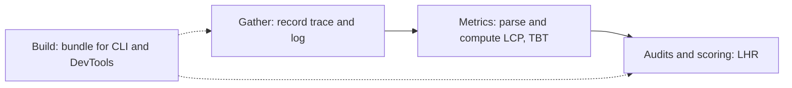
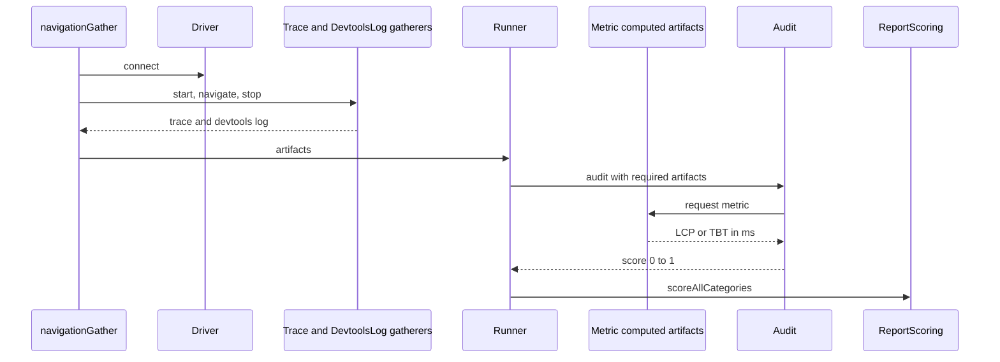

# GoogleChrome/lighthouse — architecture

## Module map

| Module | Responsibility | Note |
|--------|----------------|------|
| gather-pipeline | Loads the page in Chrome and records a trace (Performance panel data) and a devtools log (Network panel data) | [[lighthouse-module-gather-pipeline\|gather-pipeline]] |
| metrics-and-trace | Parses both recordings once and computes LCP and TBT | [[lighthouse-module-metrics-and-trace\|metrics-and-trace]] |
| audits-and-scoring | Runs each audit, forces one result shape, averages scores per category | [[lighthouse-module-audits-and-scoring\|audits-and-scoring]] |
| build-and-infra | Bundles the same code for CLI, npm and DevTools, and guards it in CI | [[lighthouse-module-build-and-infra\|build-and-infra]] |

## The picture

Gather produces two recordings. Metrics reads them. Audits score the metrics. Build packages all three. The gather step ends at `getArtifact` (`core/gather/navigation-runner.js:175-177 @ 3b399f6`). An audit asks for a metric through computed artifacts (`core/audits/metrics/largest-contentful-paint.js:73-83 @ 3b399f6`). The runner then scores categories (`core/scoring.js:73-77 @ 3b399f6`). The build step reads the gatherer and audit lists from `Runner` (`build/build-bundle.js:81-84 @ 3b399f6`). [[visual-lighthouse-module-map-browser-devtools-mastery|explanation and sources]]

## Main flow

In plain words: Lighthouse records first and judges later. The two halves meet only through saved artifacts.

1. `navigationGather` makes a `Driver` and connects to Chrome (`core/gather/navigation-runner.js:259-306 @ 3b399f6`, `core/gather/driver.js:79-92 @ 3b399f6`).
2. The runner starts the gatherers, navigates, and stops them in a fixed order (`core/gather/navigation-runner.js:206-222 @ 3b399f6`).
3. The trace gatherer reads the trace as a stream; the log gatherer keeps `Page.`, `Network.`, `Target.` and `Runtime.` events (`core/gather/gatherers/trace.js:79-90 @ 3b399f6`, `core/gather/gatherers/devtools-log.js:27 @ 3b399f6`).
4. `Runner.audit` runs each audit in a loop and hands it only the artifacts it declared (`core/runner.js:358-366 @ 3b399f6`, `core/runner.js:430-441 @ 3b399f6`).
5. The audit asks for a metric; a cache returns a stored promise or computes it (`core/computed/computed-artifact.js:51-76 @ 3b399f6`).
6. The metric picks observed or simulated mode (`core/computed/metrics/metric.js:85-97 @ 3b399f6`), and the audit maps milliseconds to a 0 to 1 score (`core/audits/metrics/largest-contentful-paint.js:86-95 @ 3b399f6`).
7. `ReportScoring.scoreAllCategories` averages scores and builds the result object (`core/scoring.js:63-77 @ 3b399f6`, `core/runner.js:118-148 @ 3b399f6`).

[[visual-lighthouse-request-flow-browser-devtools-mastery|explanation and sources]]

animation candidate (for a flow scene):

- navigationGather → Driver: connect (`core/gather/driver.js:79-92 @ 3b399f6`)
- navigationGather → gatherers: start, navigate, stop (`core/gather/navigation-runner.js:206-222 @ 3b399f6`)
- gatherers → artifacts: trace and devtools log (`core/gather/gatherers/trace.js:123-137 @ 3b399f6`)
- Runner → Audit: required artifacts only (`core/runner.js:430-442 @ 3b399f6`)
- Audit → computed artifact: metric request, cached (`core/computed/computed-artifact.js:62-65 @ 3b399f6`)
- Audit → ReportScoring: scored result (`core/scoring.js:73-77 @ 3b399f6`)

## Module dependencies (when useful)

The module notes show a one-way dependency: audits depend on computed metrics, and metrics depend on parsed gather output. Gather never calls audits. The split is visible in the saved-artifact modes `-G` (gather only) and `-A` (audit only) (`core/runner.js:206-209 @ 3b399f6`, `core/runner.js:227-231 @ 3b399f6`). A second shared dependency is the in-repo [[Lantern]] simulator, used by metrics and by byte-efficiency audits (`core/computed/metrics/lantern-metric.js:23-27 @ 3b399f6`, `core/audits/byte-efficiency/byte-efficiency-audit.js:10-12 @ 3b399f6`).

## Worth exploring interactively

- Navigation phases as a state machine, with the error branch that keeps the trace (`core/gather/navigation-runner.js:156-173 @ 3b399f6`). Fits StateMachine.
- From audit to score, with a second call answered by the cache (`core/computed/computed-artifact.js:62-65 @ 3b399f6`). Fits FlowAnimation.
- TBT: each long task is trimmed to the part beyond 50 ms (`core/audits/metrics/total-blocking-time.js:78-81 @ 3b399f6`). Fits AlgorithmStepper.
- Score mode and weight table (`core/scoring.js:64-67 @ 3b399f6`). Fits StateMachine.
- Devtools log to network rows, including a redirect split (`core/lib/network-recorder.js:94-109 @ 3b399f6`). Fits FlowAnimation.

decision candidate: Observed versus simulated metrics. Option A, observed: read what the browser measured (`core/computed/metrics/largest-contentful-paint.js:35-45 @ 3b399f6`). Option B, simulated: predict a slow device from a fast run with Lantern (`core/computed/metrics/lantern-largest-contentful-paint.js:29-32 @ 3b399f6`). Trade-off: observed is simple and real; simulated is stable but a model.

decision candidate: Record then judge, in two phases. Option A, one run does everything. Option B, save artifacts and audit later (`core/runner.js:206-209 @ 3b399f6`). Trade-off: B lets you re-audit the same recorded page without a browser.

## Design decisions worth noticing

Recording and judging are separate, so a failed audit or a failed gatherer does not end the run: see [[lighthouse-pattern-fail-soft-pipeline|fail-soft pipeline]]. Heavy parsing is shared through cached promises: see [[lighthouse-pattern-memoized-computed-artifacts|memoized computed artifacts]]. Scores come from a data-fitted curve and not fixed limits: see [[lighthouse-pattern-data-fitted-scoring|data-fitted scoring]]. The same engine ships to three hosts: see [[lighthouse-findings|findings]].

## Not analyzed

- `report/` and `flow-report/`: the report renderer UI.
- `cli/`, `clients/`, `viewer/`, `treemap/`: entry points and web clients, so how the DevTools panel calls the runner is not shown.
- Other `core/audits` and `core/gather/gatherers`, and `core/config`: many similar files.
- `core/lib/tracehouse` and `core/lib/lantern`: the trace processor and simulator internals.
- `core/lib/i18n`, `core/lib/cdt`, `third-party/`, `proto/`, `docs/`, `assets/`: translations, vendored or generated code, docs.

## My insights
