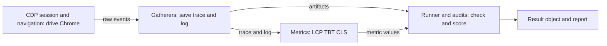
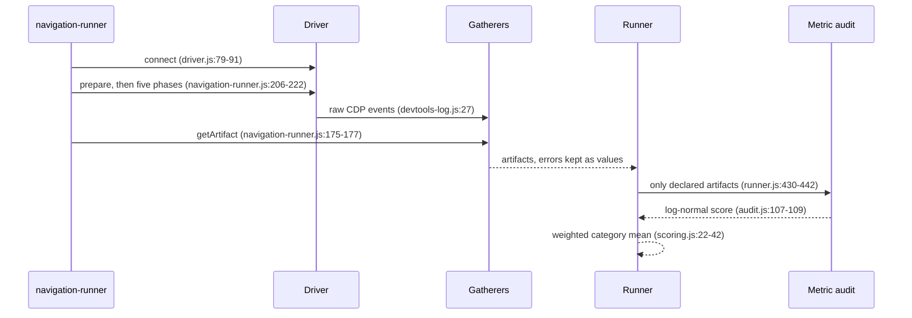
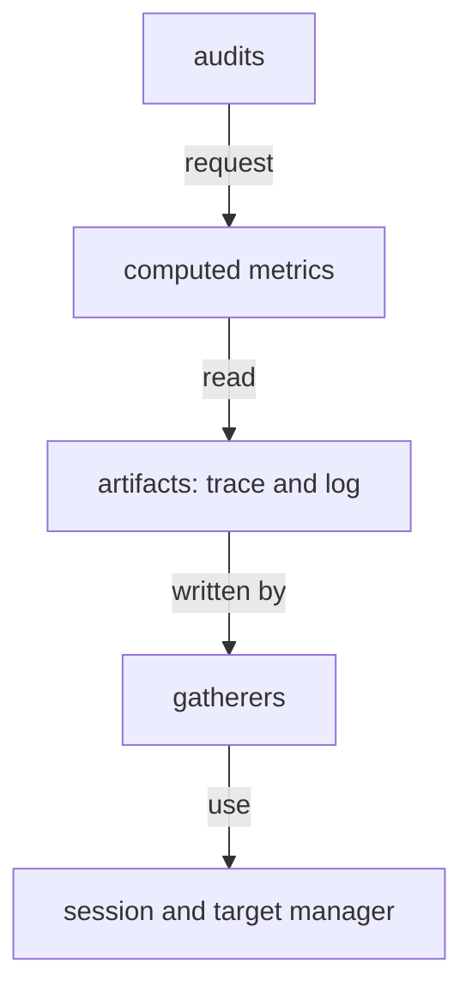

# GoogleChrome/lighthouse — architecture

Lighthouse loads a page in Chrome, saves raw data, and turns that data into scores. This note shows the four parts that were analyzed at commit `3b399f6` and how data moves between them.

## Module map

| Module | Responsibility | Note |
|--------|----------------|------|
| cdp-session-and-navigation | Sends DevTools Protocol commands, follows iframes and workers, loads the page and decides when it has settled | [[lighthouse-module-cdp-session-and-navigation\|cdp-session-and-navigation]] |
| gatherers-and-artifacts | Records the performance trace and the protocol log, and rebuilds network requests from the log | [[lighthouse-module-gatherers-and-artifacts\|gatherers-and-artifacts]] |
| metrics-lcp-tbt-cls | Computes LCP, TBT and CLS from the trace, observed or simulated, with a cache | [[lighthouse-module-metrics-lcp-tbt-cls\|metrics-lcp-tbt-cls]] |
| audit-scoring-and-runner | Runs every audit on its declared artifacts, scores each, and builds category scores | [[lighthouse-module-audit-scoring-and-runner\|audit-scoring-and-runner]] |

## The picture

The driver owns the target manager that re-emits protocol events (`core/gather/driver.js:79-91 @ 3b399f6`). The devtools-log gatherer subscribes to those events (`core/gather/gatherers/devtools-log.js:27 @ 3b399f6`). Metrics request the processed trace and the network records (`core/computed/metrics/metric.js:72-81 @ 3b399f6`). The runner passes only declared artifacts to each audit (`core/runner.js:430-442 @ 3b399f6`). [[visual-lighthouse-module-map-browser-devtools-mastery|explanation and sources]]

## Main flow

In plain words, one run has seven steps. [[visual-lighthouse-request-flow-browser-devtools-mastery|explanation and sources]]

1. The runner connects the driver, which builds the target manager, network monitor and fetcher (`core/gather/driver.js:79-91 @ 3b399f6`).
2. It visits a blank page, then sets emulation, throttling and storage (`core/gather/navigation-runner.js:50-59 @ 3b399f6`, `core/gather/driver/prepare.js:198-224 @ 3b399f6`).
3. It runs five phases around the navigation (`core/gather/navigation-runner.js:206-222 @ 3b399f6`). Trace and devtools-log record during the sensitive phases (`core/gather/base-gatherer.js:27-42 @ 3b399f6`).
4. It waits until the page is loaded, idle, or timed out (`core/gather/driver/wait-for-condition.js:433-453 @ 3b399f6`, `core/gather/driver/wait-for-condition.js:539-543 @ 3b399f6`).
5. It asks each gatherer for its artifact; a failure becomes an `Error` value in that slot (`core/gather/navigation-runner.js:156-177 @ 3b399f6`, `core/gather/runner-helpers.js:170-173 @ 3b399f6`).
6. The runner checks each audit's required artifacts and runs it, one audit at a time (`core/runner.js:352-366 @ 3b399f6`, `core/runner.js:395-421 @ 3b399f6`). A metric audit reads a computed metric, observed or simulated (`core/computed/metrics/metric.js:85-97 @ 3b399f6`), and applies a log-normal score (`core/audits/audit.js:89-109 @ 3b399f6`).
7. `scoreAllCategories` takes the weighted mean, and the result object is built (`core/scoring.js:22-42 @ 3b399f6`, `core/runner.js:118-148 @ 3b399f6`).

Animation candidate, as hops for a guided walkthrough:

- navigation-runner → Driver: connect (`core/gather/driver.js:79-91 @ 3b399f6`)
- navigation-runner → Driver: prepare emulation and throttling (`core/gather/driver/prepare.js:198-224 @ 3b399f6`)
- navigation-runner → gatherers: start and stop instrumentation (`core/gather/navigation-runner.js:206-222 @ 3b399f6`)
- Driver → wait-for-condition: wait for load and idle (`core/gather/driver/wait-for-condition.js:433-453 @ 3b399f6`)
- navigation-runner → gatherers: getArtifact (`core/gather/navigation-runner.js:175-177 @ 3b399f6`)
- Runner → audit: narrowed artifacts (`core/runner.js:430-442 @ 3b399f6`)
- Runner → scoring: category mean (`core/scoring.js:22-42 @ 3b399f6`)

## Module dependencies

Audits never import the driver. They receive artifacts through the runner (`core/runner.js:430-442 @ 3b399f6`), and metric classes request the trace and log through the cached `request()` wrapper (`core/computed/computed-artifact.js:58-65 @ 3b399f6`, `core/computed/metrics/metric.js:72-81 @ 3b399f6`). This is the layer boundary: only the lowest layer touches Chrome, so the upper layers can be re-run offline from saved artifacts (`core/runner.js:206-209 @ 3b399f6`, `core/runner.js:227-231 @ 3b399f6`).

## Worth exploring interactively

- Page-load wait as a state machine (StateMachine): waiting, loaded, timed out, hung (`core/gather/driver/wait-for-condition.js:497-527 @ 3b399f6`).
- One navigation run (FlowAnimation) (`core/gather/navigation-runner.js:206-222 @ 3b399f6`).
- Trace capture: start, end, read chunks, split at the last event separator (FlowAnimation) (`core/gather/gatherers/trace.js:87-105 @ 3b399f6`).
- Network replay with redirects (AlgorithmStepper) (`core/lib/network-recorder.js:94-113 @ 3b399f6`).
- CLS session grouping (AlgorithmStepper) (`core/computed/metrics/cumulative-layout-shift.js:139-145 @ 3b399f6`).
- Artifacts to a category score, with null spreading (AlgorithmStepper) (`core/scoring.js:22-42 @ 3b399f6`).
- Log-normal score slider (AlgorithmStepper) (`core/audits/audit.js:107-109 @ 3b399f6`).

## Design decisions worth noticing

Decision candidate: collect first, score later. Option A: compute everything while the page loads. Option B (chosen): save raw artifacts, then run audits on them. The trade-off is extra storage for the ability to re-score offline and to reject mismatched settings (`core/runner.js:333-344 @ 3b399f6`). See [[lighthouse-pattern-record-raw-then-derive|record raw, then derive]].

Decision candidate: how to end a wait. Option A: wait for the load event. Option B (chosen): race load, idle signals, a maximum wait and an abort, then check whether the page is hung (`core/gather/driver/wait-for-condition.js:539-543 @ 3b399f6`). See [[lighthouse-pattern-layered-timeouts-and-settling|layered timeouts]].

Decision candidate: what to do when one part fails. Option A: stop the run. Option B (chosen): store the error as data and continue (`core/runner.js:392-420 @ 3b399f6`). See [[lighthouse-pattern-keep-evidence-on-failure|keep evidence on failure]].

Decision candidate: measure or predict. Option A: report the measured number. Option B: predict it for a slower device with a model; the setting picks the path (`core/computed/metrics/metric.js:85-97 @ 3b399f6`). See [[Observed versus simulated metrics]].

Each metric request and audit declares its inputs: [[lighthouse-pattern-declare-inputs-explicitly|declare inputs explicitly]].

## Not analyzed

- `core/lib/lantern` and `core/lib/tracehouse`: simulation and trace-parser internals.
- The other ~100 audits and other gatherers: same pattern, not repeated.
- build-and-infra (`package.json`, `.github/workflows`, `build/`): the scout read only manifest lines for the overview.
- report, flow-report, viewer, treemap, clients, cli, proto, docs, third-party and test fixtures.

## My insights
