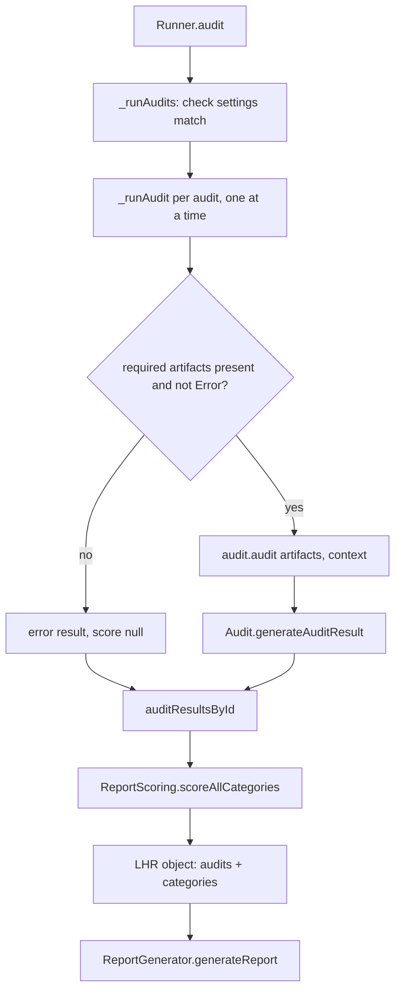

# GoogleChrome/lighthouse — module: audit-scoring-and-runner

## Responsibility

After Chrome has been driven and its data collected (the "artifacts"), this module turns those artifacts into a report. The runner loops over every audit, an audit is one small check that reads some artifacts and returns a result, and the scoring code folds audit results into category scores such as Performance. The default config decides which audits exist and how much each one counts. This is the part that explains why a "page health" number is not just one measurement.

## Key files

| File | Role |
|------|------|
| `core/runner.js` | Runs the gather phase and the audit phase, builds the final result object (the LHR) |
| `core/audits/audit.js` | Base class for every audit; turns an audit's raw output into a normalized result |
| `core/scoring.js` | Weighted average of audit scores into one score per category |
| `core/audits/metrics/largest-contentful-paint.js` | Metric audit for LCP, with score curve |
| `core/audits/metrics/total-blocking-time.js` | Metric audit for TBT, with score curve |
| `core/audits/metrics/cumulative-layout-shift.js` | Metric audit for CLS, with score curve |
| `core/config/default-config.js` | Lists artifacts, audits, groups, and categories with weights |

## How it works

In plain words: the runner checks each audit's needs, runs the audit, and stores the result by id. Then the scoring code averages the results by weight per category.

1. `Runner.audit` returns early if only gather mode was asked for, and throws if the config has no audits (`core/runner.js:51-56 @ 3b399f6`).
2. `_runAudits` compares the settings used while gathering with the settings used now. It ignores a few harmless keys (locale, output, mode) and throws on any other difference (`core/runner.js:321-350 @ 3b399f6`).
3. Audits run one after another in a plain `for` loop, not in parallel, sharing one `settings` and one `computedCache` (`core/runner.js:352-366 @ 3b399f6`).
4. `_runAudit` checks that every artifact in `meta.requiredArtifacts` exists and is not an `Error` (`core/runner.js:395-421 @ 3b399f6`).
5. It hands the audit only the artifacts it declared, then calls `audit.audit(narrowedArtifacts, auditContext)` (`core/runner.js:430-442 @ 3b399f6`).
6. `Audit.generateAuditResult` picks the display mode, normalizes the score, and builds the result record (`core/audits/audit.js:419-488 @ 3b399f6`).
7. `ReportScoring.scoreAllCategories` is called with the config categories and the results (`core/runner.js:104-106 @ 3b399f6`). It sets weight to 0 for not-applicable, informative, and manual audits (`core/scoring.js:59-68 @ 3b399f6`), then takes the weighted mean (`core/scoring.js:22-42 @ 3b399f6`).
8. The runner assembles the LHR (URLs, warnings, audits, categories, timing) (`core/runner.js:118-148 @ 3b399f6`), localizes the messages (`core/runner.js:151 @ 3b399f6`), and generates the HTML, JSON or CSV report (`core/runner.js:162 @ 3b399f6`).

How a metric becomes a score: LCP, TBT and CLS each read a computed metric value, then call `Audit.computeLogNormalScore` with two control points, `p10` and `median` (`core/audits/metrics/largest-contentful-paint.js:83-95 @ 3b399f6`, `core/audits/metrics/total-blocking-time.js:105-119 @ 3b399f6`, `core/audits/metrics/cumulative-layout-shift.js:69-79 @ 3b399f6`). The base class explains the idea: the score is the share of sites that are worse than your value, on a log-normal curve; a value at the median scores 0.5 or more, a value at p10 scores 0.9 or more (`core/audits/audit.js:89-109 @ 3b399f6`). The "good" cut-off is 0.9 (`shared/util.js:13 @ 3b399f6`, read only to see the constant).

The Performance category weights show what counts: FCP 10, LCP 25, TBT 30, CLS 25, Speed Index 10, and INP 0 (`core/config/default-config.js:419-424 @ 3b399f6`). Dozens of diagnostic and insight audits are listed with weight 0, so they appear in the report but do not change the score (`core/config/default-config.js:427-475 @ 3b399f6`).

## Beyond the textbook

### Scores come from real-world data curves, not fixed thresholds

- Textbook version: "LCP under 2.5 s is good, over 4 s is poor", a pass or fail rule.
- What they do: a smooth log-normal curve through two control points taken from percentiles of HTTP Archive data, with separate numbers for mobile and desktop (LCP mobile p10 2500, median 4000; desktop 1200 and 2400).
- Why: comments say the points are percentiles of real sites and link to a curve calculator; TBT's comment even says the raw data points gave "surprisingly harsh scoring", so they chose softer numbers by hand.
- Evidence: `core/audits/metrics/largest-contentful-paint.js:38-64 @ 3b399f6`, `core/audits/metrics/total-blocking-time.js:37-72 @ 3b399f6`, `core/audits/audit.js:89-109 @ 3b399f6`.

### One failing audit never crashes the run

- Textbook version: an exception in a check stops the program.
- What they do: the `try/catch` in `_runAudit` turns any error into an audit result with `score: null` and an error message, logs it, and reports it to Sentry. A missing artifact gets its own error code. A page load error is thrown for every audit so each shows the same cause.
- Why: one broken gatherer should not erase the other 100+ results. Errors from a failed gatherer are marked `expected` so Sentry does not get duplicates (comment in code).
- Evidence: `core/runner.js:392-420 @ 3b399f6`, `core/runner.js:446-458 @ 3b399f6`, `core/audits/audit.js:406-412 @ 3b399f6`.

### A null score is contagious, and zero-weight audits are filtered first

- Textbook version: average all scores.
- What they do: audits with weight 0 are dropped before averaging; if any remaining audit has a null score, the whole category score is null rather than a misleading partial average. Not-applicable, informative and manual audits get weight forced to 0 but stay in the report.
- Why: a category score built from missing data would look trustworthy but not be.
- Evidence: `core/scoring.js:22-42 @ 3b399f6`, `core/scoring.js:59-68 @ 3b399f6`.

### Seven score display modes, not just pass or fail

- Textbook version: an audit passes or fails.
- What they do: modes are numeric, metricSavings, binary, manual, informative, notApplicable, error. Informative audits get score 1; non-scoring modes get null; scored modes must be a number in [0, 1] or an error is thrown; scores round to two decimals. A `metricSavings` audit scores 1 if it passes, 0 if it estimates savings, else 0.5.
- Why: not every check has a yes/no answer, and the report needs to show "could not tell" distinctly.
- Evidence: `core/audits/audit.js:49-58 @ 3b399f6`, `core/audits/audit.js:349-370 @ 3b399f6`, `core/audits/audit.js:442-450 @ 3b399f6`.

### Audits are given only what they declare

- Textbook version: pass the whole data object to every check.
- What they do: the runner copies only `requiredArtifacts` plus internal optional artifacts into a new object. This makes each audit's dependencies explicit and checkable (the missing-artifact check uses the same list).
- Why: comment says it prevents consumers from needing type assertions; it also documents dependencies.
- Evidence: `core/runner.js:430-441 @ 3b399f6`, `core/audits/metrics/total-blocking-time.js:30 @ 3b399f6`.

### Gather and audit can be separate runs, guarded against mismatched settings

- Textbook version: always collect and analyze in one go.
- What they do: `-G` saves artifacts to disk, `-A` loads them with no browser, and `-GA` does both. If settings differ between the phases, the runner throws and names the key that differs.
- Why: lets you re-score saved data offline; a different setting would make the numbers meaningless.
- Evidence: `core/runner.js:206-209 @ 3b399f6`, `core/runner.js:227-231 @ 3b399f6`, `core/runner.js:333-344 @ 3b399f6`, `core/runner.js:555-563 @ 3b399f6`.

### Small output details

- Metric savings are rounded to coarse steps (50 ms, CLS 0.001) so results stay stable between runs (`core/audits/audit.js:11-18 @ 3b399f6`, `core/audits/audit.js:387-392 @ 3b399f6`). Timing values are cut to two decimals and the code comment says this saves about 4 KB (`core/runner.js:288-300 @ 3b399f6`). Falsy fields are omitted from entity data to shrink the JSON (`core/runner.js:196-199 @ 3b399f6`).
- Heading keys in table details are checked, but only under test, to catch typos without costing production time (`core/audits/audit.js:118-131 @ 3b399f6`).
- Accessibility weights are derived from axe-core impact (minor 1, moderate 3, serious 7, critical 10), with experimental rules at 0 (`core/config/default-config.js:483-499 @ 3b399f6`).
- A timespan run with simulated throttling marks TBT not applicable instead of guessing (`core/audits/metrics/total-blocking-time.js:98-103 @ 3b399f6`).

## Tests and what they protect

Not present in this slice. The test files exist at `core/test/runner-test.js`, `core/test/scoring-test.js` and `core/test/audits/audit-test.js` in the clone, but they were not part of the assigned files and were not read, so no claim is made about them.

## Error handling, performance, and security

- Error handling: see the "never crashes" practice above. `createRunnerError` translates the friendly message into the chosen locale and reports to Sentry at level fatal before rethrowing (`core/runner.js:261-267 @ 3b399f6`). The final LHR carries a `runtimeError` taken from the first artifact that has an `lhrRuntimeError` flag, with `PageLoadError` first (`core/runner.js:470-495 @ 3b399f6`).
- Performance: audits run sequentially (`core/runner.js:361-366 @ 3b399f6`), and expensive metric computations are shared through a `computedCache` map passed to every audit (`core/runner.js:353-356 @ 3b399f6`). Timing entries are deduplicated by start, name and duration (`core/runner.js:280-288 @ 3b399f6`).
- Security: the module reads and writes only local paths (`latest-run` or a user-chosen folder). Plugin versions are read with a guarded `require` that ignores failure (`core/runner.js:88-99 @ 3b399f6`).

## Technologies and services seen

- Sentry — error reporting for fatal runner errors and per-audit failures (`core/runner.js:17 @ 3b399f6`, `core/runner.js:452 @ 3b399f6`)
- axe-core — accessibility rules whose results feed accessibility audits; its version is recorded in credits (`core/runner.js:72 @ 3b399f6`, `core/config/default-config.js:483 @ 3b399f6`)
- HTTP Archive (BigQuery) — source of the percentile data behind score curves, named in comments (`core/audits/metrics/largest-contentful-paint.js:41-42 @ 3b399f6`)
- ICU message formatting (`i18n`) — localization of titles and values (`core/runner.js:14 @ 3b399f6`, `core/runner.js:151 @ 3b399f6`)
- Node `fs` and `path` — saving and loading artifacts and listing audits (`core/runner.js:7-8 @ 3b399f6`)
- ReportGenerator — produces HTML, JSON or CSV output (`core/runner.js:18 @ 3b399f6`, `core/runner.js:162 @ 3b399f6`)
- Agent Resource Discovery (ARD) — third-party module whose version is added to credits (`core/runner.js:25 @ 3b399f6`, `core/runner.js:73-76 @ 3b399f6`)

## Worth exploring interactively

- From artifacts to one category score — ordered steps: check required artifacts (`core/runner.js:395-421 @ 3b399f6`); run the audit (`core/runner.js:442 @ 3b399f6`); normalize into a result (`core/audits/audit.js:419-452 @ 3b399f6`); zero the weight of non-scoring modes (`core/scoring.js:64-68 @ 3b399f6`); weighted mean (`core/scoring.js:22-42 @ 3b399f6`) — fits AlgorithmStepper because the learner can change one audit score or weight and watch the category number move, and see null spread.
- Log-normal metric score — steps: raw value from a computed metric (`core/audits/metrics/total-blocking-time.js:105 @ 3b399f6`); pick mobile or desktop control points (`core/audits/metrics/total-blocking-time.js:107 @ 3b399f6`); `computeLogNormalScore` (`core/audits/audit.js:107-109 @ 3b399f6`) — fits AlgorithmStepper because a slider for the value shows the score sliding along the curve through p10 and median.

## Open questions

- The body of `Util.computeLogNormalScore` (in `shared/util.js`) was not read; only its contract from the doc comment is cited.
- How `_runAudit` results for `supportedModes` are filtered by config (for example LCP's `supportedModes: ['navigation']` at `core/audits/metrics/largest-contentful-paint.js:29 @ 3b399f6`) is decided in config code outside this slice.

## My insights
