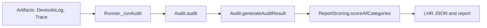

# GoogleChrome/lighthouse — module: audits-and-scoring

## Responsibility

This slice turns raw data that the browser gathered (the DevTools network log and the trace) into a report. The runner calls each audit, the audit base class forces every result into one shape, and the scoring file averages audit scores into category scores such as Performance. Lighthouse is the engine behind the DevTools Lighthouse panel, so this is the code that produces the numbers the panel shows.

## Key files

| File | Role |
|------|------|
| `core/runner.js` | Runs gather and audit phases, wraps each audit in error handling, builds the final result object |
| `core/scoring.js` | Weighted average of audit scores per category |
| `core/audits/audit.js` | Base class: score modes, log-normal scoring, result normalizing |
| `core/audits/network-requests.js` | Informative audit that lists requests from the DevTools log (the Network panel data) |
| `core/audits/byte-efficiency/byte-efficiency-audit.js` | Base class for "you could save N bytes" audits, with simulated time savings |
| `core/audits/byte-efficiency/total-byte-weight.js` | Scores total page weight |
| `core/test/scoring-test.js` | Tests for the mean and the category scoring |

## How it works

In plain words: the runner takes the gathered artifacts, hands each audit only the artifacts it asked for, collects one result per audit, then scores categories and builds one JSON object (the LHR) plus a report.

1. `Runner.audit` returns early when only gathering was requested (`core/runner.js:52 @ 3b399f6`), then calls `_runAudits` (`core/runner.js:57-58 @ 3b399f6`).
2. Before any audit runs, saved gather settings and current audit settings are compared key by key, and a difference throws (`core/runner.js:321-349 @ 3b399f6`).
3. Audits run one after another in a `for` loop, not in parallel (`core/runner.js:358-366 @ 3b399f6`).
4. `_runAudit` checks that every artifact in `meta.requiredArtifacts` exists and is not an Error (`core/runner.js:395-421 @ 3b399f6`), passes the audit only the artifacts it declared (`core/runner.js:430-441 @ 3b399f6`), and calls `audit.audit` (`core/runner.js:442 @ 3b399f6`).
5. `Audit.generateAuditResult` picks the score mode and normalizes the score (`core/audits/audit.js:419-452 @ 3b399f6`).
6. `ReportScoring.scoreAllCategories` sets weight 0 for notApplicable, informative and manual audits (`core/scoring.js:63-68 @ 3b399f6`) and averages the rest (`core/scoring.js:73-77 @ 3b399f6`).
7. The runner builds the result object (`core/runner.js:118-148 @ 3b399f6`), swaps translation placeholders for localized text (`core/runner.js:151 @ 3b399f6`) and generates the report (`core/runner.js:162 @ 3b399f6`).

The scoring mean ignores zero-weight items and returns null if any weighted audit has a null score (`core/scoring.js:24-26 @ 3b399f6`). The result is rounded to two decimals (`core/scoring.js:14 @ 3b399f6`, `core/scoring.js:41 @ 3b399f6`).

## Beyond the textbook

### One failing audit does not fail the run

- Textbook version: an exception in one check stops the whole program.
- What they do: the `catch` in `_runAudit` turns the error into an "error" audit result with a message and stack, and the loop moves on.
- Why: a report with 1 broken audit is still useful; the code also logs and sends the error to Sentry with the audit id as a tag.
- Evidence: `core/runner.js:446-458 @ 3b399f6`, `core/audits/audit.js:406-412 @ 3b399f6`

### A missing or failed gatherer becomes a readable audit error

- Textbook version: read `artifacts.X` and crash on undefined.
- What they do: each audit declares `requiredArtifacts`; the runner throws a typed `LighthouseError` for a missing artifact or one that is an Error, and marks the second kind as `expected` so it is not reported twice.
- Why: the comment says the original error was already sent to Sentry in the gather phase.
- Evidence: `core/runner.js:395-420 @ 3b399f6`

### Scores are shaped by real-world data, not fixed limits

- Textbook version: pass if the value is under a limit.
- What they do: `computeLogNormalScore` maps a value to a score using two control points (p10 and median) from a log-normal curve; the score is the share of sites that are worse. Total byte weight uses p10 of 2667 KiB and median of 4000 KiB, taken from HTTP Archive data per the comment.
- Why: the doc comment explains that value at or below the median scores at least 0.5 and at or below p10 at least 0.9.
- Evidence: `core/audits/audit.js:89-108 @ 3b399f6`, `core/audits/byte-efficiency/total-byte-weight.js:46-53 @ 3b399f6`, `core/audits/byte-efficiency/byte-efficiency-audit.js:17-23 @ 3b399f6`

### Seven score modes, and only some count

- Textbook version: every check is pass or fail and counts equally.
- What they do: modes are numeric, metricSavings, binary, manual, informative, notApplicable and error. Informative, manual and notApplicable audits get weight 0 so they show in the report but do not move the category score. Informative audits are normalized to score 1; error and similar modes get null.
- Why: the comment says a notApplicable audit "will still be included in the final report json" as "Not Applicable".
- Evidence: `core/audits/audit.js:49-58 @ 3b399f6`, `core/audits/audit.js:349-358 @ 3b399f6`, `core/scoring.js:59-68 @ 3b399f6`

### Estimated savings come from re-running a simulation

- Textbook version: "wasted bytes" divided by bandwidth gives saved time.
- What they do: for navigation runs the audit simulates the page load graph (Lantern) before and after reducing each request's transfer size, and the time difference is the saving for FCP and LCP. It rounds savings to the nearest 10 ms, restores the original sizes after, and takes the larger of the graph saving and a per-LCP-record estimate, because the graph "can underestimate" LCP savings.
- Evidence: `core/audits/byte-efficiency/byte-efficiency-audit.js:101-146 @ 3b399f6`, `core/audits/byte-efficiency/byte-efficiency-audit.js:170-203 @ 3b399f6`

### metricSavings mode turns savings into a score

- Textbook version: score a diagnostic by its own number.
- What they do: in metricSavings mode, score 1 if the input score meets the pass threshold, 0 if there are some savings, else 0.5 (unknown). Savings are also quantized and clamped at 0.
- Evidence: `core/audits/audit.js:439-450 @ 3b399f6`, `core/audits/audit.js:376-398 @ 3b399f6`

### Contract checks on audit output

- Textbook version: trust the audit author.
- What they do: a score outside 0 to 1, or non-finite, throws; `numericValue` is only read when `numericUnit` exists; the failure title is used only when the score is below the pass threshold.
- Evidence: `core/audits/audit.js:361-365 @ 3b399f6`, `core/audits/audit.js:454-459 @ 3b399f6`, `core/audits/audit.js:465 @ 3b399f6`

### Smaller output on purpose

- Textbook version: dump everything.
- What they do: timing values are cut to 2 decimals (comment: saves about 4 KB), duplicate timing entries are removed, falsy fields of entities are omitted, and data URIs are shortened in the network list.
- Evidence: `core/runner.js:288-300 @ 3b399f6`, `core/runner.js:196-199 @ 3b399f6`, `core/audits/network-requests.js:70 @ 3b399f6`

### Gather and audit can run apart

- Textbook version: one run does everything.
- What they do: `-G` saves artifacts to disk, `-A` loads them with no browser, `-GA` does both; the default folder is `latest-run`. This lets you re-audit the same recorded page.
- Evidence: `core/runner.js:206-209 @ 3b399f6`, `core/runner.js:227-231 @ 3b399f6`, `core/runner.js:562 @ 3b399f6`

## Tests and what they protect

`core/test/scoring-test.js` covers three things.

- The mean of an empty list is 0 (`core/test/scoring-test.js:13-15 @ 3b399f6`).
- Equal weights give 0.11 for 0.1, 0.2, 0.03 and varying weights give 0.04, which also checks rounding (`core/test/scoring-test.js:17-31 @ 3b399f6`).
- A category with a weight-0 audit scores 0, and notApplicable audits are left out of the mean, giving 0.5 (`core/test/scoring-test.js:49-79 @ 3b399f6`, `core/test/scoring-test.js:81-107 @ 3b399f6`).

No tests for the runner or for the audits in this slice were in the file list, so error paths in `_runAudit` are not covered here.

## Error handling, performance, and security

- Error handling: `createRunnerError` localizes the friendly message and sends the error to Sentry as fatal (`core/runner.js:261-267 @ 3b399f6`). Audit exceptions become error results (see above).
- Performance: computed values such as network records are cached through a shared `computedCache` passed to each audit (`core/runner.js:353-356 @ 3b399f6`). The byte-efficiency audit runs its own work and the load simulator request in parallel (`core/audits/byte-efficiency/byte-efficiency-audit.js:84-87 @ 3b399f6`). Total byte weight keeps only the top 10 by size (`core/audits/byte-efficiency/total-byte-weight.js:81-84 @ 3b399f6`).
- Empty timespan runs with no downloaded bytes return notApplicable, because the simulator needs records (`core/audits/byte-efficiency/byte-efficiency-audit.js:72-80 @ 3b399f6`).
- Security: not a focus of this slice. Data URIs are elided in the network list (`core/audits/network-requests.js:70 @ 3b399f6`).

## Technologies and services seen

- Sentry — error and breadcrumb reporting (`core/runner.js:17 @ 3b399f6`, `core/runner.js:266 @ 3b399f6`)
- axe-core — accessibility engine; its version is added to the credits (`core/runner.js:72 @ 3b399f6`)
- Chrome DevTools protocol network log (`DevtoolsLog`) as input to audits (`core/audits/network-requests.js:23 @ 3b399f6`)
- Lantern simulator — models page load under throttling (`core/audits/byte-efficiency/byte-efficiency-audit.js:10-12 @ 3b399f6`)
- ICU message localization (`core/runner.js:14 @ 3b399f6`, `core/runner.js:151 @ 3b399f6`)
- HTTP Archive data — source of byte-weight control points (`core/audits/byte-efficiency/total-byte-weight.js:50 @ 3b399f6`)
- Node `assert/strict` for tests (`core/test/scoring-test.js:7 @ 3b399f6`)

## Worth exploring interactively

- From artifacts to category score — steps: runner checks settings (`core/runner.js:321-349 @ 3b399f6`); loops over audits (`core/runner.js:361-366 @ 3b399f6`); checks required artifacts (`core/runner.js:395-421 @ 3b399f6`); calls the audit (`core/runner.js:442 @ 3b399f6`); normalizes the result (`core/audits/audit.js:419-452 @ 3b399f6`); zero-weights non-counting modes (`core/scoring.js:63-68 @ 3b399f6`); weighted mean (`core/scoring.js:22-42 @ 3b399f6`) — fits FlowAnimation because the learner sees one audit result move through each function, and a failing audit turn into an error result without stopping the loop.
- Score mode and weight table — steps: an audit returns a product (`core/audits/audit.js:419-437 @ 3b399f6`); mode chosen (error, notApplicable, or declared); score normalized (`core/audits/audit.js:349-369 @ 3b399f6`); weight forced to 0 for some modes (`core/scoring.js:64-67 @ 3b399f6`); category mean changes (`core/scoring.js:77 @ 3b399f6`) — fits StateMachine because each audit result sits in one mode that decides whether it counts.

## Open questions

- How `Util.computeLogNormalScore` computes the curve is outside this slice (called at `core/audits/audit.js:107-108 @ 3b399f6`).
- How the Performance category weights its audits lives in config, not in this slice.
- How the Lighthouse panel in DevTools calls this runner is not shown here.

## My insights
