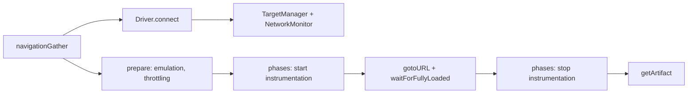

# GoogleChrome/lighthouse — module: cdp-session-and-navigation

## Responsibility

This module is how Lighthouse talks to Chrome. It wraps one DevTools Protocol (CDP) connection in a small class, follows every frame and worker the page creates, records network requests, and runs one page load from start to finish. Everything the audits later read starts here.

## Key files

| File | Role |
|------|------|
| `core/gather/session.js` | `ProtocolSession`: sends one CDP command with a timeout, re-emits events, detects crashes |
| `core/gather/driver.js` | `Driver`: connects once and owns the target manager, network monitor, and fetcher |
| `core/gather/driver/target-manager.js` | Tracks the page, iframes, and workers; merges their events into one stream |
| `core/gather/driver/network-monitor.js` | Turns network events into records and "idle" signals |
| `core/gather/driver/prepare.js` | Sets emulation, throttling, blocked URLs, and storage reset before a run |
| `core/gather/driver/wait-for-condition.js` | Decides when a page is "loaded enough" |
| `core/gather/navigation-runner.js` | The ordered steps of one navigation run |
| `core/gather/runner-helpers.js` | Runs each gatherer through the five phases |

## How it works

Plain words first: Lighthouse opens a CDP session, switches on the event feeds it needs, starts recording, loads the page, waits until the page settles, stops recording, and then asks each gatherer for its data.

1. `navigationGather` normalizes the URL. If no page is given, it connects Puppeteer to `127.0.0.1:9222` and opens a new tab (`core/gather/navigation-runner.js:40-41 @ 3b399f6`, `core/gather/navigation-runner.js:270-285 @ 3b399f6`).
2. `Driver.connect` creates a CDP session from the Puppeteer page, then builds the `TargetManager`, `NetworkMonitor`, execution context, and fetcher (`core/gather/driver.js:79-91 @ 3b399f6`).
3. `TargetManager.enable` turns on the `Page` and `Runtime` domains, reads the main frame id, and attaches to the root target (`core/gather/driver/target-manager.js:248-254 @ 3b399f6`). For each new target it enables `Network` and asks Chrome to auto-attach child targets (`core/gather/driver/target-manager.js:161-167 @ 3b399f6`).
4. `_setup` visits a blank page first, with the network monitor switched off, so that blank-page traffic does not leak into the run (`core/gather/navigation-runner.js:50-59 @ 3b399f6`). Then `prepareTargetForNavigationMode` sets emulation, auto-dismisses dialogs, resets storage, and applies throttling and blocked URLs (`core/gather/driver/prepare.js:198-224 @ 3b399f6`).
5. `_navigation` runs the phases in order: `startInstrumentation`, `startSensitiveInstrumentation`, navigate, `stopSensitiveInstrumentation`, `stopInstrumentation` (`core/gather/navigation-runner.js:206-222 @ 3b399f6`).
6. The navigate step calls `gotoURL` and waits for `load` (and `fcp` if configured) (`core/gather/navigation-runner.js:86-90 @ 3b399f6`). `waitForFullyLoaded` combines four waiters: FCP, load event, network idle, critical network idle, then CPU idle (`core/gather/driver/wait-for-condition.js:433-453 @ 3b399f6`, `core/gather/driver/wait-for-condition.js:474-482 @ 3b399f6`).
7. If the page loaded, `collectPhaseArtifacts` runs `getArtifact` and `awaitArtifacts` gathers results. If not, only the raw log and trace are kept as error artifacts (`core/gather/navigation-runner.js:156-177 @ 3b399f6`).
8. `_cleanup` clears storage, disconnects the driver, and closes the tab only if Lighthouse opened it (`core/gather/navigation-runner.js:237-250 @ 3b399f6`).

## Beyond the textbook

### One command wrapper with three ways to fail

- Textbook version: send a CDP message and await the reply.
- What they do: `sendCommand` races the reply against a Lighthouse timer (default 30 s) and a "target crashed" promise. Puppeteer's own timeout is set 50 ms longer, so Lighthouse's error always arrives first.
- Why: comments say the buffer makes "the Lighthouse timeout finish first"; a crash would otherwise show up as a confusing "Target closed" error.
- Evidence: `core/gather/session.js:12-14 @ 3b399f6`, `core/gather/session.js:126-134 @ 3b399f6`, `core/gather/session.js:54-61 @ 3b399f6`

### A one-shot timeout for the next command

- Textbook version: one fixed timeout for every command.
- What they do: `setNextProtocolTimeout` applies to only the next command, then resets. Debug mode uses `Infinity` to wait for a person; `isPageHung` uses 1000 ms for a ping. Values above about 25 days are capped to fit a 32-bit timer.
- Why: some commands are legitimately slow or must fail fast.
- Evidence: `core/gather/session.js:97-113 @ 3b399f6`, `core/gather/driver/wait-for-condition.js:381-387 @ 3b399f6`, `core/gather/driver/wait-for-condition.js:575 @ 3b399f6`

### Following iframes and workers with recursive auto-attach

- Textbook version: listen to the one page session.
- What they do: attach to every `page`, `iframe`, and `worker` target, deduplicate by target id, and tag each event with the target type and session id before re-emitting. After a main-frame navigation they call `Target.setAutoAttach` again because the page can change process. Targets start paused (`waitForDebuggerOnStart`) and are resumed in a `finally` block.
- Why: network requests from iframes must be counted, and a paused target would block the page.
- Evidence: `core/gather/driver/target-manager.js:100-104 @ 3b399f6`, `core/gather/driver/target-manager.js:137-139 @ 3b399f6`, `core/gather/driver/target-manager.js:223-228 @ 3b399f6`, `core/gather/driver/target-manager.js:68-76 @ 3b399f6`, `core/gather/driver/target-manager.js:184-187 @ 3b399f6`

### Three definitions of "network idle"

- Textbook version: wait until there are no requests.
- What they do: the monitor emits fully idle (0 in flight), semi idle (2 or fewer), and "critical idle". Critical idle counts only root-frame requests with High or VeryHigh priority and ignores WebSocket and EventSource, which stay open.
- Why: pages with analytics pixels or long-lived sockets would never become idle.
- Evidence: `core/gather/driver/network-monitor.js:147-161 @ 3b399f6`, `core/gather/driver/network-monitor.js:197-204 @ 3b399f6`

### Last-resort timeout, then a hang check

- Textbook version: `await load`.
- What they do: the race has three winners: normal load, a maximum wait, or an abort signal. On timeout it sends a `"ping"` evaluate; if that fails, it disables scripts, terminates execution, and throws `PAGE_HUNG`. If the page is only slow, it logs the still-pending URLs and returns `timedOut: true`.
- Why: a run must end, and the error should say whether the page hung or was just slow.
- Evidence: `core/gather/driver/wait-for-condition.js:497-527 @ 3b399f6`, `core/gather/driver/wait-for-condition.js:539-543 @ 3b399f6`

### Page load errors keep the evidence

- Textbook version: throw on a failed load and stop.
- What they do: `NO_FCP`, `PAGE_HUNG`, and `TARGET_CRASHED` become a `navigationError` value instead of an exception. The run then keeps the devtools log and trace as `DevtoolsLogError` and `TraceError`, adds a warning, and skips the normal gatherers.
- Why: someone can still debug the failure from the saved trace.
- Evidence: `core/gather/navigation-runner.js:95-108 @ 3b399f6`, `core/gather/navigation-runner.js:156-173 @ 3b399f6`

### Controlled starting state

- Textbook version: just load the URL.
- What they do: clear storage and caches and warn if leftover data could affect scores, dismiss JavaScript dialogs, cache native APIs before the page can overwrite them, warm up `Intl.Segmenter` so V8 caches it before tracing, and re-enable the debugger's skip-pauses after each navigation because Chrome resets it.
- Why: repeatable scores. Comments cite the reasons.
- Evidence: `core/gather/driver/prepare.js:94-108 @ 3b399f6`, `core/gather/driver/prepare.js:72-85 @ 3b399f6`, `core/gather/driver/prepare.js:168-178 @ 3b399f6`, `core/gather/driver/prepare.js:31-39 @ 3b399f6`

### One failing gatherer does not stop the run

- Textbook version: let the first error abort everything.
- What they do: each gatherer's error is reported to Sentry and logged, and the promise is stored. `awaitArtifacts` turns a rejected promise into an `Error` value in that artifact slot. A dependent gatherer gets a "Dependency failed" error.
- Why: other audits can still run on the data that did arrive.
- Evidence: `core/gather/runner-helpers.js:122-129 @ 3b399f6`, `core/gather/runner-helpers.js:170-173 @ 3b399f6`, `core/gather/runner-helpers.js:145-147 @ 3b399f6`

## Tests and what they protect

- `session-test.js` protects the timeout rules with fake timers: default timeout, an explicit longer one, `Infinity`, and protocol errors passing through. It also checks that Puppeteer receives `timeout: 30050` (30 000 plus the 50 ms buffer) (`core/test/gather/session-test.js:134-173 @ 3b399f6`, `core/test/gather/session-test.js:175-192 @ 3b399f6`).
- It also covers the one-shot timeout, including an "extremely large" value (`core/test/gather/session-test.js:201-241 @ 3b399f6`) and that `dispose` detaches (`core/test/gather/session-test.js:104-105 @ 3b399f6`).
- `driver-test.js` checks that using the driver before `connect` fails, that `connect` builds the execution context and fetcher, and that `disconnect` before connect does nothing (`core/test/gather/driver-test.js:47-52 @ 3b399f6`, `core/test/gather/driver-test.js:80-95 @ 3b399f6`, `core/test/gather/driver-test.js:97-102 @ 3b399f6`).
- Not in this slice: tests for `target-manager`, `network-monitor`, `wait-for-condition`, and `navigation-runner` (the file list had only these two).

## Error handling, performance, and security

- Before `connect`, every driver property is a function that throws "Session not connected" (`core/gather/driver.js:13-31 @ 3b399f6`).
- Closed or unsupported targets are ignored; worker attach failures only warn; other errors rethrow (`core/gather/driver/target-manager.js:169-181 @ 3b399f6`).
- Disable steps ignore failures because the tab may have crashed (`core/gather/driver/target-manager.js:272-274 @ 3b399f6`, `core/gather/session.js:160 @ 3b399f6`).
- A crash disposes the session without awaiting, to avoid cascading "Target closed" errors (`core/gather/session.js:54-60 @ 3b399f6`).
- Event handlers are removed in `disable` and `dispose`, avoiding leaks (`core/gather/driver/target-manager.js:261-270 @ 3b399f6`, `core/gather/session.js:159 @ 3b399f6`).
- Performance: async call stacks (depth 8) are enabled so network initiators can be attributed, which the code says matters for simulation accuracy (`core/gather/driver/prepare.js:12-22 @ 3b399f6`). Frame-navigation listeners are removed before the run ends because bf-cache events could otherwise send commands to a closed target (`core/gather/navigation-runner.js:224-227 @ 3b399f6`).
- Security: not a focus in this slice. Note that extra HTTP headers and blocked URL patterns come from settings (`core/gather/driver/prepare.js:127-131 @ 3b399f6`).

## Technologies and services seen

- Chrome DevTools Protocol — the wire protocol; commands like `Network.enable`, `Target.setAutoAttach` (`core/gather/driver/target-manager.js:161-167 @ 3b399f6`)
- Puppeteer (`puppeteer-core`) — supplies the browser connection and CDP session (`core/gather/navigation-runner.js:7 @ 3b399f6`, `core/gather/navigation-runner.js:282 @ 3b399f6`)
- Node `EventEmitter` — base of session, target manager, network monitor (`core/gather/session.js:7 @ 3b399f6`)
- Sentry — error reporting for failing gatherers (`core/gather/runner-helpers.js:27 @ 3b399f6`, `core/gather/runner-helpers.js:123 @ 3b399f6`)
- Jest-style test runner with fake timers (`core/test/gather/session-test.js:143 @ 3b399f6`)

## Worth exploring interactively

- Page load wait — ordered steps: network monitor receives events (`core/gather/driver/network-monitor.js:197-204 @ 3b399f6`); FCP, load, network idle, critical idle resolve (`core/gather/driver/wait-for-condition.js:433-452 @ 3b399f6`); CPU idle waiter starts (`core/gather/driver/wait-for-condition.js:480 @ 3b399f6`); race against max timeout and abort (`core/gather/driver/wait-for-condition.js:539-543 @ 3b399f6`); on timeout, hang check (`core/gather/driver/wait-for-condition.js:505-511 @ 3b399f6`) — fits StateMachine because the learner sees the run move from waiting to loaded, timed out, or hung.
- One navigation run — connect (`core/gather/driver.js:79-91 @ 3b399f6`), blank page (`core/gather/navigation-runner.js:56 @ 3b399f6`), prepare (`core/gather/navigation-runner.js:64 @ 3b399f6`), five phases (`core/gather/navigation-runner.js:206-222 @ 3b399f6`), artifacts (`core/gather/navigation-runner.js:175-177 @ 3b399f6`), cleanup (`core/gather/navigation-runner.js:302 @ 3b399f6`) — fits FlowAnimation because one request moves through these functions.

## Open questions

- How `gotoURL` (`core/gather/driver/navigation.js`) sends `Page.navigate` is outside this slice.
- Which gatherers start the trace in `startSensitiveInstrumentation` is for the gatherers module.

## My insights
