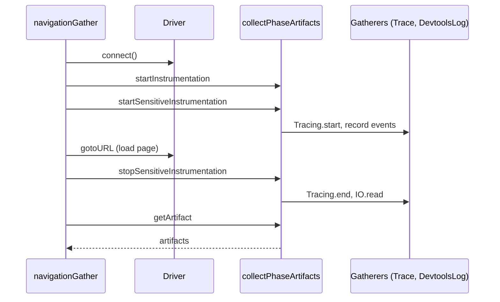

# GoogleChrome/lighthouse — module: gather-pipeline

## Responsibility

This module loads a page in Chrome and records raw evidence. It records two things: a **trace** (what the Performance panel shows) and a **devtools log** (the Network panel's event stream). It does not score anything. It hands the raw records to later code that computes metrics and audits.

## Key files

| File | Role |
|------|------|
| `core/gather/navigation-runner.js` | Runs one navigation: setup, start recording, load the page, stop, collect |
| `core/gather/driver.js` | Connects to the page and holds the session, network monitor and helpers |
| `core/gather/session.js` | Wraps one Chrome DevTools Protocol (CDP) connection with timeouts and crash detection |
| `core/gather/base-gatherer.js` | The five-phase interface every gatherer implements |
| `core/gather/runner-helpers.js` | Runs each phase for each gatherer and handles dependencies and errors |
| `core/gather/gatherers/trace.js` | Starts and stops the Chrome trace and reads it back |
| `core/gather/gatherers/devtools-log.js` | Records filtered protocol events |
| `core/lib/network-recorder.js` | Rebuilds network request records from the devtools log |
| `core/test/gather/gatherers/trace-test.js` | Unit tests of the trace gatherer |

## How it works

In plain words: Lighthouse connects to Chrome, tells every gatherer to start recording, opens the page, tells every gatherer to stop, then asks each one for its result. The trace gatherer and the devtools-log gatherer are the two that feed the Performance and Network views.

1. `navigationGather` reads the config, makes a Driver, and wraps the work in `Runner.gather` (`core/gather/navigation-runner.js:259-306 @ 3b399f6`). If no page is given, it connects to Chrome on `127.0.0.1:9222` with puppeteer and opens a new tab (`core/gather/navigation-runner.js:40-41 @ 3b399f6`, `core/gather/navigation-runner.js:280-285 @ 3b399f6`).
2. `Driver.connect` creates a CDP session, a target manager and a network monitor, and keeps the root session as `defaultSession` (`core/gather/driver.js:79-92 @ 3b399f6`). Before connect, `defaultSession` is a stub that throws "Session not connected" (`core/gather/driver.js:14-31 @ 3b399f6`).
3. `_setup` loads a blank page first, with the network monitor switched off so blank-page requests are not counted (`core/gather/navigation-runner.js:50-59 @ 3b399f6`). Then it prepares the target for navigation mode (`core/gather/navigation-runner.js:63-64 @ 3b399f6`).
4. `_navigation` runs the phases in a fixed order: `startInstrumentation`, `startSensitiveInstrumentation`, navigate, `stopSensitiveInstrumentation`, `stopInstrumentation` (`core/gather/navigation-runner.js:206-222 @ 3b399f6`).
5. The trace gatherer calls `Tracing.start` with a category list and `ReturnAsStream` (`core/gather/gatherers/trace.js:151-159 @ 3b399f6`). The devtools-log gatherer subscribes to protocol events (`core/gather/gatherers/devtools-log.js:36-41 @ 3b399f6`).
6. At stop, the trace gatherer sends `Tracing.end`, waits for `Tracing.tracingComplete`, and reads the stream with `IO.read` until `eof` (`core/gather/gatherers/trace.js:123-137 @ 3b399f6`, `core/gather/gatherers/trace.js:79-90 @ 3b399f6`).
7. `_computeNavigationResult` checks for a page-load error. If none, it runs the `getArtifact` phase and awaits all results (`core/gather/navigation-runner.js:175-177 @ 3b399f6`).
8. Later, `NetworkRecorder.recordsFromLogs` replays the devtools log into network records (`core/lib/network-recorder.js:309-315 @ 3b399f6`).

## Beyond the textbook

### Five phases, with a "sensitive" pair

- Textbook version: start recording, load the page, stop recording.
- What they do: gatherers have five hooks. Two are "sensitive" and run as close to the page load as possible (`core/gather/base-gatherer.js:27-42 @ 3b399f6`). The runner calls the sensitive pair last before and first after navigation (`core/gather/navigation-runner.js:206-222 @ 3b399f6`).
- Why: the comment says sensitive measurements "should observe as little Lighthouse-induced work as possible" (`core/gather/base-gatherer.js:28-30 @ 3b399f6`). Setup cost stays outside the measured window.
- Evidence: `core/gather/runner-helpers.js:54-61 @ 3b399f6` ties each phase to the one before it, so a gatherer's stop only runs after its own start.

### A trace with a hand-picked category list

- Textbook version: record everything in the Performance panel.
- What they do: start with `-*` to drop defaults and then add only needed categories (`core/gather/gatherers/trace.js:22-24 @ 3b399f6`). Comments explain each one, for example `loading` for layout shift and `blink.user_timing` for marks (`core/gather/gatherers/trace.js:28-39 @ 3b399f6`). Users can add more through `additionalTraceCategories` (`core/gather/gatherers/trace.js:152-153 @ 3b399f6`).
- Why: "we'll be selective to minimize trace size" (`core/gather/gatherers/trace.js:22 @ 3b399f6`). Some categories are kept only so the trace opens in the DevTools Performance panel (`core/gather/gatherers/trace.js:54-57 @ 3b399f6`).
- Evidence: the sampling frequency is set to 10000 because "1000 is default and too slow" (`core/gather/gatherers/trace.js:158 @ 3b399f6`).

### Streaming the trace out in pieces

- Textbook version: ask Chrome for the whole trace in one message.
- What they do: `transferMode: 'ReturnAsStream'` returns a handle. The code reads it chunk by chunk with `IO.read`, parses complete events as soon as it sees a `},\n` separator, and keeps the unfinished tail (`core/gather/gatherers/trace.js:86-105 @ 3b399f6`). `IO.close` is in a `finally`, so the handle is released even on error (`core/gather/gatherers/trace.js:107-109 @ 3b399f6`).
- Why: traces are large. Parsing in batches avoids one giant string parse. The comment notes the format Perfetto emits (`core/gather/gatherers/trace.js:94-97 @ 3b399f6`).
- Evidence: a decoder in `stream` mode handles multi-byte characters that split across chunks (`core/gather/gatherers/trace.js:90-92 @ 3b399f6`).

### Two timeouts that race, and a crash promise

- Textbook version: send a command and await the reply.
- What they do: each `sendCommand` races the real reply, a Lighthouse timer (default 30 seconds) and a "target crashed" promise (`core/gather/session.js:111-139 @ 3b399f6`, `core/gather/session.js:13 @ 3b399f6`). Puppeteer's own timeout is 50 ms longer, so Lighthouse's error message wins (`core/gather/session.js:127-128 @ 3b399f6`).
- Why: a hung tab must not hang the run. A crashed tab rejects with `TARGET_CRASHED` (`core/gather/session.js:54-60 @ 3b399f6`).
- Evidence: the timeout is capped below the 32-bit limit of `setTimeout` (`core/gather/session.js:17-24 @ 3b399f6`, `core/gather/session.js:101 @ 3b399f6`).

### Network records rebuilt from a log, not captured live

- Textbook version: read request data from the network panel as it happens.
- What they do: the devtools log keeps only events whose method starts with `Page.`, `Network.`, `Target.` or `Runtime.` (`core/gather/gatherers/devtools-log.js:27 @ 3b399f6`). Later, `NetworkRecorder` replays those messages (`core/lib/network-recorder.js:312 @ 3b399f6`). This lets a saved log be re-analysed offline. The class comment says the log can "recreate the network records" (`core/gather/gatherers/devtools-log.js:9-10 @ 3b399f6`).
- Why: the log is a plain array, so it can be saved, replayed and tested.
- Evidence: `core/lib/network-recorder.js:205-217 @ 3b399f6` is a `switch` over Network event names.

### Redirects and the "who started this request" puzzle

- Textbook version: one request per URL.
- What they do: Chrome reuses the same `requestId` across a redirect. The recorder creates a new record named `<id>:redirect` and links source and destination (`core/lib/network-recorder.js:94-109 @ 3b399f6`). Later events are routed to the last destination (`core/lib/network-recorder.js:234-236 @ 3b399f6`). The new request starts before the old one finishes "so we don't get erroneous quiet periods" (`core/lib/network-recorder.js:111-113 @ 3b399f6`).
- Why: network-idle detection must not fire in the gap between two hops.
- Evidence: `_chooseInitiatorRequest` narrows candidates in steps (timing, prefetch, frame, parser, preload) and returns one only if the answer is unambiguous (`core/lib/network-recorder.js:259-301 @ 3b399f6`).

### Errors keep the evidence

- Textbook version: throw and stop on a failed load.
- What they do: on `NO_FCP`, `PAGE_HUNG` or `TARGET_CRASHED` the error is returned and not thrown (`core/gather/navigation-runner.js:95-108 @ 3b399f6`). The trace and log are saved as `TraceError` and `DevtoolsLogError` (`core/gather/navigation-runner.js:163-168 @ 3b399f6`).
- Why: you can still open the failed run's trace. Each gatherer failure is also captured, not fatal: one failing gatherer is logged and the next still runs (`core/gather/runner-helpers.js:122-128 @ 3b399f6`).
- Evidence: dependency failures get a wrapped error marked `expected` so they are not reported twice (`core/gather/runner-helpers.js:34-38 @ 3b399f6`).

## Tests and what they protect

The trace gatherer test uses a mock driver and fake timers (`core/test/gather/gatherers/trace-test.js:11-21 @ 3b399f6`). It protects these behaviours:

- `Tracing.start` uses `ReturnAsStream` (`core/test/gather/gatherers/trace-test.js:30-38 @ 3b399f6`).
- Extra categories are appended and the originals kept (`core/test/gather/gatherers/trace-test.js:40-52 @ 3b399f6`).
- Timespan mode adds a clock sync marker (`core/test/gather/gatherers/trace-test.js:54-63 @ 3b399f6`).
- Reading a stream joins a plain chunk and a base64 chunk, and closes the handle (`core/test/gather/gatherers/trace-test.js:67-92 @ 3b399f6`).
- Chunks that split an event in half, with brackets inside a string, still parse (`core/test/gather/gatherers/trace-test.js:94-118 @ 3b399f6`).

No tests for the network recorder or the navigation runner are in this slice.

## Error handling, performance, and security

- Error: protocol errors are converted to `LighthouseError` with the method name (`core/gather/session.js:129-132 @ 3b399f6`). Detach failures are logged only (`core/gather/session.js:160 @ 3b399f6`).
- Error reporting: gatherer failures go to Sentry with gatherer and phase tags (`core/gather/runner-helpers.js:122-126 @ 3b399f6`).
- Performance: the trace category filter and the streamed read keep memory and size down (see above).
- Cleanup: throttling is cleared after navigation, and `disableAsyncStacks` runs before the end because bf-cache events can send commands after the target closes (`core/gather/navigation-runner.js:224-229 @ 3b399f6`). Storage for the origin is cleared unless disabled (`core/gather/navigation-runner.js:238-244 @ 3b399f6`).
- Security: Not present in this slice.

## Technologies and services seen

- puppeteer-core — connects to Chrome over the remote debugging port (`core/gather/navigation-runner.js:7 @ 3b399f6`, `core/gather/navigation-runner.js:282 @ 3b399f6`).
- Chrome DevTools Protocol — the commands `Tracing.start`, `Tracing.end`, `IO.read`, `IO.close`, `Page.enable` (`core/gather/gatherers/trace.js:154-155 @ 3b399f6`, `core/gather/gatherers/trace.js:88 @ 3b399f6`).
- Perfetto trace JSON — the format the trace reader parses (`core/gather/gatherers/trace.js:94-97 @ 3b399f6`).
- Sentry — captures gatherer errors (`core/gather/runner-helpers.js:27 @ 3b399f6`, `core/gather/runner-helpers.js:123 @ 3b399f6`).
- Node `events` EventEmitter — base of the session and network recorder (`core/gather/session.js:7 @ 3b399f6`, `core/lib/network-recorder.js:7 @ 3b399f6`).
- Mocha-style `describe/it` with a mock driver — the trace test (`core/test/gather/gatherers/trace-test.js:11 @ 3b399f6`).
- Lantern (in-repo) — used to read initiators for requests (`core/lib/network-recorder.js:256 @ 3b399f6`).

## Worth exploring interactively

- Navigation phases — steps: connect (`core/gather/driver.js:79-92 @ 3b399f6`), blank page (`core/gather/navigation-runner.js:56 @ 3b399f6`), start instrumentation (`core/gather/navigation-runner.js:206-207 @ 3b399f6`), navigate (`core/gather/navigation-runner.js:208 @ 3b399f6`), stop (`core/gather/navigation-runner.js:221-222 @ 3b399f6`), getArtifact (`core/gather/navigation-runner.js:175 @ 3b399f6`) — fits StateMachine because the learner sees the run move through fixed states, and an error jumps to the "keep evidence" branch (`core/gather/navigation-runner.js:156-173 @ 3b399f6`).
- Devtools log to network records — steps: a protocol message is filtered in (`core/gather/gatherers/devtools-log.js:108-117 @ 3b399f6`), replayed by `dispatch` (`core/lib/network-recorder.js:205-217 @ 3b399f6`), a redirect splits into two records (`core/lib/network-recorder.js:94-109 @ 3b399f6`), initiators are chosen (`core/lib/network-recorder.js:326-330 @ 3b399f6`) — fits FlowAnimation because the learner sees raw events become the rows of the Network panel.

## Open questions

- `driver/prepare.js`, `driver/navigation.js` and `driver/network-monitor.js` are outside this slice, so how "load" and "network idle" are decided is not shown here.
- Where the trace reaches the metric code (LCP, TBT) belongs to the metrics-and-trace module.

## My insights
