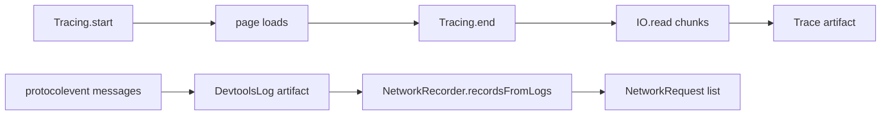

# GoogleChrome/lighthouse — module: gatherers-and-artifacts

## Responsibility

A gatherer is a small object that watches Chrome during a page load and hands back one piece of raw data, called an artifact. This slice holds the gatherer base class, the two most important gatherers (the performance trace and the network protocol log), the code that turns a protocol log into a list of network requests, and the code that adds run-wide facts (browser version, warnings) to the artifacts. Audits never talk to Chrome; they only read these artifacts.

## Key files

| File | Role |
|------|------|
| `core/gather/base-gatherer.js` | Base class with the lifecycle hooks every gatherer overrides |
| `core/gather/gatherers/trace.js` | Starts and stops Chrome tracing and reads the trace back as a stream |
| `core/gather/gatherers/devtools-log.js` | Records raw DevTools Protocol messages (Page, Network, Target, Runtime) |
| `core/lib/network-recorder.js` | Replays a protocol log into `NetworkRequest` records |
| `core/gather/gatherers/main-document-content.js` | Example of a gatherer that depends on another gatherer's artifact |
| `core/gather/base-artifacts.js` | Builds the "base" artifacts and finalizes the full artifact set |
| `core/test/gather/gatherers/trace-test.js`, `devtools-log-test.js` | Unit tests with a mocked protocol session |

## How it works



1. Every gatherer extends `BaseGatherer`, which declares empty hooks: `startInstrumentation`, `startSensitiveInstrumentation`, `stopSensitiveInstrumentation`, `stopInstrumentation` and `getArtifact` (`core/gather/base-gatherer.js:25-56 @ 3b399f6`). Its default `meta` lists no supported modes (`core/gather/base-gatherer.js:18 @ 3b399f6`).
2. The Trace gatherer declares it works in `timespan` and `navigation` modes (`core/gather/gatherers/trace.js:143-146 @ 3b399f6`). To start, it enables the Page domain and sends `Tracing.start` with the category list joined by commas and `transferMode: 'ReturnAsStream'` (`core/gather/gatherers/trace.js:151-159 @ 3b399f6`).
3. In timespan mode it also records a clock sync marker, so the trace processor can find where the timespan began (`core/gather/gatherers/trace.js:161-164 @ 3b399f6`).
4. To stop, `endTraceAndCollectEvents` waits for the `Tracing.tracingComplete` event while sending `Tracing.end` (`core/gather/gatherers/trace.js:125-131 @ 3b399f6`). The event carries a stream handle; a missing handle throws an error (`core/gather/gatherers/trace.js:133-135 @ 3b399f6`).
5. `_readTraceFromStream` calls `IO.read` in a loop until `eof`, decoding base64 when needed (`core/gather/gatherers/trace.js:87-93 @ 3b399f6`). It always sends `IO.close` in a `finally` block (`core/gather/gatherers/trace.js:107-109 @ 3b399f6`).
6. The DevtoolsLog gatherer subscribes to every raw protocol event from the target manager, and stores only messages whose method starts with `Page.`, `Network.`, `Target.` or `Runtime.` (`core/gather/gatherers/devtools-log.js:27 @ 3b399f6`, `core/gather/gatherers/devtools-log.js:40 @ 3b399f6`).
7. Later, `NetworkRecorder.recordsFromLogs` creates a recorder and replays each logged message through `dispatch` (`core/lib/network-recorder.js:309-312 @ 3b399f6`). `dispatch` is a switch on the CDP method name (`core/lib/network-recorder.js:205-216 @ 3b399f6`).
8. After replay, invalid records are dropped, an initiator is chosen for each record, and redirect chains are attached to the final record (`core/lib/network-recorder.js:315-346 @ 3b399f6`).
9. At the end of a run, `finalizeArtifacts` merges base artifacts with gatherer artifacts, de-duplicates warnings, and attaches timing entries (`core/gather/base-artifacts.js:75-89 @ 3b399f6`).

## Beyond the textbook

### Record raw protocol messages, rebuild requests later

- Textbook version: keep a list of requests as the `Network.*` events arrive, and read the list at the end.
- What they do: the gatherer stores the raw messages untouched. A separate function rebuilds the request list afterwards from that log.
- Why: the file header says the log "can be used to recreate the network records" (`core/gather/gatherers/devtools-log.js:9-10 @ 3b399f6`). A saved log can be replayed offline, so audits can be re-run or debugged without a browser. `getDebugData` also returns the messages so they can be saved (`core/gather/gatherers/devtools-log.js:55-57 @ 3b399f6`).
- Evidence: `core/lib/network-recorder.js:309-312 @ 3b399f6`

### Only record what you need, and only while recording

- Textbook version: record everything the browser sends.
- What they do: a regex filter keeps four method families, an on/off flag gates recording, and messages whose method is not a string (internal puppeteer symbols) are skipped.
- Why: the code comments say so ("We're not recording, skip the rest of the checks", "likely an internal puppeteer method that uses Symbols"). The tests protect each rule by name.
- Evidence: `core/gather/gatherers/devtools-log.js:108-117 @ 3b399f6`

### A trace with a hand-picked category list

- Textbook version: start tracing with the default categories.
- What they do: the first entry `-*` excludes all defaults, then each needed category is added with a comment on why.
- Why: "We'll be selective to minimize trace size". Comments tie `loading` to the CLS metric, `blink.user_timing` to UserTiming marks, and screenshots to the filmstrip. Some categories are kept only so a Lighthouse trace opens in the DevTools Performance panel. Users can add more through `settings.additionalTraceCategories`.
- Evidence: `core/gather/gatherers/trace.js:20-23 @ 3b399f6`, `core/gather/gatherers/trace.js:54-57 @ 3b399f6`, `core/gather/gatherers/trace.js:152-153 @ 3b399f6`

### Stream the trace and parse it incrementally

- Textbook version: ask Chrome for the whole trace in one message and call `JSON.parse`.
- What they do: Chrome writes the trace to a stream, and Lighthouse reads it chunk by chunk. After each chunk it looks for the last event separator, parses the complete events so far, and keeps the unfinished tail.
- Why: the comment explains that Perfetto's `ExportJson` writes each event as one line and puts `,\n` only between top-level events, so the separator is a safe split point. Traces can be large, so this avoids one giant string.
- Evidence: `core/gather/gatherers/trace.js:94-105 @ 3b399f6`

```js
const lastEventSep = remainder.lastIndexOf('},\n');
if (lastEventSep !== -1) {
  const {traceEvents: batch} = JSON.parse(`${remainder.slice(0, lastEventSep + 1)}]}`);
```

`core/gather/gatherers/trace.js:98-100 @ 3b399f6`

### Sensitive instrumentation hooks

- Textbook version: one "start" and one "stop" hook.
- What they do: two pairs. The "sensitive" pair is for measurements that must see as little Lighthouse-made work as possible. Trace and DevtoolsLog use it; they start tracing late and stop it first.
- Why: the doc comments say the sensitive hooks are for measurements that "should observe as little Lighthouse-induced work as possible".
- Evidence: `core/gather/base-gatherer.js:27-42 @ 3b399f6`

### Sampling frequency tuning

- Textbook version: use Chrome defaults.
- What they do: pass `sampling-frequency=10000` to tracing.
- Why: the inline comment says the default of 1000 "is default and too slow".
- Evidence: `core/gather/gatherers/trace.js:158 @ 3b399f6`

### Redirects share one request id, so the recorder re-links them

- Textbook version: look up a request by `requestId` and update it.
- What they do: a redirect fires another `requestWillBeSent` with the same id. The recorder renames the new request `<id>:redirect`, links `redirectSource` and `redirectDestination`, and `_findRealRequestAndSetSession` always follows the chain to the newest destination.
- Why: the comment says that after a redirect "all future messages referencing that requestId are about the new destination". The new request starts before the old one finishes "so we don't get erroneous quiet periods".
- Evidence: `core/lib/network-recorder.js:94-113 @ 3b399f6`, `core/lib/network-recorder.js:219-242 @ 3b399f6`

### Guess which request started which, and refuse to guess when unsure

- Textbook version: trust the initiator URL in the event.
- What they do: `_chooseInitiatorRequest` filters candidates with the same URL: the initiator must finish its headers before the new request starts, and cannot be a failed one. It then narrows by prefetch, by frame, by parser type, and by link-preload. It returns an initiator only if exactly one candidate remains.
- Why: the comment says "Only return an initiator if the result is unambiguous." A wrong dependency edge would distort later load-time simulation.
- Evidence: `core/lib/network-recorder.js:250-302 @ 3b399f6`

### Gatherers depend on each other through symbols

- Textbook version: one gatherer reads another's output through shared global state.
- What they do: MainDocumentContent lists `DevtoolsLog` under `dependencies` using the symbol `DevtoolsLog.symbol`, and receives the log in `context.dependencies`.
- Why: Lighthouse can order gatherers and pass data without gatherers importing a shared variable. Each symbol is created with `Symbol('...')` so names cannot collide.
- Evidence: `core/gather/gatherers/main-document-content.js:16-20 @ 3b399f6`, `core/gather/gatherers/main-document-content.js:27 @ 3b399f6`, `core/gather/gatherers/devtools-log.js:16 @ 3b399f6`

### Fail loudly on an incomplete artifact set

- Textbook version: return whatever was collected.
- What they do: `finalizeArtifacts` throws if `finalDisplayedUrl` is empty, and on a page load error falls back to the requested URL.
- Why: the thrown message is "Runner did not set finalDisplayedUrl", which catches a runner bug early.
- Evidence: `core/gather/base-artifacts.js:87-92 @ 3b399f6`

## Tests and what they protect

- Trace tests mock the CDP session, then check that `Tracing.start` uses `ReturnAsStream` (`core/test/gather/gatherers/trace-test.js:30-38 @ 3b399f6`), that extra categories are appended to the defaults (`core/test/gather/gatherers/trace-test.js:40-52 @ 3b399f6`), and that timespan mode records a clock sync marker (`core/test/gather/gatherers/trace-test.js:54-63 @ 3b399f6`).
- The stream tests feed chunks split mid-event and mix plain and base64 data. One chunk splits the name `second [with] brackets` and the test proves brackets inside strings do not confuse the parser. They also check `IO.close` is called (`core/test/gather/gatherers/trace-test.js:67-92 @ 3b399f6`, `core/test/gather/gatherers/trace-test.js:94-118 @ 3b399f6`).
- The tests use fake timers so no real waiting happens (`core/test/gather/gatherers/trace-test.js:12-13 @ 3b399f6`).
- DevtoolsMessageLog tests cover: records only while recording, skips non-matching methods, ignores Symbol methods, records everything with no filter, and resets cleanly (`core/test/gather/gatherers/devtools-log-test.js:23-72 @ 3b399f6`).
- Not tested in this slice: network-recorder.js and base-artifacts.js have no test file in the slice.

## Error handling, performance, and security

- Missing stream handle throws a clear error (`core/gather/gatherers/trace.js:133-135 @ 3b399f6`). If `Tracing.end` fails, the listener is removed and the promise rejects, so nothing leaks (`core/gather/gatherers/trace.js:127-130 @ 3b399f6`).
- Performance: category filtering and incremental parsing keep trace memory and size down (`core/gather/gatherers/trace.js:22 @ 3b399f6`, `core/gather/gatherers/trace.js:98-105 @ 3b399f6`).
- Records marked invalid are ignored for later events (`core/lib/network-recorder.js:232 @ 3b399f6`). Unknown protocol methods fall through the switch and are ignored (`core/lib/network-recorder.js:215 @ 3b399f6`).
- Observability: the recorder logs each step at verbose level (`core/lib/network-recorder.js:85 @ 3b399f6`). A TODO notes an unhandled case should report to Sentry (`core/lib/network-recorder.js:89 @ 3b399f6`). Browser name and version are set as Sentry context (`core/gather/base-artifacts.js:26-29 @ 3b399f6`).
- Security: not present in this slice.

## Technologies and services seen

- Chrome DevTools Protocol commands `Tracing.start`, `Tracing.end`, `IO.read`, `IO.close`, `Page.enable` — the transport for all raw data (`core/gather/gatherers/trace.js:154-159 @ 3b399f6`)
- Perfetto trace format via `ExportJson` — the trace stream shape the parser relies on (`core/gather/gatherers/trace.js:94-97 @ 3b399f6`)
- Node `events` `EventEmitter` — NetworkRecorder emits `requeststarted` and `requestfinished` (`core/lib/network-recorder.js:7 @ 3b399f6`)
- Sentry — error reporting context (`core/gather/base-artifacts.js:13 @ 3b399f6`)
- TypeScript types through JSDoc, `LH.*` — type checking without a compile step (`core/gather/base-gatherer.js:7-14 @ 3b399f6`)
- Mocha-style `describe`/`it` tests with a mock driver and fake timers (`core/test/gather/gatherers/trace-test.js:7-11 @ 3b399f6`)
- Lantern graph (`PageDependencyGraph.getNetworkInitiators`) — reused to find initiators (`core/lib/network-recorder.js:256 @ 3b399f6`)
- Node `assert/strict` — assertions in the log test (`core/test/gather/gatherers/devtools-log-test.js:7 @ 3b399f6`)

## Worth exploring interactively

- Trace capture — steps: `Tracing.start` with categories (`core/gather/gatherers/trace.js:155-159 @ 3b399f6`); `Tracing.end` and wait for `tracingComplete` (`core/gather/gatherers/trace.js:125-131 @ 3b399f6`); `IO.read` loop until `eof` (`core/gather/gatherers/trace.js:87-93 @ 3b399f6`); split at the last `},\n` and parse (`core/gather/gatherers/trace.js:98-104 @ 3b399f6`); `IO.close` (`core/gather/gatherers/trace.js:108 @ 3b399f6`) — fits FlowAnimation because the learner would see chunks arrive and the event list grow.
- Network replay — steps: messages from the log (`core/lib/network-recorder.js:312 @ 3b399f6`); `requestWillBeSent` creates a record (`core/lib/network-recorder.js:79-84 @ 3b399f6`); redirect creates `:redirect` record and links it (`core/lib/network-recorder.js:96-113 @ 3b399f6`); `loadingFinished` closes it (`core/lib/network-recorder.js:167-175 @ 3b399f6`); initiator is chosen (`core/lib/network-recorder.js:326-330 @ 3b399f6`) — fits AlgorithmStepper because the list of records and links changes step by step.

## Open questions

- Which code calls the gatherer hooks in order, and how `dependencies` are resolved, lives outside this slice (the navigation runner).
- How `NetworkRequest` computes timing fields is in `core/lib/network-request.js`, not read here.

## My insights
