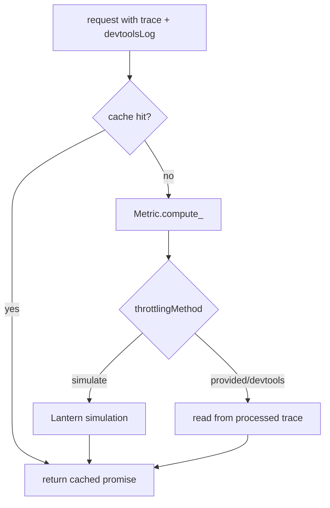

# GoogleChrome/lighthouse — module: metrics-lcp-tbt-cls

## Responsibility

This code turns a recorded Chrome trace (a list of timed events from the browser) into three Core Web Vitals style numbers: Largest Contentful Paint (LCP), Total Blocking Time (TBT) and Cumulative Layout Shift (CLS). It also provides the shared base class that decides whether a metric is read from the real trace ("observed") or predicted for a slower device ("simulated"). A small caching wrapper makes sure each computation runs once per run.

## Key files

| File | Role |
|------|------|
| `core/computed/computed-artifact.js` | Wraps a class so `request()` caches results by their inputs |
| `core/computed/metrics/metric.js` | Base class: validates input, picks observed or simulated path |
| `core/computed/metrics/navigation-metric.js` | Refuses to run outside a page navigation |
| `core/computed/metrics/largest-contentful-paint.js` | LCP: read from trace, or ask Lantern |
| `core/computed/metrics/total-blocking-time.js` | TBT: sum of main-thread task time beyond 50 ms |
| `core/computed/metrics/cumulative-layout-shift.js` | CLS: filter shift events, group into sessions, take the max |
| `core/computed/metrics/lantern-metric.js` | Helpers that build the inputs for simulated metrics |
| `core/computed/processed-trace.js`, `processed-navigation.js` | Cached wrappers around the trace parser |
| `core/test/computed/metrics/*-test.js` | Tests for LCP, TBT, CLS |

## How it works

Plain words first: a metric class says "give me the trace and the network log". The base class parses the trace once, then either reads the number straight from the trace or runs a simulation, depending on the throttling setting.

1. Every computed class is wrapped by `makeComputedArtifact`, which adds a `request()` method (`core/computed/computed-artifact.js:23`, `core/computed/computed-artifact.js:79 @ 3b399f6`). It keeps a cache per class name, keyed by the dependencies, and returns the stored promise on a hit (`core/computed/computed-artifact.js:58-65 @ 3b399f6`).
2. `Metric.compute_` rejects calls with no trace, devtools log or settings (`core/computed/metrics/metric.js:67-70 @ 3b399f6`). It then requests the processed trace, the processed navigation (skipped in `timespan` mode) and the network records (`core/computed/metrics/metric.js:72-81 @ 3b399f6`).
3. It asserts the trace has main-thread top-level events (`core/computed/metrics/metric.js:83 @ 3b399f6`).
4. A `switch` on `settings.throttlingMethod` chooses the path: `simulate` calls `computeSimulatedMetric`, `provided` and `devtools` call `computeObservedMetric`, anything else throws a `TypeError` (`core/computed/metrics/metric.js:85-97 @ 3b399f6`).
5. LCP observed: reads `processedNavigation.timings.largestContentfulPaint`; if it is missing, throws `LighthouseError.errors.NO_LCP` (`core/computed/metrics/largest-contentful-paint.js:35-45 @ 3b399f6`). LCP simulated: hands off to `LanternLargestContentfulPaint` (`core/computed/metrics/largest-contentful-paint.js:26-29 @ 3b399f6`).
6. TBT observed: takes main-thread top-level tasks, then sums blocking time between First Contentful Paint and Time to Interactive (`core/computed/metrics/total-blocking-time.js:46-59 @ 3b399f6`). In a timespan (no navigation) it sums from 0 to the trace end (`core/computed/metrics/total-blocking-time.js:61-67 @ 3b399f6`). The definition, "the last 60 ms of a 110 ms task" is in the file comment (`core/computed/metrics/total-blocking-time.js:19-22 @ 3b399f6`).
7. CLS does not extend `Metric`. It collects `LayoutShift` events (`core/computed/metrics/cumulative-layout-shift.js:26-77 @ 3b399f6`), then groups them into sessions with `calculate` (`core/computed/metrics/cumulative-layout-shift.js:130-149 @ 3b399f6`).

The diagram follows `core/computed/computed-artifact.js:58-76 @ 3b399f6` and `core/computed/metrics/metric.js:85-97 @ 3b399f6`.

## Beyond the textbook

### Cache keyed by an explicit list of inputs

- Textbook version: call a function each time you need a number, or memoize on all arguments.
- What they do: each computed artifact declares the exact keys that matter (for LCP: `devtoolsLog`, `gatherContext`, `settings`, `simulator`, `trace`, `URL`, `SourceMaps`, `HostDPR`). Other properties are dropped before caching. A key that is `undefined` is an error, so optional values must be passed as `null`.
- Why: the doc comment says this "guard[s] against developer mistakes" and ensures only required properties build the cache key. In tests it throws; in production it only logs.
- Evidence: `core/computed/computed-artifact.js:17-21 @ 3b399f6`, `core/computed/computed-artifact.js:36-49 @ 3b399f6`, `core/computed/metrics/largest-contentful-paint.js:48-51 @ 3b399f6`

### Observed versus simulated metrics

- Textbook version: report the number you measured in the browser.
- What they do: with `simulate` throttling the same metric is predicted by a model of a slower network and CPU (Lantern); with `provided` or `devtools` it is read from the trace. Simulation is refused outside navigations.
- Why: the base class file comment says it "encapsulates logic for choosing the correct metric computation method based on the specified throttling settings".
- Evidence: `core/computed/metrics/metric.js:13-20 @ 3b399f6`, `core/computed/metrics/metric.js:85-91 @ 3b399f6`

### CLS rules match the field metric and work around Chrome bugs

- Textbook version: add up every layout shift score.
- What they do: skip shifts that had recent user input; but ignore that flag for the first events, because Lighthouse's own emulation resize and the viewport event after navigation set it wrongly (linked Chromium bugs in the comments). Shifts are grouped into sessions that end after a 1 s gap or at 5 s, and the largest session wins. Both the all-frames and main-frame-only scores are computed.
- Why: comments cite chromium issues 1094974 and 1302667.
- Evidence: `core/computed/metrics/cumulative-layout-shift.js:29-45 @ 3b399f6`, `core/computed/metrics/cumulative-layout-shift.js:60-65 @ 3b399f6`, `core/computed/metrics/cumulative-layout-shift.js:130-146 @ 3b399f6`, `core/computed/metrics/cumulative-layout-shift.js:187-188 @ 3b399f6`

### Shadow-running a new engine and reporting differences

- Textbook version: replace the old code and hope.
- What they do: after the hand-written CLS result, they also run the new shared trace engine on the same events and compare. A difference throws in unit tests but is sent to Sentry in production, and the old value is still returned. The new engine is skipped if any event had recent input, because it always drops those.
- Why: a TODO says the engine "always drops `had_recent_input` events, but Lighthouse is more lenient" and needs upstreaming.
- Evidence: `core/computed/metrics/cumulative-layout-shift.js:190-199 @ 3b399f6`, `core/computed/metrics/cumulative-layout-shift.js:204-231 @ 3b399f6`

### Blame per element

- Textbook version: one CLS number for the page.
- What they do: each shift's score is split across the shifted nodes in proportion to their impact area (old rect plus new rect minus the overlap), so an audit can name the worst elements.
- Evidence: `core/computed/metrics/cumulative-layout-shift.js:79-87 @ 3b399f6`, `core/computed/metrics/cumulative-layout-shift.js:102-115 @ 3b399f6`

### Typed Lantern errors become user-facing errors

- Textbook version: let any exception bubble up.
- What they do: `lanternErrorAdapter` turns an internal `LanternError` whose message is a known code into a `LighthouseError`; unknown errors are rethrown. Lantern can also build its graph from the trace instead of the devtools log, behind an environment variable and a TODO to remove the old path.
- Evidence: `core/computed/metrics/lantern-metric.js:59-70 @ 3b399f6`, `core/computed/metrics/lantern-metric.js:76-83 @ 3b399f6`

## Tests and what they protect

- LCP: a simulated value on a real trace fixture, with inline snapshots of the optimistic and pessimistic estimates (`core/test/computed/metrics/largest-contentful-paint-test.js:21-40 @ 3b399f6`), an observed value (`core/test/computed/metrics/largest-contentful-paint-test.js:43-56 @ 3b399f6`), and a hand-built trace showing a non-blocking script and API call do not delay an image LCP in the optimistic graph (`core/test/computed/metrics/largest-contentful-paint-test.js:59-160 @ 3b399f6`).
- TBT: one simulated and one observed case; the observed value on a CNN trace is about 400 ms (`core/test/computed/metrics/total-blocking-time-test.js:23-57 @ 3b399f6`).
- CLS: real traces, including one with no events returning 0 and one that must throw without `weighted_score_delta` (`core/test/computed/metrics/cumulative-layout-shift-test.js:42`, `:64 @ 3b399f6`). Constructed traces test recent-input handling, multi-frame traces, other tabs being ignored, and the 1 s gap and 5 s limit rules (`core/test/computed/metrics/cumulative-layout-shift-test.js:135-240`, `:267-435`, `:435-500 @ 3b399f6`). `getImpactByNodeId` is tested for merging and malformed nodes (`core/test/computed/metrics/cumulative-layout-shift-test.js:525`, `:565`, `:598 @ 3b399f6`).

## Error handling, performance, and security

- Missing input throws early with a clear message (`core/computed/metrics/metric.js:68-70 @ 3b399f6`); a trace without LCP raises a named `NO_LCP` error (`core/computed/metrics/largest-contentful-paint.js:37-39 @ 3b399f6`); non-navigation use of a navigation-only metric throws (`core/computed/metrics/navigation-metric.js:38-40 @ 3b399f6`).
- Performance: results are cached as promises, so concurrent requests share one computation, and timing is logged at verbose level (`core/computed/computed-artifact.js:67-74 @ 3b399f6`).
- Security: Not present in this slice.

## Technologies and services seen

- Sentry — error reporting for the CLS engine mismatch (`core/computed/metrics/cumulative-layout-shift.js:11`, `:223 @ 3b399f6`)
- `@paulirish/trace_engine` — shared trace parser run in parallel to check CLS (`core/computed/metrics/cumulative-layout-shift.js:162 @ 3b399f6`)
- Lantern (in-repo simulation library) — predicts metrics for throttled devices (`core/computed/metrics/lantern-metric.js:7 @ 3b399f6`)
- Mocha-style `describe`/`it` with Jest-style `expect` and inline snapshots (`core/test/computed/metrics/total-blocking-time-test.js:19`, `:38 @ 3b399f6`)
- Chrome trace events (`LayoutShift`, `viewport`) as the data source (`core/computed/metrics/cumulative-layout-shift.js:42`, `:48 @ 3b399f6`)

## Worth exploring interactively

- CLS session grouping — steps: filter events by `had_recent_input` (`core/computed/metrics/cumulative-layout-shift.js:60-65 @ 3b399f6`); for each event start a new session if more than 5 s since the first or 1 s since the previous (`core/computed/metrics/cumulative-layout-shift.js:139-142 @ 3b399f6`); add its score (`core/computed/metrics/cumulative-layout-shift.js:144 @ 3b399f6`); keep the maximum (`core/computed/metrics/cumulative-layout-shift.js:145 @ 3b399f6`) — fits AlgorithmStepper because the learner sees the running session score and the max change after each shift.
- Metric request path — steps: `request` checks cache (`core/computed/computed-artifact.js:62-65 @ 3b399f6`); `compute_` parses trace (`core/computed/metrics/metric.js:72 @ 3b399f6`); throttling switch (`core/computed/metrics/metric.js:85 @ 3b399f6`); observed read or Lantern (`core/computed/metrics/largest-contentful-paint.js:26-45 @ 3b399f6`) — fits FlowAnimation because a request moves through named functions.

## Open questions

- How `calculateSumOfBlockingTime` and the trace parser work is in `core/lib/lantern` and `core/lib/tracehouse`, which are outside this slice.
- How the metric audits turn these numbers into scores is in the audit-scoring module.

## My insights
