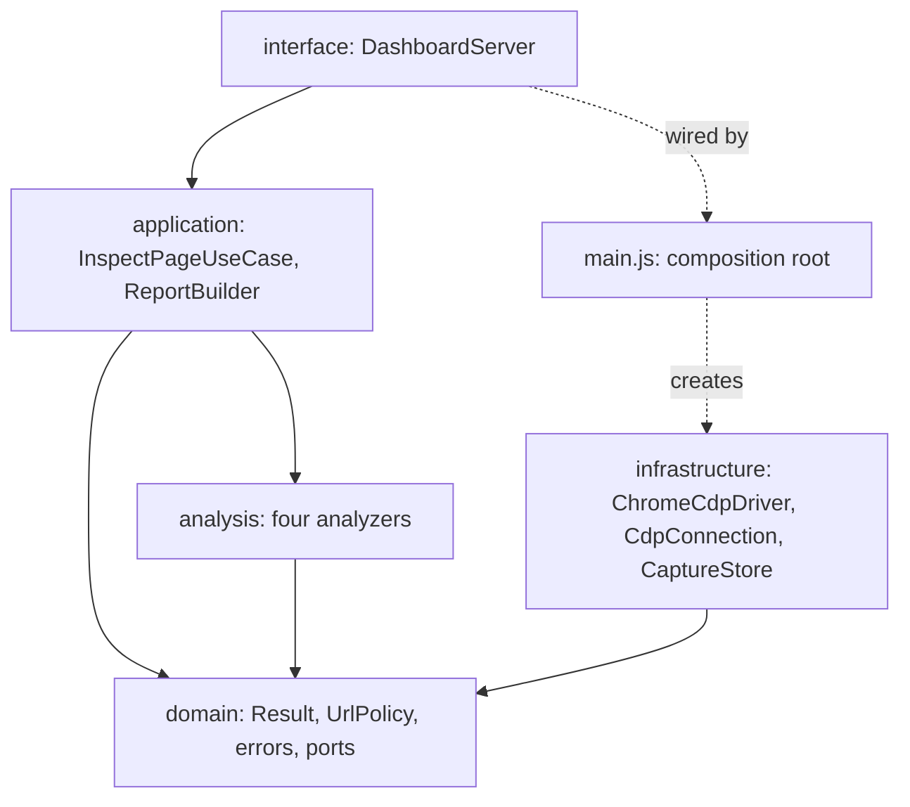

# Browser DevTools mastery (used in every phase) — capstone

## What it is

The Page health inspector is a small web service. A team member pastes a URL into a dashboard. A Node service loads the page in headless Chrome through the [[Chrome DevTools Protocol]] and shows a report: network timing, [[Core Web Vitals]], console errors and heap growth. It solves the problem that DevTools evidence is hard to share and repeat. The project is in `projects/frontend-engineering/learning-system-and-workstation/browser-devtools-mastery/capstone/`. It has no npm dependencies.

## Architecture at a glance



Diagrams with explanations and sources: [[visual-capstone-architecture-browser-devtools-mastery]], [[visual-capstone-request-flow-browser-devtools-mastery]], [[visual-capstone-deployment-browser-devtools-mastery]].

## Layers and key classes

| Layer | Key classes | What the layer is for |
|-------|-------------|-----------------------|
| domain | `Result`, `UrlPolicy`, `Rating`, error classes | Rules and error values, with no Chrome in sight |
| analysis | `RequestTimingAnalyzer`, `WebVitalsAnalyzer`, `ConsoleErrorAnalyzer`, `HeapAnalyzer` | Pure functions on a recorded capture |
| application | `InspectPageUseCase`, `AnalyzeSavedCaptureUseCase`, `ReportBuilder` | One class per thing the system does |
| infrastructure | `ChromeCdpDriver`, `CdpConnection`, `ChromeLauncher`, `LoadSettler`, `CaptureStore`, `Config`, `Logger` | The only code that touches Chrome, files and the environment |
| interface | `DashboardServer` and the dashboard page | HTTP routes and the report view |

## Ideas applied

- [[Request timing phases]]: DNS, connect, TLS, wait and download come from the `timing` object, and a `-1` offset means "did not happen".
- [[Out-of-order events]]: the request table keeps a response that has no request and marks it incomplete.
- [[Errors as values]]: every Chrome command returns a result or an error, and a closed socket fails all waiting commands.
- [[Partial failure]]: a heap or trace failure makes one section "could not measure", and the others still print.
- [[Record and replay]]: the raw events are saved as JSON, so a report can be rebuilt with no browser.
- [[Network idle]]: "loaded" means the load event fired and at most two requests stayed open for 500 ms.
- [[Long task]]: tasks over 50 ms add to total blocking time.
- [[Untrusted input]]: the URL is checked, and page text is shown with `textContent`.
- [[Dependency inversion]] and [[Explicit dependencies]]: use cases receive the driver and store in constructors, so tests use a fake driver.

## Borrowed from production

| Practice | Source | Where it is applied |
|----------|--------|---------------------|
| Drive, collect, analyze as three layers | [[lighthouse-takeaways]] | `ChromeCdpDriver` and `src/analysis/` |
| Save raw CDP events, rebuild the report from the file | [[lighthouse-takeaways]] | `CaptureStore`, `npm run analyze` |
| Define "loaded" with a hard maximum and a slow-or-hung probe | [[lighthouse-takeaways]] | `LoadSettler` |
| Command wrapper with timeout and crash check | [[lighthouse-takeaways]] | `CdpConnection.send` |
| Request table keyed by id, tolerate gaps and `-1` | [[devtools-frontend-takeaways]] | `RequestTimingAnalyzer` |
| Each section fails on its own | [[devtools-frontend-takeaways]] | `ReportBuilder` |

## How to run it

```bash
cd projects/frontend-engineering/learning-system-and-workstation/browser-devtools-mastery/capstone
npm test        # 50 tests, no browser needed
npm start       # then open http://localhost:3000 (needs Google Chrome installed)
```

Read `ARCHITECTURE.md` in that folder for every class, and `docs/adr/0001-record-raw-capture-then-analyze.md` for the main design decision. The live Chrome run was not executed in the build environment; the tests use recorded events.

## How to extend it

- Decode minified console-error stacks with a source map.
- Add a throttling profile and print it in the report settings.
- Store a summary per run and chart the history on the dashboard.

## My insights
