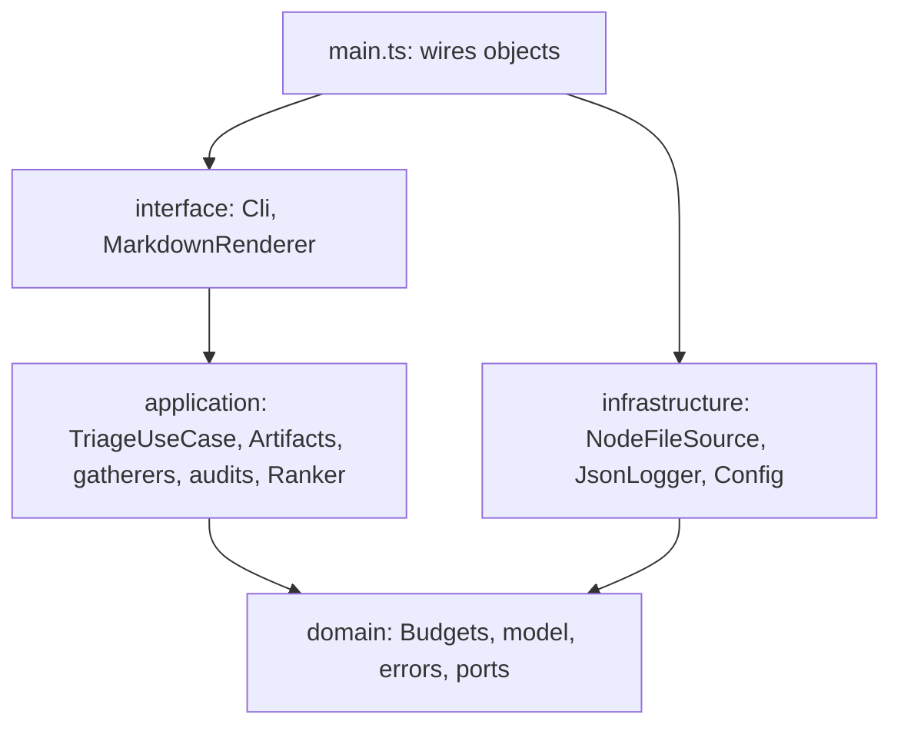

# Browser DevTools mastery (used in every phase) — capstone

## What it is

Perf-triage is a Node.js command line tool. A frontend team gets a bug report with a [[HAR file]], a [[Performance trace]] and a Lighthouse JSON report. The tool reads all three, checks them against budgets and prints one ranked triage report. It builds on the mini projects: the HAR waterfall report and the trace long task finder. Project folder: `projects/frontend-engineering/learning-system-and-workstation/browser-devtools-mastery/capstone/`. Start with its `README.md` and `ARCHITECTURE.md`.

## Architecture at a glance



Visual notes: [[visual-capstone-layers-browser-devtools-mastery]], [[visual-capstone-request-flow-browser-devtools-mastery]], [[visual-capstone-deployment-browser-devtools-mastery]].

## Layers and key classes

- **Domain:** `Budgets` (limits and overrides), the plain data types, `InputError`, and the ports `FileSource`, `Logger`, `Gatherer`, `Audit`.
- **Application:** three gatherers (`HarGatherer`, `TraceGatherer`, `LighthouseGatherer`), three audits, `Artifacts` (parse once, failures become values), `Ranker`, `TriageUseCase`.
- **Infrastructure:** `NodeFileSource`, `JsonLogger`, `Config`.
- **Interface:** `Cli` (flags and exit codes) and `MarkdownRenderer`. `main.ts` wires them.

## Ideas applied

- A HAR phase of `-1` means "did not happen", so it is never counted as 0 ms ([[Network waterfall]], [[Derived data]]).
- A long task is a `RunTask` over 50 ms; blocking time is the part above 50 ms.
- Lighthouse numbers carry a label, lab or simulated ([[Lab and simulated metrics]]).
- A HAR file is outside input, so it is validated first ([[Untrusted input]]).
- Each file is parsed once ([[Memoization]]), and a broken file becomes a skipped row ([[Fail-soft pipeline]]).
- Exit codes tell a CI job what happened ([[Exit codes]]).

## Borrowed from production

| Practice | Source | Applied in |
|---|---|---|
| Separate reading from judging | [[lighthouse-takeaways]] | `*Gatherer.ts` and `*Audit.ts` |
| Parse each input once and cache it | [[lighthouse-takeaways]] | `Artifacts.ts` |
| A failure becomes a result row | [[lighthouse-takeaways]] | `Artifacts.ts`, `TriageUseCase.ts` |
| Validate the HAR, keep -1 as not applicable | [[devtools-frontend-takeaways]] | `HarGatherer.ts` |
| Never print secrets from a HAR | [[devtools-frontend-takeaways]] | `HarAudit.ts` |
| Golden report test | [[lighthouse-takeaways]] | `tests/integration/cli.test.ts` |

## How to run it

```bash
cd projects/frontend-engineering/learning-system-and-workstation/browser-devtools-mastery/capstone
npm install
npm start          # runs on the sample files
npm test           # 28 tests
```

Needs Node.js 22.18 or newer. Use your own files with `node src/main.ts --har my.har --trace t.json --lighthouse r.json`.

## How to extend it

- Add a gatherer and an audit for a new input, such as a coverage report, and one line in `main.ts`.
- Use the source map resolver from mini project 1 to turn minified frames in long task events into original file names.
- Replace `NodeFileSource` and `TraceGatherer` with a streaming reader for very large traces.

## My insights
