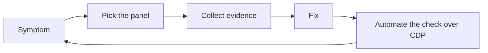

## In one sentence

DevTools are the inspectors inside every browser. They show the live page, its requests, its main thread and its memory, so you find a bug's cause from evidence.

## The mental model



Start from what the user sees, open the one panel that shows its cause, and keep the evidence. When a check is worth repeating, a script runs it through the same DevTools Protocol.

## Visual refresher

- [[visual-request-timing-phases-sequence-browser-devtools-mastery|Request timing phases]]: read each waterfall bar from queueing to content download.
- [[visual-performance-panel-traces-browser-devtools-mastery|Performance trace lab]] (hybrid): redo the experiment where 4x CPU throttling plus yielding removes the long task.
- [[visual-breakpoints-async-debugging-browser-devtools-mastery|Async debugging lab]] (hybrid): redo the predict checkpoint on which response renders last.
- [[visual-a-production-debugging-workflow-browser-devtools-mastery|Triage deck]] (branching): pick the first panel for "error only on iPhone".

All visuals: [[visuals-browser-devtools-mastery|all visuals]].

## Key ideas

- Each panel answers one kind of question, so pick it from the symptom. Layout: Elements. Logic: Sources. Loading: Network. Slowness: Performance. Growth: Memory. Stored data: Application.
- A waterfall bar splits into phases from queueing to download. The longest phase names the cause.
- A task longer than 50 ms on the main thread is a long task, because it blocks input; split it and yield to fix it.
- The async call stack keeps the frames that scheduled a callback. With a conditional breakpoint, it shows which `fetch` started a stale render.
- A source map turns a minified position back into your original line. Its `mappings` field stores Base64 VLQ offsets.
- A memory leak is a retainer path from a GC root to an object you no longer need; compare two heap snapshots and read the retainers.
- The Lighthouse performance score is a weighted average (TBT 30, LCP 25, CLS 25, FCP 10, SI 10 at commit 3b399f6), so fix the heaviest metric first.
- iOS pages need Safari Web Inspector on a Mac; Android Chrome uses `chrome://inspect`.

## When to use it / when not to

Use it when you must explain a real bug, a slow page or growing memory on a page you can open. It shows the live state, not your guess.

Do not use it alone when a problem appears only for real users. Use field data (CrUX) and logging, because local throttling only approximates their devices. For a regression gate, script the check over CDP and repeat it.

## Trade-offs and failure modes

- CPU throttling is relative to your machine, so a fast laptop still hides slow-phone problems (symptom: no long tasks locally, bad INP in the field).
- A missing or stale source map points breakpoints at the wrong line (symptom: the pause lands in unrelated code).
- Edits in Elements and Styles are temporary; without overrides or a workspace they vanish on reload.
- Heap snapshots pause the page and the accessibility inspector can skew measurements, so close extra tools before measuring.

## Commands or code worth remembering

```js
console.table(rows); console.dir(el);   // tabular view vs object view
$0; $$('a[href^="http"]'); copy(obj);   // selected node, query all, copy to clipboard
monitorEvents(window, 'resize');        // log events on a target
// Sources: right-click a line > Add conditional breakpoint > `query !== latestQuery`
// Android: open chrome://inspect ; iOS: Safari > Develop > <device>
```

## What production systems do differently

- Lighthouse saves raw CDP messages and rebuilds network records later, so analysis reruns without a browser, see [[lighthouse-findings]].
- Lighthouse keeps evidence on failure: a page error becomes an error artifact and a null score, not a crash, see [[lighthouse-takeaways]].
- DevTools frontend treats protocol replies as values (`result` or `error`) and fails pending calls when a session ends, see [[devtools-frontend-findings]].
- DevTools derives waterfall phases from timing offsets and tolerates missing or out-of-order events, see [[devtools-frontend-takeaways]].

## Go deeper

- [[00-start-here-browser-devtools-mastery|Start here: the topic map]]
- [[01-brief-browser-devtools-mastery|Brief]]
- [[02-lesson-browser-devtools-mastery|Interactive lesson]]
- [[03-mini-projects-browser-devtools-mastery|Mini projects]]
- [[00-digests-browser-devtools-mastery|Digests]]
- [[00-repo-intel-browser-devtools-mastery|Repository deep dives]]
- [[06-capstone-browser-devtools-mastery|Capstone: Page health inspector]]
- [[08-recall-browser-devtools-mastery|Recall cards]]

## My insights
