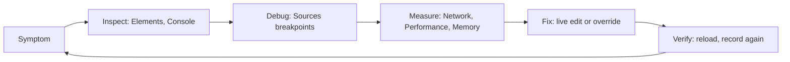

## In one sentence

DevTools shows the page the browser actually built, so you can inspect, debug, measure and fix it instead of guessing from your source code.

## The mental model



Start from the symptom. Each step picks one panel. You leave the loop only when a new recording shows the fix.

## Visual refresher

- [[visual-how-it-works-browser-devtools-mastery|The DevTools inspect, debug, measure and fix loop]]: which panel belongs to which step.
- [[visual-debugger-lab-browser-devtools-mastery|Debugger lab: catch the search race]]: hybrid mode. Redo the checkpoint where the conditional breakpoint pauses only once.
- [[visual-network-waterfall-lab-browser-devtools-mastery|Slow down a request and read its waterfall]]: interactive mode. Redo the Slow 4G prediction.
- [[visual-perf-trace-lab-browser-devtools-mastery|Performance trace lab: find the long task]]: hybrid mode. Redo the INP check at 20x CPU throttling.
- [[visual-detached-node-retainer-path-browser-devtools-mastery|The retainer path that keeps a detached list alive]]: find the one reference to remove.

All visuals: [[visuals-browser-devtools-mastery|all visuals]].

## Key ideas

- The Styles pane lists every matching rule; the Computed pane shows the one value the cascade applied, so start from Computed when a style is wrong.
- Pick the breakpoint by the bug: conditional for one bad value, logpoint when pausing hides a race, DOM or fetch breakpoints when you do not know which script runs.
- The async call stack joins the frames before and after an `await`, so you see who started the work.
- A source map links generated positions to original lines through base64 VLQ segments; `ignoreList` hides library frames.
- Each request splits into phases (Queueing, Stalled, DNS, connection, SSL, Waiting, Content Download); the long phase names the cause.
- A task over 50 ms is a long task; it blocks input and raises INP, so split it.
- A leak is an object still reachable from a GC root; compare two heap snapshots and read the Retainers.

## When to use it / when not to

Use it when:
- A live page behaves differently from your code: DevTools shows real state in seconds.
- You need numbers for a slow page: a trace and a HAR file replace guesses.

Do not use it when:
- You need field data from real users: use CrUX or real-user monitoring, because one lab run is one device.
- A bug appears only on iOS or a low-end phone: use Safari Web Inspector or remote debugging on a real device, not desktop emulation.
- Firefox has the better tool: use its grid, flex and font inspectors for layout and fonts.

## Trade-offs and failure modes

- DevTools records only while it is open. Symptom: an empty Network panel after the request already ran.
- Fast laptops hide slow code. Symptom: a 15 ms handler that gives a poor INP on phones; throttle the CPU.
- Local overrides do not save DOM edits. Symptom: the fix vanishes on reload.
- A HAR export can hold cookies and tokens; export it sanitized before you share it.

## Commands or code worth remembering

```js
$0                         // the element selected in Elements
$$('.card')                // all matches as a real array
copy(JSON.stringify(data)) // put a value on the clipboard
monitorEvents($0, 'click') // log events on the selected element
console.table(rows)        // read an array of objects as a table
```

## What production systems do differently

- Lighthouse separates gathering from auditing, so one recorded page can be audited again with no browser: [[lighthouse-findings|Lighthouse findings]].
- Lighthouse scores with log-normal curves fitted to real-site data, not fixed limits: [[lighthouse-takeaways|Lighthouse takeaways]].
- DevTools treats an imported HAR file as untrusted input and computes timing phases, using `-1` for "not applicable": [[devtools-frontend-findings|DevTools frontend findings]].
- Retained size comes from a dominator tree built only from essential edges: [[devtools-frontend-takeaways|DevTools frontend takeaways]].

## Go deeper

[[01-brief-browser-devtools-mastery|Brief]] · [[02-lesson-browser-devtools-mastery|Lesson]] · [[03-mini-projects-browser-devtools-mastery|Mini projects]] · [[00-digests-browser-devtools-mastery|Digests]] · [[00-repo-intel-browser-devtools-mastery|Repository deep dive]] · [[06-capstone-browser-devtools-mastery|Capstone]] · [[08-recall-browser-devtools-mastery|Recall cards]]

## My insights
