# Concept map of Browser DevTools mastery (used in every phase)

Generated from the research curriculum. A solid arrow points from a concept to the concept that refines it; a dotted arrow shows a prerequisite.

```mermaid
flowchart TD
  elements_styles_panel["Elements styles panel"]
  box_model_and_computed_styles["Box model and computed styles"]
  flex_grid_overlays["Flex and grid overlays"]
  force_element_state["Force element state"]
  console_power_use["Console power use"]
  console_utilities["Console utilities"]
  live_expressions["Live expressions"]
  sources_panel_debugging["Sources panel debugging"]
  breakpoint_types["Breakpoint types"]
  async_call_stack["Async call stack"]
  source_maps["Source maps"]
  local_overrides["Local overrides"]
  network_panel["Network panel"]
  waterfall_timing_phases["Waterfall timing phases"]
  network_throttling_and_blocking["Network throttling and blocking"]
  har_export["HAR export"]
  initiator_and_priority["Initiator and priority"]
  performance_panel["Performance panel"]
  flame_chart_and_long_tasks["Flame chart and long tasks"]
  core_web_vitals_live["Live Core Web Vitals"]
  cpu_throttling["CPU throttling"]
  memory_panel["Memory panel"]
  heap_snapshots["Heap snapshots"]
  retainers_and_detached_dom["Retainers and detached dom"]
  allocation_timeline["Allocation timeline"]
  application_panel["Application panel"]
  storage_inspection["Storage inspection"]
  service_worker_and_cache_storage["Service worker and cache storage"]
  bfcache_test["Back/forward cache test"]
  lighthouse_panel_other_panels["Lighthouse panel and other panels"]
  lighthouse_audits["Lighthouse audits"]
  coverage_panel["Coverage panel"]
  rendering_emulation["Rendering emulation"]
  recorder_and_issues["Recorder and issues"]
  firefox_safari_devtools["Firefox and Safari DevTools"]
  firefox_layout_and_font_tools["Firefox layout and font tools"]
  safari_web_inspector["Safari Web Inspector"]
  remote_device_debugging["Remote device debugging"]
  android_chrome_inspect["Android Chrome remote inspection"]
  ios_safari_remote_inspection["iOS Safari remote inspection"]
  cascade_layers_view["Cascade layers in the Styles pane"]
  layout_shifts_track["Layout shifts track"]
  speculative_loads["Speculative loads"]
  logpoints["Logpoints"]
  ignore_listing_frames["Ignore-listed frames in the call stack"]
  source_map_vlq_mappings["How a source map encodes positions"]
  override_xhr_fetch["Override a fetch or XHR response"]
  elements_styles_panel --> box_model_and_computed_styles
  elements_styles_panel -. needed for .-> box_model_and_computed_styles
  elements_styles_panel --> flex_grid_overlays
  elements_styles_panel -. needed for .-> flex_grid_overlays
  elements_styles_panel --> force_element_state
  elements_styles_panel -. needed for .-> force_element_state
  console_power_use --> console_utilities
  console_power_use -. needed for .-> console_utilities
  console_power_use --> live_expressions
  console_power_use -. needed for .-> live_expressions
  sources_panel_debugging --> breakpoint_types
  sources_panel_debugging -. needed for .-> breakpoint_types
  sources_panel_debugging --> async_call_stack
  sources_panel_debugging -. needed for .-> async_call_stack
  sources_panel_debugging --> source_maps
  sources_panel_debugging -. needed for .-> source_maps
  sources_panel_debugging --> local_overrides
  sources_panel_debugging -. needed for .-> local_overrides
  network_panel --> waterfall_timing_phases
  network_panel -. needed for .-> waterfall_timing_phases
  network_panel --> network_throttling_and_blocking
  network_panel -. needed for .-> network_throttling_and_blocking
  network_panel --> har_export
  network_panel -. needed for .-> har_export
  network_panel --> initiator_and_priority
  network_panel -. needed for .-> initiator_and_priority
  performance_panel --> flame_chart_and_long_tasks
  performance_panel -. needed for .-> flame_chart_and_long_tasks
  performance_panel --> core_web_vitals_live
  performance_panel -. needed for .-> core_web_vitals_live
  performance_panel --> cpu_throttling
  performance_panel -. needed for .-> cpu_throttling
  memory_panel --> heap_snapshots
  memory_panel -. needed for .-> heap_snapshots
  memory_panel --> retainers_and_detached_dom
  memory_panel -. needed for .-> retainers_and_detached_dom
  memory_panel --> allocation_timeline
  memory_panel -. needed for .-> allocation_timeline
  application_panel --> storage_inspection
  application_panel -. needed for .-> storage_inspection
  application_panel --> service_worker_and_cache_storage
  application_panel -. needed for .-> service_worker_and_cache_storage
  application_panel --> bfcache_test
  application_panel -. needed for .-> bfcache_test
  lighthouse_panel_other_panels --> lighthouse_audits
  lighthouse_panel_other_panels -. needed for .-> lighthouse_audits
  lighthouse_panel_other_panels --> coverage_panel
  lighthouse_panel_other_panels -. needed for .-> coverage_panel
  lighthouse_panel_other_panels --> rendering_emulation
  lighthouse_panel_other_panels -. needed for .-> rendering_emulation
  lighthouse_panel_other_panels --> recorder_and_issues
  lighthouse_panel_other_panels -. needed for .-> recorder_and_issues
  firefox_safari_devtools --> firefox_layout_and_font_tools
  firefox_safari_devtools -. needed for .-> firefox_layout_and_font_tools
  firefox_safari_devtools --> safari_web_inspector
  firefox_safari_devtools -. needed for .-> safari_web_inspector
  remote_device_debugging --> android_chrome_inspect
  remote_device_debugging -. needed for .-> android_chrome_inspect
  remote_device_debugging --> ios_safari_remote_inspection
  remote_device_debugging -. needed for .-> ios_safari_remote_inspection
  elements_styles_panel --> cascade_layers_view
  elements_styles_panel -. needed for .-> cascade_layers_view
  performance_panel --> layout_shifts_track
  performance_panel -. needed for .-> layout_shifts_track
  application_panel --> speculative_loads
  application_panel -. needed for .-> speculative_loads
  breakpoint_types --> logpoints
  breakpoint_types -. needed for .-> logpoints
  sources_panel_debugging --> ignore_listing_frames
  async_call_stack -. needed for .-> ignore_listing_frames
  source_maps --> source_map_vlq_mappings
  source_maps -. needed for .-> source_map_vlq_mappings
  local_overrides --> override_xhr_fetch
  local_overrides -. needed for .-> override_xhr_fetch
```

Back to [[visuals-browser-devtools-mastery|all visuals]].

## My insights
