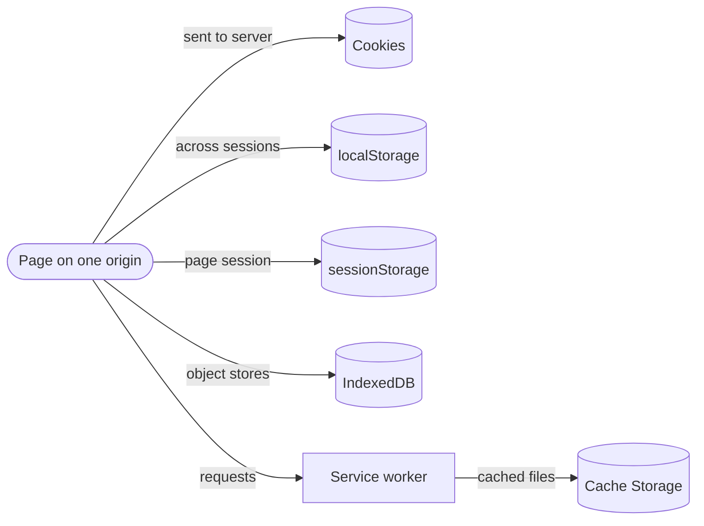

# Where a page keeps data, and how long it lives

**Concept map** · teaches Application panel, Service worker and cache inspection

**Why this visual.** Place each store in the Application panel by what it holds and how long it keeps data.

## What it shows

One origin has several stores. Cookies travel to the server in the Cookie header and expire at Expires or at the end of the session. localStorage keeps key-value pairs across browser sessions. sessionStorage clears when the page session ends. IndexedDB holds databases with object stores. A service worker intercepts requests and can answer from Cache Storage.

Text alternative: A page on one origin points to Cookies sent to the server, localStorage kept across sessions, sessionStorage kept for one page session, IndexedDB object stores, and a service worker that reads Cache Storage. The lifetime and reader decide the store.

## Check yourself

A notes app keeps thousands of notes, searched by title and body. Which store fits?

Answer: IndexedDB, because it holds databases of object stores with indexes on fields such as title and body.

## Sources

- Chrome DevTools — https://developer.chrome.com/docs/devtools (`chrome-devtools-docs`)

## Used in

- lesson page `/frontend-engineering/learning-system-and-workstation/browser-devtools-mastery/lesson/09-application-panel-storage/` (file `site/src/content/lessons/frontend-engineering/learning-system-and-workstation/browser-devtools-mastery/09-application-panel-storage.mdx`)

Back to [[visuals-browser-devtools-mastery|all visuals]].

## My insights
