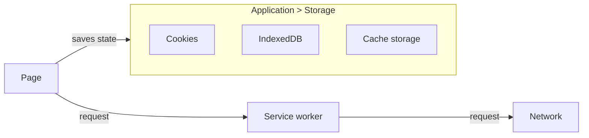

# Where the page keeps state: storage areas and the service worker

**Architecture** · teaches Application panel, Storage inspection, Service worker and cache storage

**Why this visual.** Place each storage area that the Application panel shows, and the service worker between the page and the network.

## What it shows

The page has two paths for state. A request passes through the service worker before it reaches the network; the Network panel shows this as the Request to ServiceWorker phase. Saved values live in Cookies, IndexedDB or Cache storage, the three areas of the Application panel's Storage section. Stale state hides in either path.

Text alternative: Flowchart: the page sends a request to the service worker, which sends it on to the network; the page also saves state into a group labeled Application Storage that holds Cookies, IndexedDB and Cache storage, so old state can come from the worker path or from storage.

## Check yourself

A tester sees old JavaScript after a deploy, but the server sends the new file. Which two places in the Application panel do you check first?

Answer: Service workers and Cache storage, because the worker sits between the page and the network and can answer with a saved response.

## Sources

- Chrome DevTools: Performance, Application, Coverage, Rendering and Recorder docs — https://developer.chrome.com/docs/devtools/performance/reference (`chrome-devtools-measure-docs`)
- Chrome DevTools: Network features reference — https://developer.chrome.com/docs/devtools/network/reference (`chrome-devtools-network-docs`)

## Used in

- lesson page `/frontend-engineering/learning-system-and-workstation/browser-devtools-mastery/lesson/08-application-storage/` (file `site/src/content/lessons/frontend-engineering/learning-system-and-workstation/browser-devtools-mastery/08-application-storage.mdx`)

Back to [[visuals-browser-devtools-mastery|all visuals]].

## My insights
