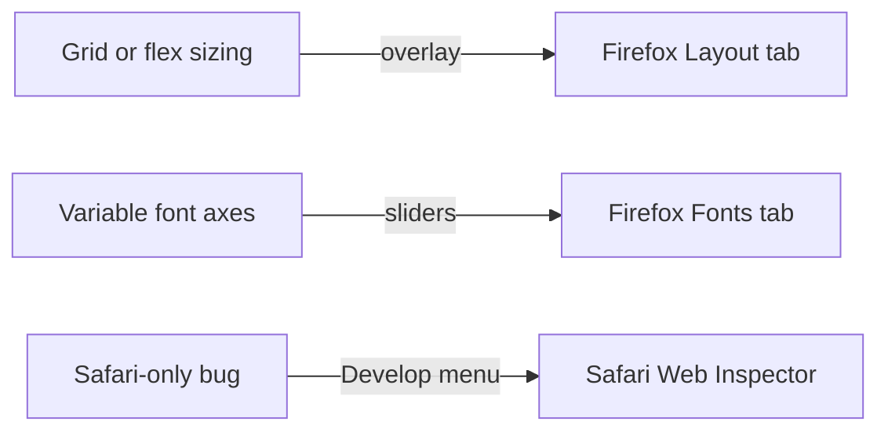

# Which browser tool fits which debugging task

**Comparison** · teaches Firefox and Safari DevTools, Firefox layout and font tools, Safari Web Inspector

**Why this visual.** Show that you pick a second browser by the task: Firefox for layout and fonts, Safari for bugs that only Safari shows.

## What it shows

Each arrow starts at a debugging task and ends at the tool that shows it best. Firefox draws a grid or flex overlay on the page and gives each variable font axis its own slider. Safari Web Inspector is the tool for a bug that only Safari shows; you open it from the Develop menu. Chrome DevTools stays your default for everything else.

Text alternative: Diagram with three task-to-tool arrows. Grid or flex sizing leads to the Firefox Layout tab, variable font axes lead to the Firefox Fonts tab, and a Safari-only bug leads to Safari Web Inspector through the Develop menu. Conclusion: choose the browser by the task, not by habit.

## Check yourself

A flex item renders 40px narrower than you expect. Which tool explains its final size?

Answer: The Firefox flexbox inspector in the Layout tab. It shows the item's Content Size, Flexibility, Minimum Size when clamped, and Final Size.

## Sources

- Firefox DevTools User Docs — https://firefox-source-docs.mozilla.org/devtools-user/ (`firefox-devtools-user-docs`)
- Web Inspector Reference (WebKit) — https://webkit.org/web-inspector/ (`webkit-web-inspector-docs`)

## Used in

- lesson page `/frontend-engineering/learning-system-and-workstation/browser-devtools-mastery/lesson/10-firefox-and-safari-devtools/` (file `site/src/content/lessons/frontend-engineering/learning-system-and-workstation/browser-devtools-mastery/10-firefox-and-safari-devtools.mdx`)

Back to [[visuals-browser-devtools-mastery|all visuals]].

## My insights
