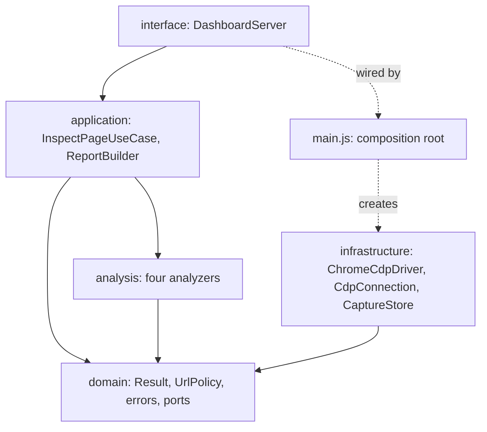

# Page health inspector: layers

**Architecture** · teaches Browser DevTools, Debugging workflow

**Why this visual.** See which layer may depend on which, and which one talks to Chrome.

## What it shows

Only the infrastructure layer talks to Chrome. The analysis classes read plain data, so tests need no browser. Dependencies point toward the domain.

Text alternative: Layered diagram: DashboardServer calls the application layer, which uses four analyzers and the domain; infrastructure classes depend on the domain, and main.js wires everything.

## Check yourself

Which layer would change if you switched from Chrome to another browser driver?

Answer: Only infrastructure: ChromeCdpDriver and its helpers.

## Sources

- GoogleChrome/lighthouse — https://github.com/GoogleChrome/lighthouse (`googlechrome-lighthouse-repo`)
- ChromeDevTools/devtools-frontend — https://github.com/ChromeDevTools/devtools-frontend (`chromedevtools-devtools-frontend-repo`)

## Used in

- `projects/frontend-engineering/learning-system-and-workstation/browser-devtools-mastery/capstone/ARCHITECTURE.md`
- [[06-capstone-browser-devtools-mastery]]

Back to [[visuals-browser-devtools-mastery|all visuals]].

## My insights
