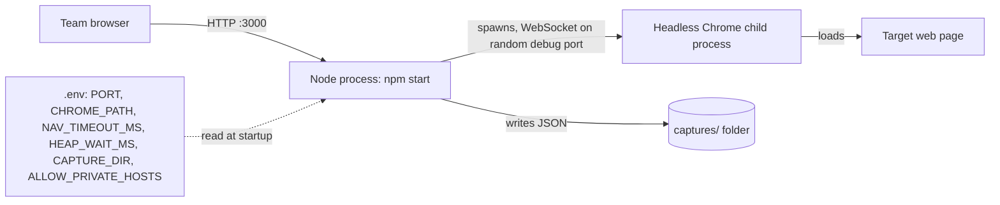

# Page health inspector: processes and ports

**Deployment** · teaches Browser DevTools

**Why this visual.** Know which processes run, which ports they use, and which settings the service reads.

## What it shows

One Node process serves HTTP and starts a headless Chrome child on demand. Chrome offers a debug WebSocket on a random local port. Reports are saved as JSON in captures/.

Text alternative: Deployment diagram: a team browser reaches the Node process on port 3000; Node spawns headless Chrome, writes capture files, and reads its settings from environment variables.

## Check yourself

Which setting stops the service from opening localhost pages?

Answer: ALLOW_PRIVATE_HOSTS is false by default.

## Sources

- Get started with remote debugging Android devices — https://developer.chrome.com/docs/devtools/remote-debugging (`chrome-devtools-remote-debugging-docs`)
- GoogleChrome/lighthouse — https://github.com/GoogleChrome/lighthouse (`googlechrome-lighthouse-repo`)

## Used in

- `projects/frontend-engineering/learning-system-and-workstation/browser-devtools-mastery/capstone/ARCHITECTURE.md`
- `projects/frontend-engineering/learning-system-and-workstation/browser-devtools-mastery/capstone/README.md`

Back to [[visuals-browser-devtools-mastery|all visuals]].

## My insights
