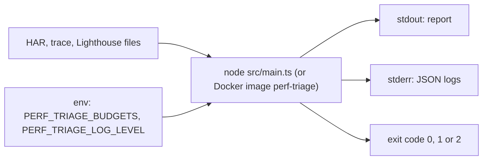

# Perf-triage run recipe: inputs, settings, outputs

**Deployment** · teaches HAR export, Waterfall timing phases, Lighthouse audits

**Why this visual.** See the inputs, settings and outputs of one run.

## What it shows

The CLI is one process or one Docker container. It reads three files and two environment variables. It writes the report to stdout, JSON logs to stderr, and sets an exit code a CI job can read.

Text alternative: Three inputs flow into one node process: files, environment variables. The process has three outputs: report on stdout, logs on stderr, and an exit code of 0, 1 or 2.

## Check yourself

Why are logs on stderr?

Answer: So stdout holds only the report and can be redirected to a file.

## Sources

- GoogleChrome/lighthouse — https://github.com/GoogleChrome/lighthouse (`googlechrome-lighthouse-repo`)
- ChromeDevTools/devtools-frontend — https://github.com/ChromeDevTools/devtools-frontend (`chromedevtools-devtools-frontend-repo`)

## Used in

- `projects/frontend-engineering/learning-system-and-workstation/browser-devtools-mastery/capstone/ARCHITECTURE.md`
- [[06-capstone-browser-devtools-mastery]]

Back to [[visuals-browser-devtools-mastery|all visuals]].

## My insights
