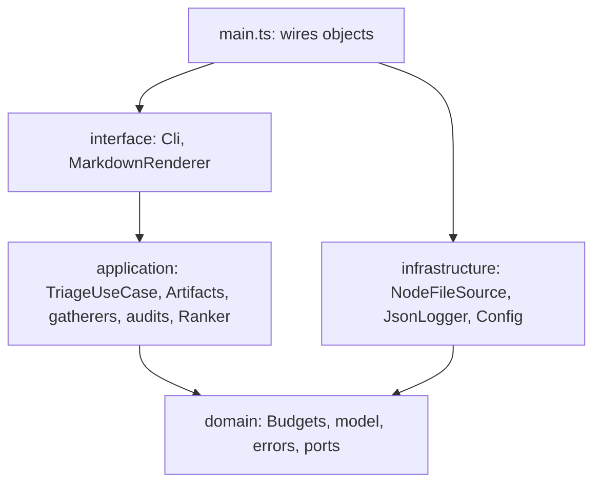

# Perf-triage layers and their dependencies

**Architecture** · teaches HAR export, Waterfall timing phases, Lighthouse audits

**Why this visual.** See which layer may depend on which.

## What it shows

The interface calls the application layer. Both depend on the domain. Infrastructure implements the domain ports. main.ts wires everything. The domain imports nothing from the other layers.

Text alternative: Five boxes: main wires interface and infrastructure; interface depends on application; application and infrastructure both depend on the domain, which holds budgets, model, errors and ports.

## Check yourself

Which layer does NodeFileSource depend on?

Answer: The domain, because it implements the FileSource port.

## Sources

- GoogleChrome/lighthouse — https://github.com/GoogleChrome/lighthouse (`googlechrome-lighthouse-repo`)
- ChromeDevTools/devtools-frontend — https://github.com/ChromeDevTools/devtools-frontend (`chromedevtools-devtools-frontend-repo`)

## Used in

- `projects/frontend-engineering/learning-system-and-workstation/browser-devtools-mastery/capstone/ARCHITECTURE.md`
- [[06-capstone-browser-devtools-mastery]]

Back to [[visuals-browser-devtools-mastery|all visuals]].

## My insights
