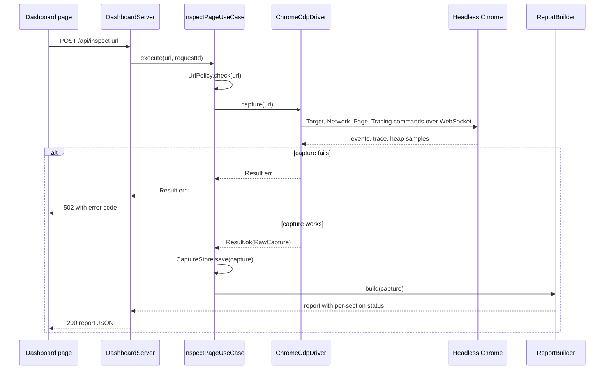

# Page health inspector: one inspection

**Sequence** · teaches [[Network panel]], [[Request timing phases]], Core Web Vitals in DevTools

**Why this visual.** Follow one URL from the dashboard to the report, including the failure path.

## What it shows

The use case checks the URL, asks the driver for a raw capture, saves it, and builds the report. A failed capture returns an error value that the server maps to 502.

Text alternative: Sequence diagram: the dashboard posts a URL, the server calls the use case, the use case checks the URL and calls the driver, the driver talks to Chrome, and either an error or a report returns.

## Check yourself

Why is the capture saved before the report is built?

Answer: So an analysis bug cannot lose the evidence.

## Sources

- GoogleChrome/lighthouse — https://github.com/GoogleChrome/lighthouse (`googlechrome-lighthouse-repo`)
- ChromeDevTools/devtools-frontend — https://github.com/ChromeDevTools/devtools-frontend (`chromedevtools-devtools-frontend-repo`)

## Used in

- `projects/frontend-engineering/learning-system-and-workstation/browser-devtools-mastery/capstone/ARCHITECTURE.md`

Back to [[visuals-browser-devtools-mastery|all visuals]].

## My insights
