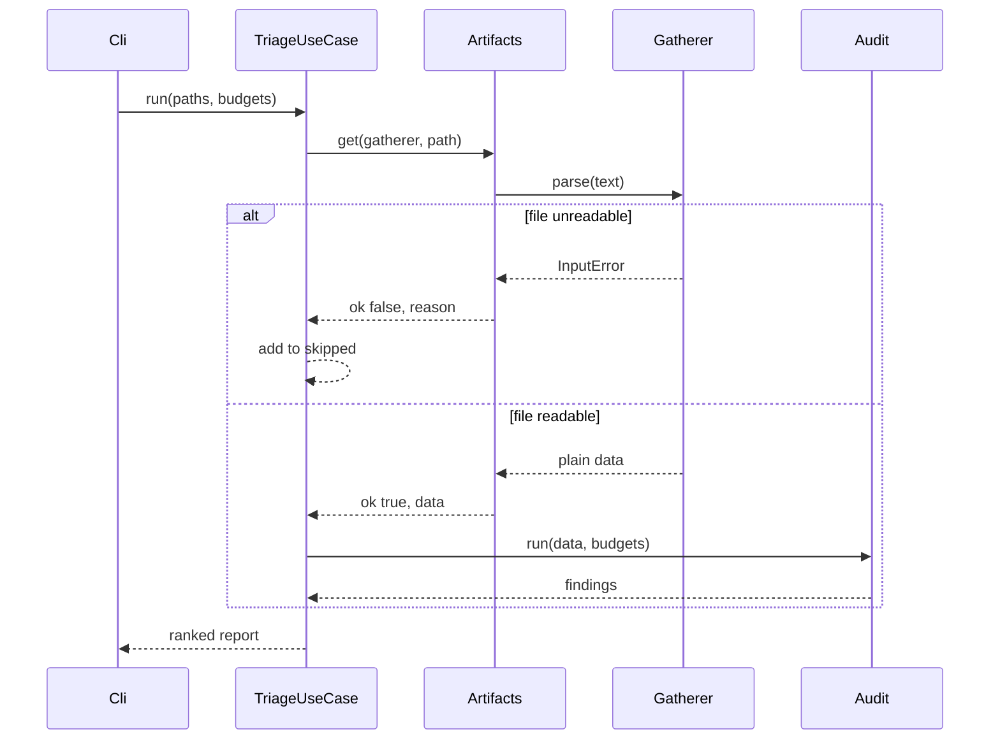

# Perf-triage request flow with a failed input

**Sequence** · teaches HAR export, Waterfall timing phases, Lighthouse audits

**Why this visual.** Follow one triage run, including the path of an unreadable file.

## What it shows

The use case asks Artifacts for each input. A gatherer parses it. A bad file becomes a skipped row, and a good file goes to its audit. The use case then returns one ranked report.

Text alternative: Sequence of six participants: Cli calls TriageUseCase, which asks Artifacts, which calls a gatherer. If parsing fails the result is skipped; otherwise an audit returns findings and the report is ranked.

## Check yourself

What happens to a trace that is not valid JSON?

Answer: It becomes a skipped row; the HAR and Lighthouse files are still checked.

## Sources

- GoogleChrome/lighthouse — https://github.com/GoogleChrome/lighthouse (`googlechrome-lighthouse-repo`)
- ChromeDevTools/devtools-frontend — https://github.com/ChromeDevTools/devtools-frontend (`chromedevtools-devtools-frontend-repo`)

## Used in

- `projects/frontend-engineering/learning-system-and-workstation/browser-devtools-mastery/capstone/ARCHITECTURE.md`
- [[06-capstone-browser-devtools-mastery]]

Back to [[visuals-browser-devtools-mastery|all visuals]].

## My insights
