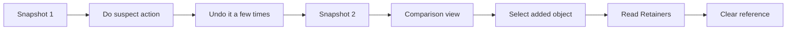

# Finding a leak with two heap snapshots

**Workflow** · teaches Memory panel, Heap snapshots, Retainers and detached dom

**Why this visual.** Learn the order of steps that finds an object that stays in memory and the reference that holds it.

## What it shows

Take a snapshot, do a suspect action, undo it a few times, and take a second snapshot. Compare the two, pick an object that was added, and read its Retainers to find the reference that keeps it alive.

Text alternative: Flowchart of eight steps: Snapshot 1, do suspect action, undo it a few times, Snapshot 2, Comparison view, select added object, read Retainers, clear the reference.

## Check yourself

Which section shows what keeps a selected object alive?

Answer: The Retainers section, which lists the objects that point to it.

## Sources

- Chrome DevTools: Fix memory problems and heap snapshots — https://developer.chrome.com/docs/devtools/memory-problems (`chrome-devtools-memory-docs`)

## Used in

- [[chrome-devtools-memory-docs-browser-devtools-mastery]]

Back to [[visuals-browser-devtools-mastery|all visuals]].

## My insights
