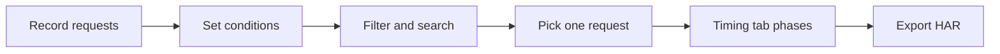

# Network panel workflow, from recording to one request's timing

**Workflow** · teaches [[Network panel]]

**Why this visual.** See the order of work in the Network panel: record, set loading conditions, narrow the list, then read one request.

## What it shows

The panel records every request while DevTools is open. You can change the cache and the network speed, then filter or search the list. You open one request to read its timing phases. When you must share the evidence, you export a HAR file, which hides cookies and authorization headers by default.

Text alternative: Left to right flowchart of six steps: record requests, set conditions such as disable cache and throttling, filter and search, pick one request, read its Timing tab phases, and export a HAR file.

## Check yourself

Why set conditions before you read a request's timing?

Answer: Cache and throttling change the phases you see, so a first-visit slow-network run shows different timing than a cached fast run.

## Sources

- Network features reference — https://developer.chrome.com/docs/devtools/network/reference (`chrome-devtools-network-reference`)

## Used in

- [[chrome-devtools-network-reference-browser-devtools-mastery]]

Back to [[visuals-browser-devtools-mastery|all visuals]].

## My insights
