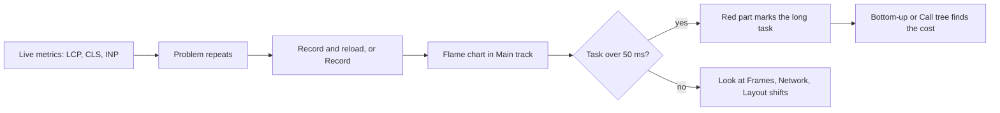

# From live metrics to a long task in the Performance panel

**Workflow** · teaches Performance panel, Flame chart and long tasks, Core Web Vitals in DevTools

**Why this visual.** Learn the order of steps: spot a problem in live metrics, record a trace, find the long task in the flame chart, then name its cost.

## What it shows

The Performance panel starts with live Core Web Vitals. When a problem repeats, you record a trace. In the Main track, the flame chart shows tasks over time. The part of a task beyond 50 ms is shaded red. Bottom-up and Call tree then show which activity used the time.

Text alternative: Flowchart: live metrics lead to recording a trace, then to the flame chart in the Main track. A decision asks whether a task exceeds 50 ms. If yes, the red part marks a long task and Bottom-up finds the cost. If no, look at other tracks.

## Check yourself

A task takes 400 ms. How much of it is shaded red?

Answer: The part beyond the first 50 ms, so about 350 ms.

## Sources

- Performance features reference — https://developer.chrome.com/docs/devtools/performance/reference (`chrome-devtools-performance-reference`)

## Used in

- [[chrome-devtools-performance-reference-browser-devtools-mastery]]

Back to [[visuals-browser-devtools-mastery|all visuals]].

## My insights
