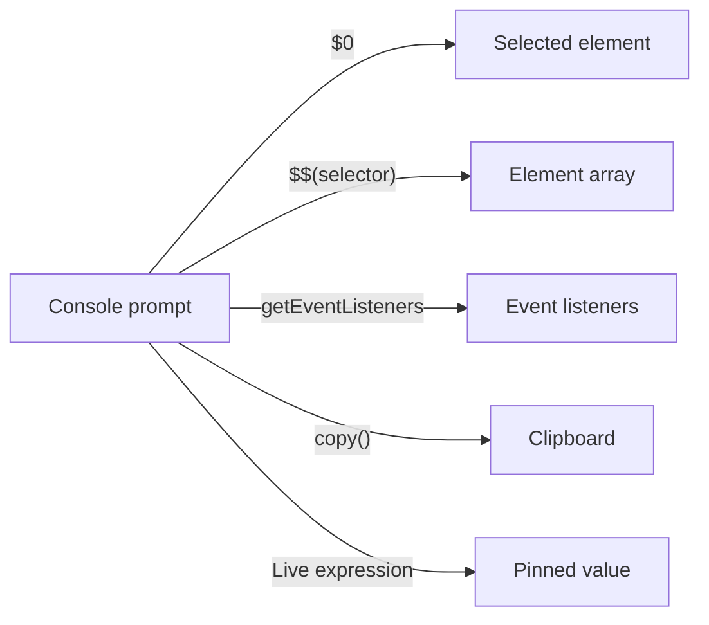

# Which Console utility reads which part of the page

**Dependency graph** · teaches Console power use, Console utilities, Live expressions

**Why this visual.** Show that each Console utility is a shortcut to one part of the live page state.

## What it shows

The Console runs JavaScript against the live page. Each utility reads one part of it: $0 is the element selected in Elements, $$() returns an array of elements that match a selector, getEventListeners() returns the listeners on an object, and copy() puts a value on the clipboard. A live expression pins one expression to the top of the Console and refreshes its result.

Text alternative: Diagram: the Console prompt points to five targets. $0 leads to the selected element, $$(selector) to an element array, getEventListeners to event listeners, copy() to the clipboard, and a live expression to a pinned value. Conclusion: pick the utility by the page state you need.

## Check yourself

You need every product card on the page as an array. Which utility do you type?

Answer: $$('.card') with the card selector. It returns an array of all matching elements, unlike $0, which is only the selected element.

## Sources

- Chrome DevTools documentation: Elements/CSS, Console, JavaScript debugging, Overrides — https://developer.chrome.com/docs/devtools (`chrome-devtools-docs`)

## Used in

- lesson page `/frontend-engineering/learning-system-and-workstation/browser-devtools-mastery/lesson/02-console-power-use/` (file `site/src/content/lessons/frontend-engineering/learning-system-and-workstation/browser-devtools-mastery/02-console-power-use.mdx`)

Back to [[visuals-browser-devtools-mastery|all visuals]].

## My insights
