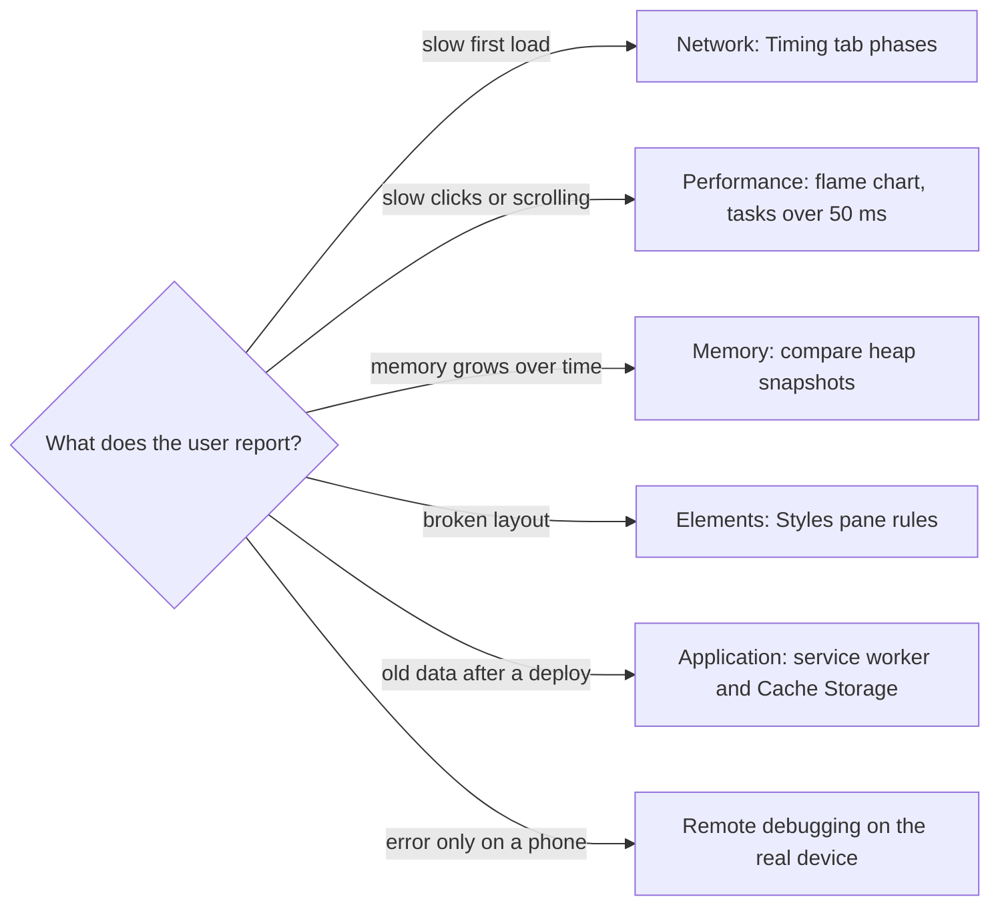

# Which DevTools panel to open first for a symptom

**Workflow** · teaches Debugging workflow, Browser DevTools

**Why this visual.** Pick the first panel from the symptom, so the first evidence you collect can explain the problem.

## What it shows

Each panel records one kind of evidence. Network records requests and their timing. Performance records main-thread tasks. Memory records the heap. Elements shows the DOM and the CSS rules. Application shows service workers and storage. A phone-only error needs DevTools attached to the real device.

Text alternative: Decision diagram: one question, what does the user report, branches to six panels. Slow first load goes to Network, slow clicks to Performance, growing memory to Memory, broken layout to Elements, old data after a deploy to Application, and an error only on a phone to remote debugging on the real device.

## Check yourself

A page gets slower each time a user opens and closes a dialog. Which panel do you open first?

Answer: Memory: take a heap snapshot, repeat the action, take another and compare them to find what grows.

## Sources

- Chrome DevTools — https://developer.chrome.com/docs/devtools (`chrome-devtools-docs`)
- Network features reference — https://developer.chrome.com/docs/devtools/network/reference (`chrome-devtools-network-reference`)
- Performance features reference — https://developer.chrome.com/docs/devtools/performance/reference (`chrome-devtools-performance-reference`)
- Fix memory problems — https://developer.chrome.com/docs/devtools/memory-problems (`chrome-devtools-memory-docs`)
- Web Inspector Reference (WebKit) — https://webkit.org/web-inspector/ (`webkit-web-inspector-docs`)

## Used in

- `projects/frontend-engineering/learning-system-and-workstation/browser-devtools-mastery/experiences/a-production-debugging-workflow/experience.json`

Back to [[visuals-browser-devtools-mastery|all visuals]].

## My insights
