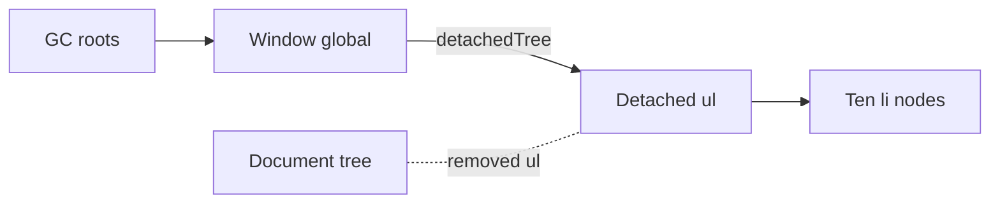

# The retainer path that keeps a detached list alive

**Dependency graph** · teaches Memory panel, Heap snapshots, Retainers and detached dom

**Why this visual.** See why a node that left the page still uses memory: a chain of references from a GC root still reaches it.

## What it shows

The code removed the ul from the document tree, but the global variable detachedTree still points to it. The path GC roots, Window, detachedTree reaches the ul and its ten li children, so the garbage collector cannot free them. The Retainers section of a heap snapshot shows this path. Set detachedTree to null and the path breaks.

Text alternative: Flowchart: GC roots point to the Window global, Window points through the variable detachedTree to a detached ul, the ul points to ten li nodes, and a dashed line shows the ul was removed from the document tree, so the reference from detachedTree alone keeps eleven nodes in memory.

## Check yourself

Which single reference must you remove so the garbage collector can free the ul and its ten li children?

Answer: The global variable detachedTree. It is the only link from a GC root to the detached ul.

## Sources

- Chrome DevTools: Fix memory problems and heap snapshots — https://developer.chrome.com/docs/devtools/memory-problems (`chrome-devtools-memory-docs`)

## Used in

- lesson page `/frontend-engineering/learning-system-and-workstation/browser-devtools-mastery/lesson/07-memory-leaks/` (file `site/src/content/lessons/frontend-engineering/learning-system-and-workstation/browser-devtools-mastery/07-memory-leaks.mdx`)

Back to [[visuals-browser-devtools-mastery|all visuals]].

## My insights
