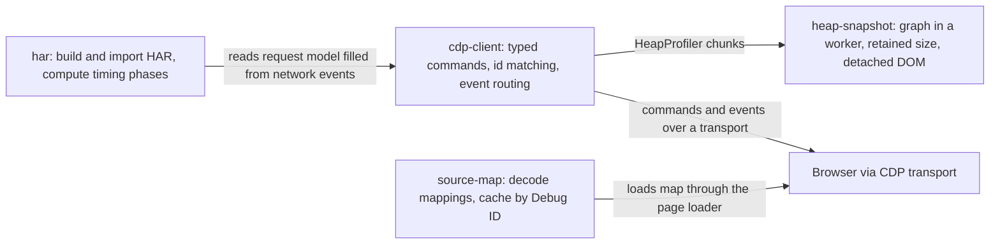

# DevTools frontend: four studied modules

**Architecture** · teaches [[Source maps]], HAR export, Heap snapshots, Remote device debugging

**Why this visual.** See which parts of the DevTools frontend own the protocol, source maps, HAR and heap snapshots.

## What it shows

The protocol client carries every command and event between DevTools and the browser. Heap snapshots arrive as protocol chunks. Source maps are fetched through the page loader. HAR files are built from the request model.

Text alternative: Flowchart of four modules: cdp-client sends commands and events to the browser and passes heap profiler chunks to heap-snapshot; source-map loads maps through the page loader; har reads the request model filled from network events.

## Check yourself

Which module carries heap snapshot chunks from the browser?

Answer: The cdp-client module, which delivers HeapProfiler events to the heap-snapshot code.

## Sources

- ChromeDevTools/devtools-frontend — https://github.com/ChromeDevTools/devtools-frontend (`chromedevtools-devtools-frontend-repo`)

## Used in

- [[devtools-frontend-architecture]]

Back to [[visuals-browser-devtools-mastery|all visuals]].

## My insights
