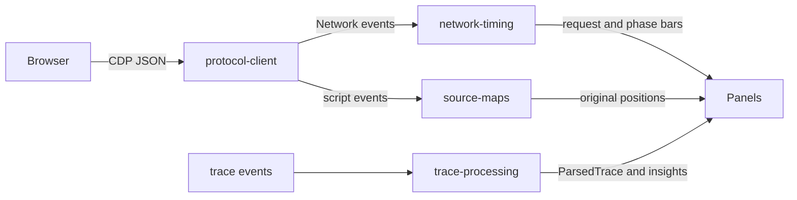

# DevTools frontend: four modules between the browser and the panels

**Architecture** · teaches Browser DevTools, [[Network panel]]

**Why this visual.** See which module turns raw browser data into what a panel shows.

## What it shows

The browser sends JSON protocol messages. The protocol client routes them. Network code turns events into requests and timing bars. Source map code maps built code back to your files. Trace code turns recorded events into a model for the Performance panel. Panels only draw the results.

Text alternative: Left to right: the browser sends protocol JSON to the protocol-client module, which feeds network-timing and source-maps. Trace events go to trace-processing. All three modules feed the panels, which draw the results.

## Check yourself

Which module owns the work of turning Network events into timing bars?

Answer: The network-timing module, after the protocol client routes the events to it.

## Sources

- ChromeDevTools/devtools-frontend — https://github.com/ChromeDevTools/devtools-frontend (`chromedevtools-devtools-frontend-repo`)

## Used in

- [[devtools-frontend-architecture]]

Back to [[visuals-browser-devtools-mastery|all visuals]].

## My insights
