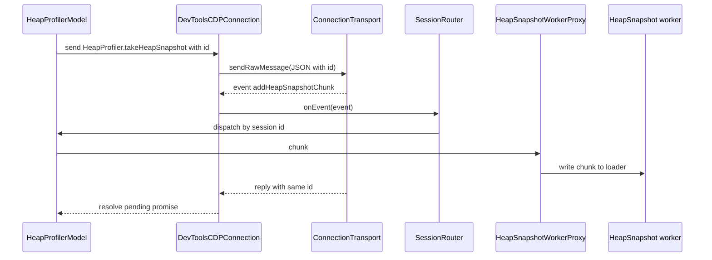

# A heap snapshot request across the protocol client

**Sequence** · teaches Heap snapshots, Remote device debugging

**Why this visual.** Follow one numbered command and its unnumbered events from the model to the worker.

## What it shows

The model sends a numbered command. Chunk events arrive without a number and are routed by session to the model, then the proxy passes them to a worker. The reply with the same number finishes the stored promise.

Text alternative: Sequence diagram: HeapProfilerModel sends takeHeapSnapshot with an id through the connection and transport; chunk events return, are routed by session to the model and forwarded through the proxy to the worker; the reply with the same id resolves the promise.

## Check yourself

How does the connection tell a reply from an event?

Answer: A reply carries an id that matches a stored promise; an event has only a method.

## Sources

- ChromeDevTools/devtools-frontend — https://github.com/ChromeDevTools/devtools-frontend (`chromedevtools-devtools-frontend-repo`)

## Used in

- [[devtools-frontend-architecture]]

Back to [[visuals-browser-devtools-mastery|all visuals]].

## My insights
