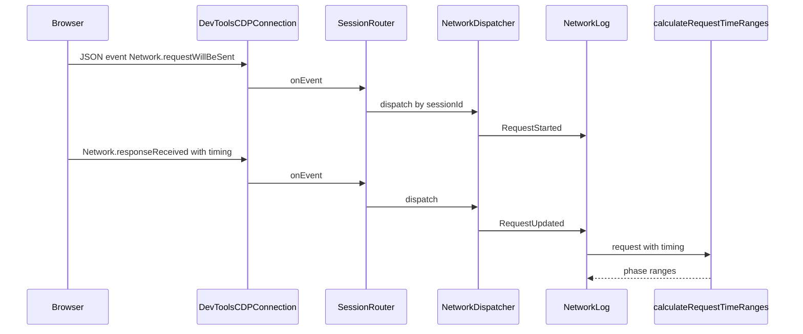

# One network event from the browser to a timing bar

**Sequence** · teaches Browser DevTools, [[Network panel]]

**Why this visual.** Follow one request through the real classes, from a protocol message to its phase ranges.

## What it shows

The browser sends a JSON event. The connection passes it to the router. The router picks the target by session id. The network dispatcher updates the request and the log announces it. Later, the timing function turns the browser's timing numbers into named phases.

Text alternative: Sequence of six participants: browser, connection, session router, network dispatcher, network log and the time-range function. Events flow down the chain; the log asks the function for phase ranges and gets them back.

## Check yourself

Which object chooses the target that receives an event?

Answer: The SessionRouter, using the sessionId in the event.

## Sources

- ChromeDevTools/devtools-frontend — https://github.com/ChromeDevTools/devtools-frontend (`chromedevtools-devtools-frontend-repo`)

## Used in

- [[devtools-frontend-architecture]]

Back to [[visuals-browser-devtools-mastery|all visuals]].

## My insights
