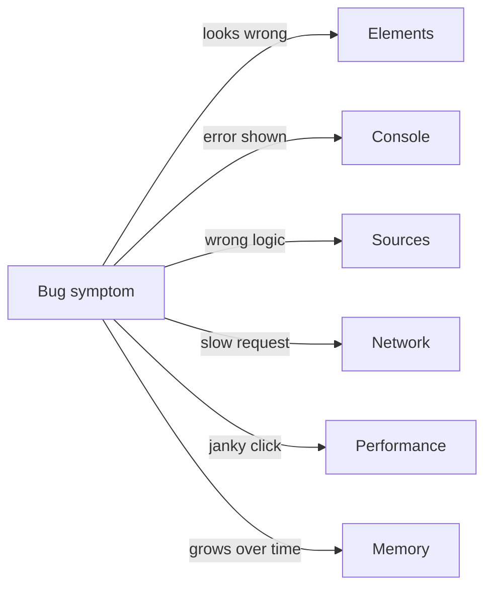

# Which DevTools panel answers which symptom

**Decision tree** · teaches Browser DevTools

**Why this visual.** Pick the first panel to open from the symptom of a bug, instead of opening panels at random.

## What it shows

Each DevTools panel shows one kind of fact about the running page. Elements shows the DOM and CSS. Console shows errors and runs code. Sources pauses JavaScript. Network shows every request. Performance records the main thread. Memory takes heap snapshots. So the symptom tells you which panel to open first.

Text alternative: One box labelled bug symptom points to six panels: looks wrong goes to Elements, error shown to Console, wrong logic to Sources, slow request to Network, janky click to Performance, and grows over time to Memory. The symptom decides the first panel.

## Check yourself

A page gets slower the longer it stays open. Which panel do you open first?

Answer: Memory, because a page that grows over time points to memory that the page never frees.

## Sources

- Chrome DevTools — https://developer.chrome.com/docs/devtools (`chrome-devtools-docs`)
- Network features reference — https://developer.chrome.com/docs/devtools/network/reference (`chrome-devtools-network-reference`)
- Performance features reference — https://developer.chrome.com/docs/devtools/performance/reference (`chrome-devtools-performance-reference`)
- Fix memory problems — https://developer.chrome.com/docs/devtools/memory-problems (`chrome-devtools-memory-docs`)

## Used in

- lesson page `/frontend-engineering/learning-system-and-workstation/browser-devtools-mastery/lesson/01-what-devtools-are-for/` (file `site/src/content/lessons/frontend-engineering/learning-system-and-workstation/browser-devtools-mastery/01-what-devtools-are-for.mdx`)

Back to [[visuals-browser-devtools-mastery|all visuals]].

## My insights
