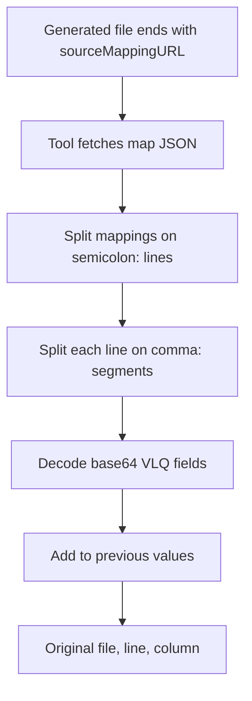

# How a source map turns generated code positions into original positions

**Workflow** · teaches Source maps

**Why this visual.** Show the order of steps from a generated file to an original source position.

## What it shows

The generated file points to a map file. The tool fetches the JSON and splits the mappings string into lines and segments. It decodes each segment from base64 VLQ and adds the numbers to the previous values. The result is an original file, line and column.

Text alternative: Flowchart with seven steps: the generated file ends with a sourceMappingURL comment, the tool fetches the map JSON, splits mappings on semicolons into lines, splits each line on commas into segments, decodes VLQ fields, adds them to the previous values, and gets an original file, line and column.

## Check yourself

Why must a tool decode segments in order instead of reading one segment alone?

Answer: Most fields are relative to the previous segment, so each value depends on the ones before it.

## Sources

- ECMA-426: Source map format specification — https://tc39.es/ecma426/ (`ecma-426-source-map`)

## Used in

- [[ecma-426-source-map-browser-devtools-mastery]]

Back to [[visuals-browser-devtools-mastery|all visuals]].

## My insights
