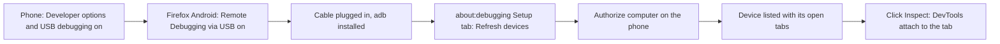

# Connecting desktop Firefox DevTools to a phone over USB

**Workflow** · teaches Remote device debugging, Firefox and Safari DevTools

**Why this visual.** Learn the order of steps that attach desktop DevTools to a tab on an Android phone.

## What it shows

You switch on USB debugging on the phone and in Firefox for Android, plug in the cable, and refresh devices in about:debugging. After you authorize the computer on the phone, the device and its open tabs appear. Inspect attaches DevTools to the tab.

Text alternative: Flowchart of seven steps: enable Developer options and USB debugging on the phone, enable Remote Debugging via USB in Firefox for Android, connect the cable with adb installed, Refresh devices in about:debugging, authorize the computer on the phone, see the device with its tabs, click Inspect.

## Check yourself

What must you do on the phone after you click Refresh devices?

Answer: Authorize the computer, so the device then appears with its open tabs.

## Sources

- Firefox DevTools User Docs — https://firefox-source-docs.mozilla.org/devtools-user/ (`firefox-devtools-user-docs`)

## Used in

- [[firefox-devtools-user-docs-browser-devtools-mastery]]

Back to [[visuals-browser-devtools-mastery|all visuals]].

## My insights
