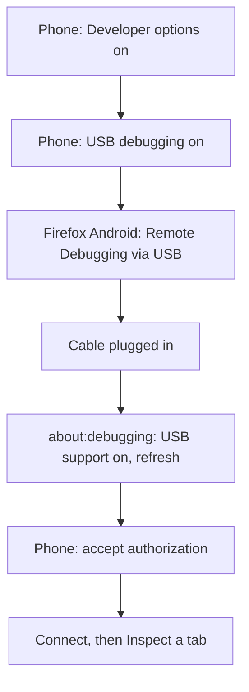

# Connecting desktop Firefox DevTools to a phone over USB

**Workflow** · teaches Firefox and Safari DevTools

**Why this visual.** Learn the order of steps that attach desktop DevTools to a tab on an Android phone.

## What it shows

You switch on USB debugging on the phone and in Firefox for Android, plug in the cable, and refresh the device list in about:debugging. After you accept the prompt on the phone and click Connect, the device and its tabs appear. Inspect attaches desktop DevTools to a tab.

Text alternative: Flowchart of seven steps: turn on Developer options and USB debugging on the phone, enable Remote Debugging via USB in Firefox for Android, plug in the cable, turn on USB support in about:debugging and refresh the device list, accept the authorization prompt on the phone, then Connect and Inspect a tab.

## Check yourself

What must you do on the phone after the cable is connected and the device list is refreshed?

Answer: Accept the authorization prompt, then click Connect in about:debugging.

## Sources

- Firefox DevTools User Docs — https://firefox-source-docs.mozilla.org/devtools-user/ (`firefox-devtools-user-docs`)

## Used in

- [[firefox-devtools-user-docs-browser-devtools-mastery]]

Back to [[visuals-browser-devtools-mastery|all visuals]].

## My insights
