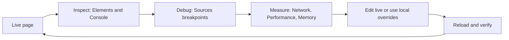

# The DevTools inspect, debug, measure and fix loop

**Workflow** · teaches Elements styles panel, Sources panel debugging, Network panel, Performance panel, Memory panel, Local overrides

**Why this visual.** Show the inspect, debug, measure, fix and verify loop that every DevTools task follows.

## What it shows

You start on the live page. You inspect the element or log in Elements and Console. You pause the code with a breakpoint in Sources. You measure the cost in Network, Performance or Memory. You try a fix as a live edit or a local override, then reload to verify it.

Text alternative: Flowchart: Live page, then Inspect with Elements and Console, then Debug with Sources breakpoints, then Measure with Network, Performance and Memory, then Edit live or use local overrides, then Reload and verify, which loops back to the live page.

## Check yourself

Which panel do you open after a breakpoint shows the code is correct but the page is still slow?

Answer: A measuring panel: Performance for slow scripts or rendering, Network for slow requests, Memory for growing memory.

## Sources

- Chrome DevTools documentation: Elements/CSS, Console, JavaScript debugging, Overrides — https://developer.chrome.com/docs/devtools (`chrome-devtools-docs`)
- Chrome DevTools: Network features reference — https://developer.chrome.com/docs/devtools/network/reference (`chrome-devtools-network-docs`)
- Chrome DevTools: Performance, Application, Coverage, Rendering and Recorder docs — https://developer.chrome.com/docs/devtools/performance/reference (`chrome-devtools-measure-docs`)
- Chrome DevTools: Fix memory problems and heap snapshots — https://developer.chrome.com/docs/devtools/memory-problems (`chrome-devtools-memory-docs`)

## Used in

- [[01-brief-browser-devtools-mastery]]
- lesson page `/frontend-engineering/learning-system-and-workstation/browser-devtools-mastery/lesson/01-elements-and-styles/` (file `site/src/content/lessons/frontend-engineering/learning-system-and-workstation/browser-devtools-mastery/01-elements-and-styles.mdx`)

Back to [[visuals-browser-devtools-mastery|all visuals]].

## My insights
