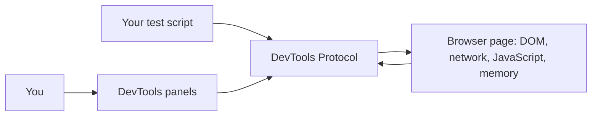

# DevTools and scripts read the same page

**Architecture** · teaches Browser DevTools, Debugging workflow

**Why this visual.** See that the DevTools panels and automation scripts both inspect the page through one protocol.

## What it shows

The DevTools panels are a web app. They send commands to the running page through the DevTools Protocol and get back DOM, network, JavaScript and memory data. A Puppeteer script uses the same protocol, so a manual inspection can become an automated check.

Text alternative: Left to right: you use the DevTools panels, and a test script uses the DevTools Protocol directly. Both go through the protocol to the browser page, which sends DOM, network, JavaScript and memory data back.

## Check yourself

Why can a check you do by hand in DevTools also run in a script?

Answer: Because the panels and a script such as Puppeteer use the same DevTools Protocol to talk to the page.

## Sources

- ChromeDevTools/devtools-frontend — https://github.com/ChromeDevTools/devtools-frontend (`chromedevtools-devtools-frontend-repo`)
- puppeteer/puppeteer — https://github.com/puppeteer/puppeteer (`puppeteer-puppeteer-repo`)

## Used in

- [[01-brief-browser-devtools-mastery]]

Back to [[visuals-browser-devtools-mastery|all visuals]].

## My insights
