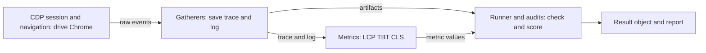

# Lighthouse module map

**Architecture** · teaches Lighthouse audits

**Why this visual.** See the four slices of Lighthouse and which one feeds which.

## What it shows

Lighthouse drives Chrome first, then saves raw data as artifacts, then computes metrics from the trace, then audits score the artifacts. Audits never talk to Chrome. Each arrow in the picture is one hand-off of data.

Text alternative: Left to right flowchart: CDP session and navigation sends raw events to gatherers; gatherers send artifacts to runner and audits and a trace to metrics; metrics send values to audits; audits produce the result object.

## Check yourself

Which module talks to Chrome, and which modules never do?

Answer: Only the CDP session and navigation module talks to Chrome; gatherers read its events, and metrics and audits only read saved artifacts.

## Sources

- GoogleChrome/lighthouse — https://github.com/GoogleChrome/lighthouse (`googlechrome-lighthouse-repo`)

## Used in

- [[lighthouse-architecture]]

Back to [[visuals-browser-devtools-mastery|all visuals]].

## My insights
