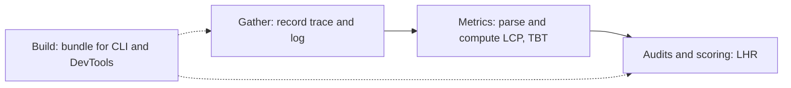

# Lighthouse module map

**Architecture** · teaches Lighthouse audits, Lighthouse panel and other panels, Live Core Web Vitals, Performance panel, Network panel

**Why this visual.** See which part of Lighthouse records a page load, which computes metrics, which scores, and which packages it.

## What it shows

Gather records a trace and a devtools log. Metrics parses them and computes LCP and TBT. Audits and scoring turn the numbers into a result. Build bundles the same code for the CLI and for DevTools.

Text alternative: Flowchart: Gather feeds Metrics, Metrics feeds Audits and scoring, and Build connects with dotted lines to Gather and to Audits and scoring.

## Check yourself

Which module never calls an audit?

Answer: Gather. It only records the trace and the devtools log; audits read them later.

## Sources

- GoogleChrome/lighthouse — https://github.com/GoogleChrome/lighthouse (`googlechrome-lighthouse-repo`)

## Used in

- [[lighthouse-architecture]]

Back to [[visuals-browser-devtools-mastery|all visuals]].

## My insights
