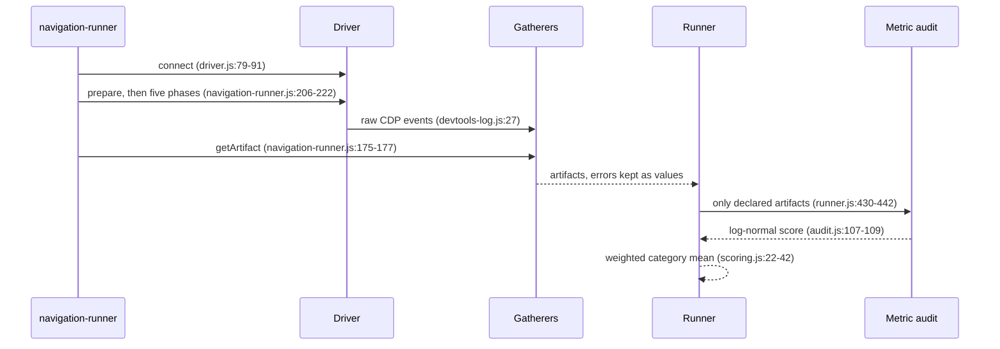

# One Lighthouse run, from URL to score

**Sequence** · teaches Lighthouse audits

**Why this visual.** Follow one page load from the first CDP connection to a category score.

## What it shows

The navigation runner connects a driver, prepares the page, and runs five instrumentation phases around the load. Gatherers record raw events and return artifacts. The runner hands each audit only the artifacts it declared, and the scoring code takes a weighted mean.

Text alternative: Sequence diagram: navigation-runner connects and prepares the driver, gatherers record raw events, getArtifact returns artifacts to the runner, the runner passes declared artifacts to a metric audit, which returns a score, and the runner computes the weighted category mean.

## Check yourself

Why can the audit phase run later without a browser?

Answer: Because gatherers saved raw events as artifacts, and audits read only those artifacts.

## Sources

- GoogleChrome/lighthouse — https://github.com/GoogleChrome/lighthouse (`googlechrome-lighthouse-repo`)

## Used in

- [[lighthouse-architecture]]

Back to [[visuals-browser-devtools-mastery|all visuals]].

## My insights
