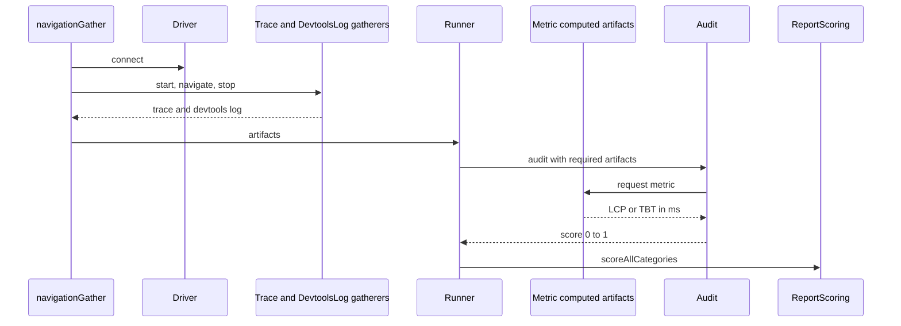

# Lighthouse flow from page load to score

**Sequence** · teaches Lighthouse audits, Lighthouse panel and other panels, Live Core Web Vitals, Performance panel, Network panel

**Why this visual.** Follow one page load from recording to a 0 to 1 audit score.

## What it shows

The navigation runner connects, starts the gatherers, loads the page and stops them. The runner gives each audit only its required artifacts. The audit asks for a metric, then the scoring code averages the scores.

Text alternative: Sequence diagram: navigationGather connects a Driver and runs gatherers, the Runner passes artifacts to an Audit, the Audit asks a metric artifact for a value, and ReportScoring scores categories.

## Check yourself

Where do recording and judging meet?

Answer: In the saved artifacts: the trace and devtools log that gather produces and audits consume.

## Sources

- GoogleChrome/lighthouse — https://github.com/GoogleChrome/lighthouse (`googlechrome-lighthouse-repo`)

## Used in

- [[lighthouse-architecture]]

Back to [[visuals-browser-devtools-mastery|all visuals]].

## My insights
