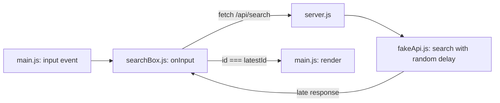

# A late response returns to onInput

**Data flow** · teaches Breakpoint debugging, Async call stacks

**Why this visual.** Show where a stale search response re-enters onInput and where the id check stops it.

## What it shows

Each key press calls onInput. The request goes to the server, which waits a random time. The response returns to onInput, which renders it only when its id matches latestId.

Text alternative: Flow from input event to onInput, server, fake API with random delay, back to onInput, then render if the id is the latest.

## Check yourself

At which step can an old response overwrite a new one, and which check prevents it?

Answer: When the late response returns to onInput; the id === latestId check stops it.

## Sources

- Chrome DevTools — https://developer.chrome.com/docs/devtools (`chrome-devtools-docs`)

## Used in

- `projects/frontend-engineering/learning-system-and-workstation/browser-devtools-mastery/mini-01-debug-an-async-race/README.md`

Back to [[visuals-browser-devtools-mastery|all visuals]].

## My insights
