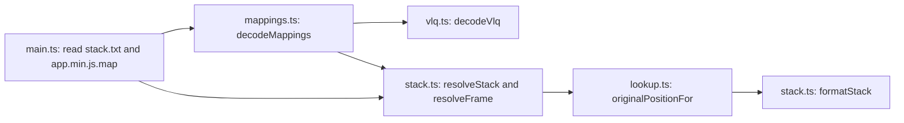

# Source map stack resolver: execution flow

**Data flow** · teaches [[Source maps]], How a source map encodes positions, Ignore-listed frames in the call stack

**Why this visual.** Show how a minified stack frame becomes an original file and line in the mini project.

## What it shows

main.ts reads the stack and the map. decodeMappings splits the mappings string and calls decodeVlq for each segment. resolveFrame calls originalPositionFor to find the original file and line. formatStack hides frames from ignoreList files.

Text alternative: Flowchart: main.ts feeds decodeMappings, which calls decodeVlq, and feeds resolveStack. decodeMappings output and resolveStack go to resolveFrame, then originalPositionFor in lookup.ts, then formatStack.

## Check yourself

Which function decides that a frame is hidden as ignore-listed, and which field does it read?

Answer: originalPositionFor sets ignored from the map's ignoreList, and formatStack hides every frame where ignored is true.

## Sources

- ECMA-426: Source map format specification — https://tc39.es/ecma426/ (`ecma-426-source-map`)

## Used in

- `projects/frontend-engineering/learning-system-and-workstation/browser-devtools-mastery/mini-01-source-map-stack-resolver/README.md`

Back to [[visuals-browser-devtools-mastery|all visuals]].

## My insights
