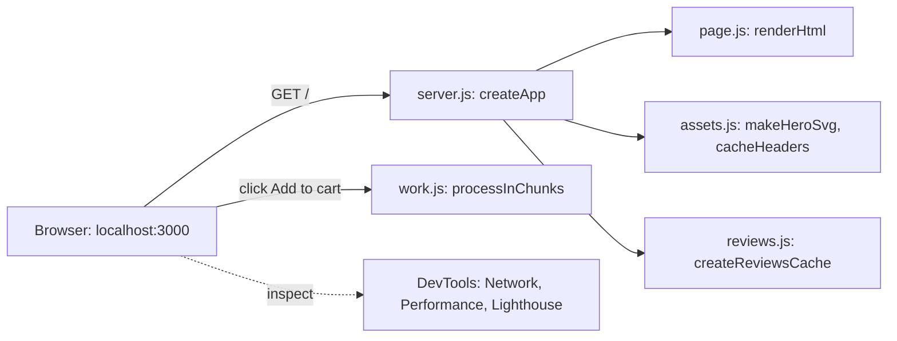

# The slow product page and where you inspect it

**Architecture** · teaches [[Network panel]], [[Request timing phases]], Performance panel, Flame chart and long tasks, Lighthouse audits

**Why this visual.** See which file of the practice server causes which symptom, and which DevTools panel shows it.

## What it shows

The browser asks server.js for the page. server.js builds the HTML in page.js, the hero image in assets.js and the reviews in reviews.js. The click handler runs processInChunks from work.js in the browser. You inspect the load in the Network panel, the click in the Performance panel, and the whole page with Lighthouse.

Text alternative: Left to right: the browser requests the page from server.js, which uses page.js, assets.js and reviews.js. The browser runs work.js on click. A dotted line shows DevTools panels inspecting the browser.

## Check yourself

Which panel do you open first for a slow click, and which for a late image?

Answer: Performance for the slow click (find the task over 50 ms); Network for the late image (read the waterfall).

## Sources

- Network features reference — https://developer.chrome.com/docs/devtools/network/reference (`chrome-devtools-network-reference`)
- Performance features reference — https://developer.chrome.com/docs/devtools/performance/reference (`chrome-devtools-performance-reference`)
- Optimize long tasks — https://web.dev/articles/optimize-long-tasks (`webdev-optimize-long-tasks`)
- GoogleChrome/lighthouse — https://github.com/GoogleChrome/lighthouse (`googlechrome-lighthouse-repo`)

## Used in

- `projects/frontend-engineering/learning-system-and-workstation/browser-devtools-mastery/mini-02-audit-a-slow-page/README.md`

Back to [[visuals-browser-devtools-mastery|all visuals]].

## My insights
